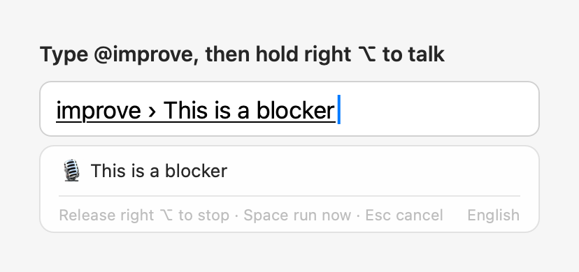

# AllInOneIME

English | [中文](README.zh-CN.md)

A macOS input method with AI commands in every text field. Start a sentence with `@` and press ⏎ when done:
`@improve` polishes what you wrote and offers a few rewrites, `@translate` translates it into the languages you pick,
`@question` asks a question, `@claude` hands it to Claude Code, and `@open` finds files and apps or opens a web
address. You can also hold right ⌥ and talk. Without `@`, your keys go to the app as usual. It's also a full
Chinese (pinyin) input method, built on Rime and rime-ice, for those who want one, and types French, Korean (Hangul)
and Hindi (Devanagari from Latin letters).

Author: [Weijian Zhang](https://weijianz.com)


For more detail (every command and setting, installation troubleshooting, privacy), see the [Wiki](https://github.com/MicroZ-LLC/AllInOneIME/wiki).

## How to use

Without `@`, it stays out of the way: in English, letters are typed directly and ⏎ is Return; nothing goes online.
A new install writes English; to type Chinese (pinyin), French, Korean or Hindi too, add it in the settings (see [Input and translation](#input-and-translation)).

| Key | What it does |
|---|---|
| Type pinyin, Space / digits | In Chinese mode: pick words, as in any pinyin input method |
| `@` (at the start of a sentence) | Opens the command list: the most used lately first, 5 at a time, scrolled with ↑↓, the wheel or the trackpad; or type letters to find one (names starting with them first, then names containing them). ⏎, Tab, Space or a digit chooses |
| ⏎ | Runs the command. Works even if the pinyin isn't picked yet: it's picked first, as with Space |
| Space, ⏎ / digits | Once the results are up: insert the highlighted / numbered one; 0 is the original |
| ⌘C | Copies the highlighted result (for `@open`, the path); the candidate panel stays open |
| ⌃V | In a command (e.g. after `@improve `): appends the clipboard text after what you've typed instead of pasting it into the app. Multiple lines become one, up to 2000 characters at a time (`@note` keeps the line breaks and takes up to 20000). Works in any app; without a command, the key goes to the app as usual |
| ⌘V | Like ⌃V, but some apps handle ⌘V themselves (terminals such as Ghostty, iTerm2 and Terminal, and Notes) and paste into the app as usual; use ⌃V there |
| Esc, ⌫ | Back to the sentence to keep editing; typing just continues it |
| Tap Shift | With more than one input language: the next one, in their order (English → Chinese → French → …, then back to the first) |
| Hold right ⌥ | Talk, release to stop. In the language you're typing (English, Chinese, French, Korean or Hindi). In a command, the text goes after it; otherwise it's inserted directly |

## @ commands (beta)

| Command | What it does |
|---|---|
| `@improve` | Polish: 1–3 are three versions in the sentence's own language, 4 onward the rewrite styles (added and ordered in the settings), 0 is the original. No translation; with "@improve also translates" on, it works like `@translate @improve` |
| `@translate` | Translate into the languages you added (settings → Translate, drag to reorder), a line each, three versions with only one; the sentence's own language is skipped. `@translate @improve` together translates and rewrites in one request |
| `@question` | Ask a question; the answer appears in the candidates, ⏎ or Space inserts it, ⌘C copies it |
| `@claude` | Hands the task to Claude Code: in the background by default, with a notification when it's done (click it to open the session in Terminal and go on), or see `@tasks`. It uses your own Claude Code (the `claude` command) with its own sign-in and settings. Turn off "@claude runs in the background" in the settings to open it in Terminal as before. The first time it opens Terminal, macOS asks whether AllInOneIME may control Terminal: click OK |
| `@tasks` | Lists the background Claude tasks (working / done / waiting for you) with their last replies; ⏎ opens one in Terminal, ⌘C copies the reply |
| `@settings` | Opens the settings window right away (picking it is enough) |
| `@open` | Lists matching files, folders and apps as you type (Spotlight). Several keywords work, separated by spaces: each must be in the path, at least one in the name (a standard folder's name counts for what's in it: `downloads pdf` finds the PDFs in Downloads). Apps and the standard folders are also found by their Chinese names, and a Chinese interface shows them that way. What you opened with `@open` comes first, then apps and those folders, then recently used or changed files; when the names find two files or fewer and no app or folder of those, the files in your home folder are searched by content too, those rows marked "content"; when there's nothing else, ⏎ lists them to pick from instead of opening the first. With a web address (`github.com`, `localhost:3000`, `https://…`), the first row is "open in the browser" and contents aren't searched; a file named exactly that (say `MANIFEST.in`) comes first. Text starting with `~/` or `/` is a path: Tab completes it and goes into folders; ⏎ opens, ⌘C copies the path |
| `@note` | Saves the text to the Notes app, in a folder named AllInOneIME (made when missing); nothing is inserted. Pasted text keeps its line breaks, up to 20000 characters |
| `@reminder` | Adds a reminder to the Reminders app, in a list named AllInOneIME. Write the time in the text; it's read on the Mac, and a row shows what was read: ⏎ or Space adds it, Esc goes back to edit. With a time, it has an alarm then; with only a date, it's all day |
| `@calculate` | Calculates on this Mac; the result appears in the candidates, ⏎ or Space inserts it: `@calculate 23*17` → `391`. It also works inside a sentence: `@reply the total is @calculate 23*17 dollars` |
| `@py` | Runs a line of Python (the Mac's `python3`) and inserts the result: the value of the code's last expression, e.g. `@py 2**100`, `@py import math; math.sqrt(2)`, or else what it printed. Not offered without `python3` (Xcode's command line tools have it) |
| `@js` | Runs a line of JavaScript and inserts the same: the value of the last expression or what `console.log` printed, e.g. `@js [1, 2, 3].map(x => x * 2)`. It uses macOS's built-in JavaScriptCore, so there's nothing to install; it can't read files, reach the network or run other programs |
| `@imessage` | Sends an iMessage: type a name, a phone number or an email (a Chinese name also by its pinyin, in full or the initials) and pick the recipient in the candidate panel (the ones you messaged lately come first; a full number or address works too), then write the message (commands inside it such as `@stock AAPL` run first). ⏎ shows "Send to Alex (…): message" in the panel, ⏎ again sends it, Esc goes back to editing; nothing is typed into the text field. The first time, macOS asks whether AllInOneIME may access Contacts and control Messages: click OK for both |

Example: `@q` ⏎, type `what is quantum computing`, ⏎. `@note books to read: The Three-Body Problem` ⏎ saves a note.
`@reminder call Bob tomorrow at 3pm` ⏎, check the time it read, then ⏎ again to add it. Once the command is chosen, you can also hold right ⌥
and talk. In Chinese mode, `@open` and `@calculate` switch to English letters for the moment and go back to Chinese when you're done.

The code for `@py` and `@js` is typed in English letters, and full-width punctuation (from Chinese mode) becomes ASCII; write it on one line, with `;` between statements.
It runs in a separate process, stopped after 10 seconds or with Esc at any time; on an error, the error's first line is shown, e.g. `ZeroDivisionError: division by zero`.
Output with several lines is inserted as printed; in a terminal it goes in as one line (a terminal runs every line it is given).
A terminal inside an editor (VS Code, Cursor, JetBrains) can't be told apart from the editor itself, so there any command's output with several lines goes in as it is.
Both also work inside another command's sentence: `@reply the answer is @py 2**100`; put code with spaces in quotes: `@question explain @py "sum(x * x for x in range(10))"`.
Not the other way round: the code of `@py` and `@js` always runs exactly as you typed it, and `@commands` in it don't run first.


When `@` isn't followed by a command, as in `@john`, the `@` is inserted as usual, so @-mentioning
people in chat apps still works.
`@question`, `@improve` and `@translate` send to your own Bedrock only when you press the action key; `@open` searches only on this
Mac; `@note` and `@reminder` go only to Notes and Reminders on this Mac; `@claude` uses the Claude Code installed on your Mac (the `claude` command) and its own account, and it asks you
first, as usual, before changing files or running commands. Without Claude Code installed, `@claude` isn't offered.
`@imessage` reads Contacts on this Mac only (names, phone numbers, emails), never goes through the AI, and Messages sends
the message; without the Messages app it isn't offered.

`@calculate` works on this Mac, offline: `+ - * /` (also `× ÷`), `^` or `**` for powers, parentheses, percent (`50%` is 0.5,
`200*5%` is 10; as on a calculator, a percentage added or subtracted is of what comes before: `100+10%` is 110,
`100-10%` is 90), the functions `sqrt abs round floor ceil ln log exp sin cos tan min max pow` (`log` is base 10, angles
are radians, `round(x, 2)` keeps two decimals) and the constants `pi` (`π`) and `e`. Full-width digits and signs work too. Arithmetic is exact in decimal, so `0.1+0.2` is `0.3`; results have at most 15 significant digits, and
whole numbers of up to 38 digits are written out in full (`2^100` → `1267650600228229401496703205376`).

### Notes and reminders

`@note` makes a new note; its first line is the title. After copying some text, ⌃V after `@note ` (or ⌘V, outside terminals) saves it with its line breaks, shown as ↵ in the command.
If you leave the text field (click elsewhere, switch apps) or press ⇧⏎ (insert as typed) before a note with line breaks is saved, it isn't typed into the app (in a terminal, each line would run as a command): it goes on the clipboard instead ("The note wasn't saved; its text is on the clipboard"). A note of one line is inserted as typed.

`@reminder` reads times like `tomorrow at 3pm`, `in 2 hours`, `in 3 days at 3pm`, `on the 15th`, `this weekend`, `in 1 month`, `next month` (its 1st), `end of the year` (Chinese times too).
The day and the time can be apart (`tomorrow call Bob at 5`); weeks start on Monday.
A time without am or pm (`at 5`) is the next one, never between midnight and 6 a.m.; a time already past today is tomorrow, but a part of the day still going (`this afternoon`, `tonight`) is today, all day; a date already past this year is next year's.
Written to repeat (`standup every Monday at 9`), it is added once, for the next time: the words stay in the title and the row says "once only".
The row to confirm shows the time it read, e.g. "tomorrow 3:00 PM" (following the Mac's 12/24-hour setting); if it's wrong, Esc goes back to the text. With no time or date in it, it has none ("no date").

`@stock` and the like inside these two aren't run: the text is saved as written (typing `@` there doesn't open the command list). The first time, macOS asks whether AllInOneIME may control Notes (`@note`) or access Reminders (`@reminder`): allow it.
If you didn't, allow AllInOneIME in System Settings → Privacy & Security → Automation (Notes) or → Reminders.
When a save fails (no permission, say), the notice says why and the text comes back into the command, to fix and send again; when you have to fix something first (a permission, an account), it's also put on the clipboard (going to System Settings takes the focus from the text field). If you've moved to another text field or are typing something else, it goes on the clipboard instead ("Not saved; the text is on the clipboard.").

### Your own commands

In the settings, under "Custom @ Commands", click "Add Command…": give it a name and choose what it does (an AI
instruction, a program, a program in Terminal, or a web page), or start from an example. Your commands come after the built-in
ones; names are English letters only and can't be a built-in command's; they work from the next sentence.
They're kept in `customCommands` in the config file (`~/.config/allinoneime/config.json`), which you can also edit:

```json
"customCommands": [
  { "name": "python", "type": "run", "argv": ["python3", "-c", "{input}"], "summary": "Run Python" },
  { "name": "bc", "type": "run", "argv": ["bc", "-l"], "stdin": "{input}\n" },
  { "name": "sh", "type": "terminal", "argv": ["zsh", "-c", "{input}"] },
  { "name": "reply", "type": "prompt", "prompt": "Write a short, polite reply to the user's message." },
  { "name": "google", "type": "link", "url": "https://www.google.com/search?q={input}" }
]
```

| `type` | What it does |
|---|---|
| `prompt` | Goes to the AI with `prompt` as its instruction; the answer appears in the candidates, to insert or copy (⌘C) |
| `run` | Runs `argv` in the background; what it prints appears in the candidates (several lines are inserted as printed, in a terminal as one line). On an error, its last line is shown |
| `terminal` | Runs `argv` in a new Terminal window; nothing is inserted |
| `link` | Puts the text into the web address `url` and opens it in the default browser; nothing is inserted |

- `{input}` becomes what you wrote after the command, and it always stays within the one argument it's in: no shell is involved. For a shell, say so, like `sh` above (`zsh -c`).
- `stdin`: what goes to the program's standard input, with `{input}` replaced too.
- A `link`'s `url` must be `https://`, with `{input}` once, after the `?` or `#`; the text is encoded (a space is `%20`, a newline `%0A`), 4000 characters at most.
- `run` and `terminal` type English letters by default (like `@open`; in Chinese mode, Chinese comes back after), and full-width punctuation becomes ASCII. Set `"ascii": false` to keep text as typed.
- Programs run in your home folder with your login shell's PATH (so Homebrew, pyenv and nvm installs are found). `run` stops a program after 10 seconds (`timeoutSeconds`) or when it prints too much; Esc stops it at any time.
- `summary` is the description in the command list (optional).
- When the program in `argv` isn't found (say, no `python3`), the command isn't offered and `@python …` is inserted as text; once it's installed, the command appears in the next text field.

`run` and `terminal` run code on your Mac: only add commands you wrote and trust. They, too, run only when you press the action key, and never during secure input.

### Plugins

Plugins are ready-made `@` commands for things not everyone needs, like `@stock AAPL 600519 700` for stock quotes.
Installed, they work like any command; "Plugins" in the settings shows what's installed and where each sends your text,
and removes them. Plugins are JavaScript run in a separate process: they can reach only the websites they declare
(HTTPS), and can't read files or run other programs. "Browse Library…" under Plugins in the settings installs them
from the [plugin library](https://github.com/MicroZ-LLC/AllInOneIME-plugins): it shows which websites a plugin
contacts before installing; the library's index is signed and every file must match it. A newer version shows an
"Update" button; nothing updates by itself. Your own plugins go in `~/.config/allinoneime/plugins/` ("Open Plugins
Folder"): local plugins, never overwritten by the library.
"Link" plugins run no code: they put the text into a web address and open it in the browser, like `@x nice weather
today`, which opens X's composer with the text filled in; posting is up to you on the page. The library has four
(`@x`, `@threads`, `@bsky`, `@weibo`). `@xe` converts currencies: `@xe 100 USD CNY`, `@xe 1000 JPY EUR`, one line
with the date of the rate (rates by ExchangeRate-API). Writing one: [docs/plugins.md](docs/plugins.md).

Commands that fetch something (plugins and programs) also work inside a sentence: `@reply tell her @stock AAPL is up today`.
The inner ones run first, their output takes their place, and the outer command works on the result. The argument is
the word after the command, plus the uppercase codes or numbers right after it (`@stock AAPL TSLA`, `@stock 600519 700`);
a lowercase word ends it (`@stock SNDK is good to buy` looks up SNDK). Quotes mark it exactly: `@stock "aapl tsla"`.
`@calculate` works inside a sentence too; its argument is the whole expression after it, spaces included, up to other text:
`@reply the total is @calculate 23 * 17 dollars`.
Inside `@claude` and terminal commands they aren't run: those get the text as written (typing `@` there doesn't open the command list).

### Action key

⏎ by default; change it under "Action key" in the settings (`actionKey` in the config): ⏎, Tap ⌥ (either side: press
and let go right away; holding right ⌥ is still for talking), ⌥Space, or Space (press Space once more after the words
are picked; twice in English mode).
Whatever the action key, @ commands also run on ⏎. If ⌥Space is already a shortcut for Alfred, Raycast or the like,
they get it first.

## Menu bar panel


Click AllInOneIME's icon in the menu bar (the ∞-and-cursor mark, without a box; the boxed one is the input source) and the panel drops down under it; a click elsewhere closes it:

- Notes: the notes saved with `@note`, the newest 5; click one to open it in Notes.
- Reminders: the reminders not done yet in the AllInOneIME list of Reminders (`@reminder` adds to that list), the soonest due first, 8 shown; click the circle to tick one off, or the title to open Reminders.
- Claude Tasks: like `@tasks`, the background Claude tasks (what `@claude` hands off), up to 30, 5 shown at a time: scroll for more, or search their titles and replies in the search box; with their progress and the first line of the last reply; click one to open it in Terminal and go on.

Swipe a row (a note, a reminder or a task) to the left with two fingers to show its Remove button, or all the way to remove it at once; with a mouse, right-click it. Removing only takes it off the panel: the note stays in Notes, the reminder in Reminders (not completed), the task in Claude Code.

The header has the counts (like "2 reminders · 1 task running"; tasks waiting for you are counted apart, like "1 waiting for you") and a refresh button.
It never takes the focus from the app you're typing in: ticking off a reminder or refreshing leaves that app in front; only the Claude tasks' search box, once clicked, takes the keyboard.
The icon is shown by default; turn it off under "Menu Bar Panel" in the settings.

What it reads, and when:

- Notes: the list is the panel's own record (kept while it's closed too), and Notes is never launched: only when Notes is running already, and AllInOneIME was allowed to control it before, does the panel check it for edited titles and deleted notes.
- Reminders: the AllInOneIME list is read when the panel drops down, every 60 seconds and when reminders change. The panel never makes macOS ask for access by itself: if macOS hasn't asked you yet, it shows "Allow Access to Reminders", and only that button asks; if you said no, it shows "Open System Settings".
- Claude tasks: the panel runs `claude agents` only while it's down: once when it drops down, on Refresh, and when `@claude` hands off a task; and every 15 seconds while a task isn't done yet, no longer once they're all done. The last replies are read from the end of Claude Code's transcripts on this Mac (`~/.claude/projects`), and only when a transcript has changed.
- While it's closed, none of this runs; it only keeps a record of the notes `@note` saves.

## Input and translation

In the settings:

- **Input languages**: one to five of English, Chinese (pinyin), French, Korean and Hindi, added with + (always there; greyed out at five). A new install starts with English only. New text fields start in the first; tap Shift for the next, in their order; with one, Shift doesn't switch.
  - **French** types with its own keyboard layout: AZERTY unless you pick another on its card. Its dead keys (^, ¨, `, ´, ~) compose from it too.
  - **Korean** types Hangul in the 2-set (Dubeolsik) layout, each syllable put together as you type (g k s → 한); Shift gives ㄲ ㄸ ㅃ ㅆ ㅉ and ㅒ ㅖ.
  - **Hindi**: type the words as they sound in Latin letters and get Devanagari (namaste → नमस्ते). Common words are spelled as Hindi writes them; otherwise Space inserts the first spelling, a digit another, ⏎ the letters as typed, and "." the danda (।).
  - A command's name, `@open`'s text and code (`@py`, `@js`) are typed in letters whatever the language; it comes back after the command.
  - `@improve` keeps a Korean, Hindi or French sentence in its own language, and `@translate` translates it into your languages (French is told apart from English when it's one of your input languages).
- **Language packs**: the app comes with English (and French, which needs only macOS's layout). Chinese, Korean and Hindi are packs you download when you add them: adding Chinese (pinyin) downloads its dictionaries (about 34 MB, 125 MB unpacked) with a progress bar, and pinyin works as soon as it's done, without a restart; Korean's pack (its key table and how jamo make syllables) and Hindi's (its letters and common words) are a few kilobytes. A pack is data only (dictionaries, tables and schemas, never code), listed in a signed index and checked against its SHA-256 before it's used, like plugins. Each language's card shows its pack (version, size, where it came from) with Delete…, and removing the language offers to delete its pack. Updating from 0.6.1 or earlier keeps Chinese without a download: the installer keeps the dictionaries the old version came with.
- **Fuzzy pinyin** (with Chinese input): sounds you don't tell apart typed either way, e.g. z ↔ zh, n ↔ l, in ↔ ing. On the Input page, pick Chinese (pinyin) in the bar of input languages, turn on "Fuzzy pinyin" and pick the pairs; the dictionaries are deployed again in a second or two. It writes `rime_ice.custom.yaml` in the Rime user folder, and never over a file of your own there.
- **Translate (@translate)**: add the languages to translate into (Spanish, French, German, Japanese, Korean, Chinese, Hindi, Bengali, Tamil and the other main Indian languages…) and drag them into order. Hindi typed in Latin letters ("aap kaise ho") comes back in Devanagari. `@translate` writes a line in each, in this order (three versions with only one); the sentence's own language is skipped. A new install translates into the first language in your Mac's preferred languages that isn't English; with English alone, `@translate` opens this page to add one.
- **Keyboard layouts**: French types with the layout picked on its card (`keyboardLayouts` in the config). For the other languages, under the input method macOS keeps your last Latin layout (AZERTY, QWERTZ, Spanish, US International…), so you type as usual, `@` included wherever your layout has it, and dead keys compose in a command's text too (⌥E then E → é, ^ then e → ê). Layouts without Latin letters (Russian, Hindi InScript) can't be used under an input method: switch to them with ⌃Space, or paste (⌃V) or dictate text into a command.
- `@improve` polishes and rewrites without translating; `@translate @improve` together translates and rewrites in one request. Turn on "@improve also translates" in the settings to make `@improve` always do that.

## Rewrite styles

After lines 1–3 come the rewrites, **in the language you typed**: English rewrites for English, Chinese rewrites for Chinese. Pick any of them in the settings:

- Polish: same tone, more natural
- Concise
- Formal: for managers and clients
- Casual
- Tactful
- Jargon: Amazon-speak in English (bandwidth, circle back…), big-tech jargon in Chinese. Bad news is played down, e.g. "this is a blocker bug" → "Oh! Looks like your team has the bandwidth to fix this minor issue!"

Rewrites that only change punctuation or repeat another line aren't shown.

### Jargon list (your own terms)

Jargon has no built-in term list. You can prepare your own (for example, the phrases your team uses), and the model
prefers its terms. In the candidates, the Jargon line notes what the terms it used mean.

The list is a text file with one term per line, optionally followed by its meaning, separated by "=", a colon or a
Tab (you can copy two columns from a spreadsheet and paste them). Lines starting with `#` are comments:

```
PRFAQ = a new-feature proposal: the press release and FAQ, written first
COE = an incident review
two-way door = a decision you can undo at any time
```

Under "Rewrite Styles → Jargon list" in the settings, click "New" to create an empty list at `~/.config/allinoneime/jargon.txt` and open it;
if you already have a list file, click "Choose File…" to use it where it is (`jargonFile` in the config). Changes apply right away.
Only the first 150 terms are read. With "Jargon" checked, the list is sent to Bedrock along with each request.


## Voice input



Hold right ⌥ and talk; when you let go, the text is inserted. It's recognized in the language you're typing (English, Chinese, French, Korean or Hindi). If you type a command first (e.g. `@improve `, `@question `) and then talk, the text goes after the command and ⏎ runs it; you can also press ⏎ without letting go of right ⌥ to run it as soon as you finish. Speech is recognized on the Mac by macOS's built-in speech recognition (SpeechAnalyzer), and no audio is uploaded; it needs macOS 26 or later.

The first time:

- macOS asks whether AllInOneIME may use the microphone. You can also click "Allow Microphone" in the settings beforehand.
- If this Mac doesn't have the speech model for that language yet, it's downloaded once, automatically. You can also download it in the settings.

Recording starts only after you've held the key for about 0.2 s, so a quick tap on right ⌥ doesn't turn on the microphone (with the action key set to "Tap ⌥", a tap runs the action). If you press another key while holding it (an ⌥ shortcut, ⌥←), it counts as a shortcut and nothing is recorded either. Pressing any other key while recording cancels the recording.

## Installation

Running it needs macOS 14 or later, voice input macOS 26 or later. The installer is universal: it works on Macs with
Apple silicon and Intel. So far it has only been tested on macOS 27 on Apple silicon (the Intel build only through its self-test under Rosetta).

1. Download `AllInOneIME-<version>.dmg` from [Releases](https://github.com/MicroZ-LLC/AllInOneIME/releases/latest) (only from there) and open it.
2. Double-click "Install AllInOneIME" in it and click Install. The input method goes into `~/Library/Input Methods`
   and "AllInOneIME Settings" into `~/Applications`. For this user only; no administrator password needed.
3. The installer isn't notarized by Apple yet, so macOS can't verify who made it, and the first time it says it can't verify "Install AllInOneIME":
   click Done (Cancel on macOS 14), open System Settings → Privacy & Security, click Open Anyway near the bottom, and confirm.
   Each new version's installer needs this once.

After that, AllInOneIME is enabled and in your input sources; switch to it with Ctrl+Space
(the 🌐 key switches only if "Press 🌐 key to" is set to "Change Input Source" in System Settings → Keyboard).
If the installer tells you to add it by hand, this Mac doesn't let programs enable it, so add it once yourself:
System Settings → Keyboard → Text Input → Input Sources → Edit… → + (bottom left) → English → AllInOneIME
(it types pinyin too once you add Chinese under Input in its settings).

If Ctrl+Space doesn't get you to AllInOneIME, or it switches back to U.S. after a while, run the installer again: it adds AllInOneIME back to your input sources.

To update, install again from the new version's disk image, without uninstalling first; settings, the jargon list and learned words are kept.
Before upgrading, read the [changelog](CHANGELOG.md): it has each version's changes and upgrade notes.

If you had AIPinyin installed (AllInOneIME's earlier name), just install: the old AIPinyin.app and its settings launcher are removed,
and the entry in your input sources gets the new name, with no need to add it again. Settings, the jargon list and learned words move to the new folders
(`~/.config/allinoneime` and others) on first launch, and each old folder is left as a link to the new one.

To uninstall, open "Install AllInOneIME" and click Uninstall…. Settings and learned words are kept.

### Building from source

Building needs Xcode 26 or later, since voice input uses the macOS 26 SDK.

```sh
git clone https://github.com/MicroZ-LLC/AllInOneIME.git
cd AllInOneIME
make install
```

`make install` downloads librime and the rime-ice dictionaries and verifies them, builds, and installs into the same places, adding it to your input sources the same way.
The app it installs has no Chinese dictionaries (they're the Chinese language pack): an install that had them keeps them as the pack; otherwise `make install-pack` installs the pack from the checkout's dictionaries, without a download.
`make status` shows the installed version (`version:`) and whether it's in your input sources (`listed:`). To uninstall: `make uninstall`.

## Setting up the AI

Translations and rewrites use your own AI provider, and the costs go to your account: Amazon Bedrock in your AWS account by default, or the Claude API, Gemini or an OpenAI-compatible service (see "Other AI providers" below).

### Amazon Bedrock

1. Enable Bedrock in the AWS console and make sure you can use the chosen model. The default is Claude Haiku 4.5; the first time you use an Anthropic model, you fill in a use-case form once.
2. Create an access key with the `bedrock:InvokeModelWithResponseStream` permission and put it in a profile in `~/.aws/credentials`.
   Only such static keys are supported for now, not SSO or assume-role.
3. Open "AllInOneIME Settings": you can find it in Spotlight or in Applications, or open it from the input method's icon in the menu bar → Settings….
   Pick the profile, region and model, and click "Test Connection". "Language" at the top of the settings window can be English or Chinese; by default ("System") it follows the system
   (Chinese if Chinese comes before English in the system's preferred languages, English otherwise). The settings window, the hints in the candidate panel and the input menu all follow it.


### Other AI providers: Claude API, Gemini, OpenAI-compatible services

You don't need AWS: pick one under "AI Provider" in the settings, paste an API key, click "Save", then "Test Connection".

| Provider | Default model | API key |
|---|---|---|
| Claude API | `claude-haiku-5-5` (fastest, cheapest; Sonnet 5.5 and Opus 5.5 are more careful but slower and pricier) | [Claude Console](https://platform.claude.com) |
| Gemini API | `gemini-3.8-flash` | Google AI Studio |
| OpenAI-compatible | OpenAI's `gpt-6-luna` (or `gpt-5.4-mini`); "Common Services…" has DeepSeek, Qwen, Kimi, Zhipu GLM, SiliconFlow, OpenRouter and Ollama on this Mac: picking one fills in its base URL, then enter its model | The service's key; set the Base URL to its address, e.g. `https://api.deepseek.com/v1`, or `http://localhost:11434/v1` for Ollama on this Mac |

- API keys are kept in the system keychain, never in the config file. Without one there, `ANTHROPIC_API_KEY`, `GEMINI_API_KEY` (or `GOOGLE_API_KEY`) and `OPENAI_API_KEY` from your shell are used.
- "Thinking" is low by default: the input method waits on every sentence, and less thinking is faster. Choose "Not set" for models that don't take it.
- With Claude Opus 5.5 or Sonnet 5.5 chosen, requests carry the Claude API's refusal fallback (`fallbacks: "default"`): when a safety classifier declines, the server retries on another model.
- In the config file: `provider` (`"bedrock"`, `"anthropic"`, `"gemini"`, `"openai"`), and `model`, `baseURL`, `effort` and `temperature` under `anthropic`, `gemini` and `openai` (unset ones use the defaults).

All settings are stored in `~/.config/allinoneime/config.json`; after a change, the next translation uses the new settings, with no restart. The newer keys:

| Key | What it does | Default |
|---|---|---|
| `inputLanguages` | Input languages, one to five, the first is the default: `"en"` English, `"zh"` Chinese (pinyin), `"fr"` French, `"ko"` Korean, `"hi"` Hindi, e.g. `["en", "zh"]`, `["fr", "en", "ko"]`. Chinese, Korean and Hindi work once their pack is installed | `["en"]` (a new install) |
| `keyboardLayouts` | The keyboard layout an input language types with, by its code (only French so far): `{"fr": "com.apple.keylayout.French-PC"}` | French: `com.apple.keylayout.French` (AZERTY) |
| `outputLanguages` | What `@translate` translates into, in order: `["es", "fr", "de"]`, … | `["en"]` |
| `improveTranslates` | `@improve` also translates (as `@translate @improve`) | `false` |
| `voiceInput` | Hold right ⌥ to talk | `true` |
| `actionKey` | Action key: `"enter"` (⏎), `"optionTap"` (Tap ⌥), `"optionSpace"` (⌥Space), `"space"` (Space) | `"enter"` |
| `uiLanguage` | Interface language (settings window, candidate panel hints, menu): `"zh"`, `"en"` | `null` (follow the system) |
| `rewriteStyles` | Rewrite styles: `polish`, `concise`, `formal`, `casual`, `tactful`, `jargon`, e.g. `["polish", "concise", "jargon"]` | Polish, Concise, Formal |
| `jargonFile` | Your own jargon list file | `null` (i.e. `~/.config/allinoneime/jargon.txt`) |
| `menuBarIcon` | The menu bar icon and its drop-down panel | `true` |
| `fuzzyPinyin` | Fuzzy pinyin pairs: `["z-zh", "n-l", "in-ing"]` (z-zh, c-ch, s-sh, n-l, f-h, r-l, an-ang, en-eng, in-ing, ian-iang, uan-uang) | `[]` |

## Privacy

- Typing (English and pinyin) and `@calculate` calculations are entirely local. Only when you press the action key on `@improve`, `@translate` or `@question` is that sentence sent to the AI provider you chose (your own Bedrock, or the service whose key you added). With "Jargon" checked and a jargon list set, the list is sent along with it.
- With AllInOneIME Cloud, the sentence goes through the developer's server to a model provider (currently through OpenRouter): the server keeps counts only, never the text. Signing in keeps only your email address.
- Voice is recorded only while you hold right ⌥ and is recognized on the Mac; the recognized text is sent only in the commands above, when you press the action key.
- The input method reads the clipboard text, once, only when you press ⌃V or ⌘V in a command; content that password managers mark as concealed isn't read. The text is shown in the command first and, again, is sent only when you press the action key. Recent macOS versions ask whether AllInOneIME may read the clipboard: allow it. To stop being asked every time, set AllInOneIME's paste permission to always allow in System Settings → Privacy & Security.
- In password fields macOS switches to its own keyboard (U.S. or ABC) and back when you leave them. Whenever the app you type in holds secure input, AllInOneIME doesn't compose text and can't record: keys go in as typed. And while the system is in secure input (password fields, Terminal's Secure Keyboard Entry, etc.), nothing is sent to the AI.
- `@note` and `@reminder` don't go to the AI: AllInOneIME hands the text only to Notes and Reminders on this Mac, and reads the reminder's time on the Mac too (whether those apps sync it to your other devices depends on their accounts, such as iCloud). So they work during secure input as well.
- `@open` searches only on this Mac. It remembers what you opened with it (the latest 200), in the input method's own preferences (not in config.json), to list those first.
- To list your notes, the menu bar panel keeps the id and first line (up to 80 characters) of the last 30 notes saved with `@note`, in the input method's own preferences, also while the panel is off.
- `@py` and `@js` run only when you press the action key, and only code you typed or pasted yourself: the AI's answers and other commands' output are never run as code. `@py` uses your Mac's `python3`, which can read and write files and go online as it does in Terminal; `@js` runs in a separate process that can't read files, reach the network or run other programs. Neither runs during secure input.
- Logs don't record what you type. For every third-party input method, macOS warns "The developer can access anything you type with this input source"; it's a generic system warning.

## Development

```sh
make test         # unit tests, plus tests that run the real Rime engine
make pack         # the Chinese language pack: build/packs/zh-pinyin-<version>.tar.xz, its sha256, its packs.json entry
make packs        # all the language packs: Chinese, and Korean and Hindi from LanguagePacks/ (ko-hangul, hi-phonetic)
make selftest     # drives the input method through a simulated text field: real Bedrock calls, plus on-device recognition tested with synthesized speech
make realtest     # types into a real app's text field (needs the screen unlocked; takes over the foreground for about 1 minute)
make screenshots  # regenerates the screenshots in docs/
make cli && .build/release/allinoneime-cli --styles concise,jargon "this is a blocker bug your team need fix it asap"   # try polishing and rewrites in the terminal
make icon         # regenerates the app icon and the menu bar icon from Resources/AppIcon.png
make dmg          # the release installer, build/AllInOneIME-<version>.dmg (universal; signed if there's a Developer ID certificate, optionally notarized)
```

Code layout:

- `Sources/AllInOneIMECore`: Bedrock client, SigV4, prompts, the two-level input state machine (including @ commands and the voice gesture); no AppKit dependency
- `Sources/AllInOneIMERime`: librime wrapper
- `Sources/AllInOneIME`: the InputMethodKit input method, candidate panel, settings window, speech recognition
- `Sources/AllInOneIMESettings`: the "AllInOneIME Settings" launcher
- `Sources/AllInOneIMEInstaller`: "Install AllInOneIME" on the disk image: installs, updates and uninstalls

Language packs have their own library, apart from the plugins: the repository
[MicroZ-LLC/AllInOneIME-languages](https://github.com/MicroZ-LLC/AllInOneIME-languages), served at
https://languages.allinoneime.com/, signed with their own key. `make pack` builds the archive; it's published as a
release asset there (release `zh-pinyin-<version>`, `ko-hangul-<version>`, `hi-phonetic-<version>`), and `swift Scripts/build-packs-index.swift <languages repo>
build/packs/*.tar.xz.json` writes `packs.json` there and signs it into `packs.json.sig` with the language packs' key
from the keychain (`allinoneime-languages-signing`). The app reads https://languages.allinoneime.com/packs.json, checks
the signature, then the archive's size and SHA-256. To try a pack from a local server: `--test-key` signs with a test key, and
`AllInOneIME --install-pack zh-pinyin --library http://127.0.0.1:8765/ --key <its public key> --packs-dir <folder>`.

The bundle ID is still `com.aipinyin.inputmethod.AIPinyin`: macOS uses it to remember the added input source and the microphone permission, so changing it would mean adding the input method and granting the permission again.

## License

Copyright © 2026 MicroZ LLC. Source available under the [Functional Source License 1.1](LICENSE) (FSL-1.1-ALv2): use it,
read it, change it and share it for anything but a competing product. Each version becomes Apache-2.0 two years after
its release. Versions up to 0.6.1 were released under the GPL-3.0 and stay available under it.

Third-party components (librime and its plugins under BSD-3-Clause; rime-ice's Lua scripts and the Chinese language pack
under GPL-3.0) are listed in [THIRD_PARTY_NOTICES.md](THIRD_PARTY_NOTICES.md).
