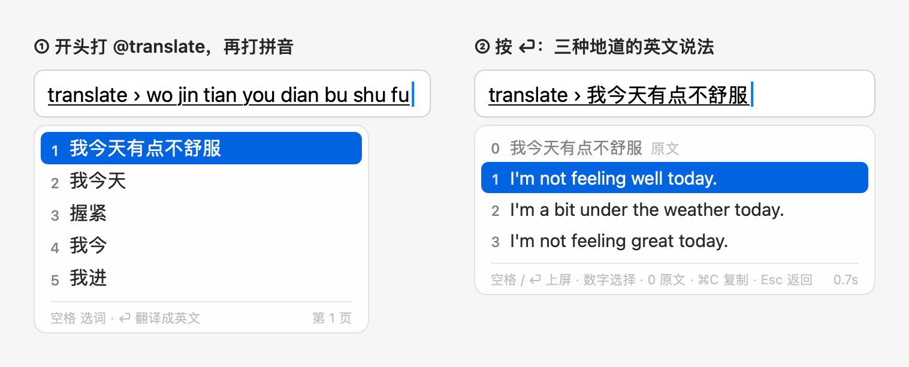
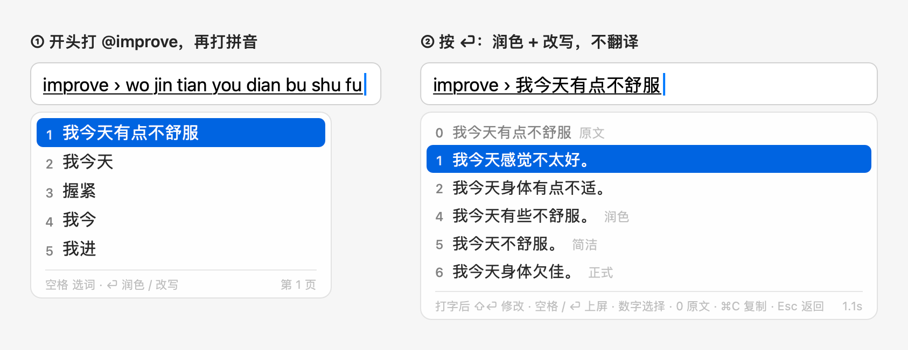
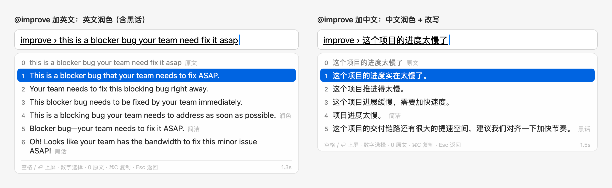
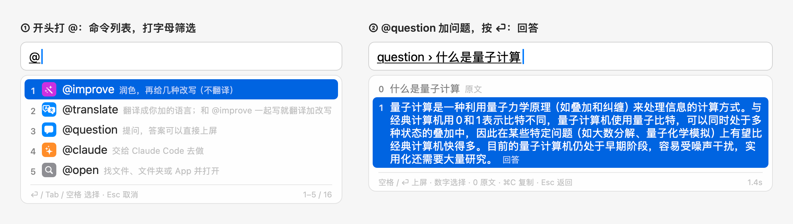
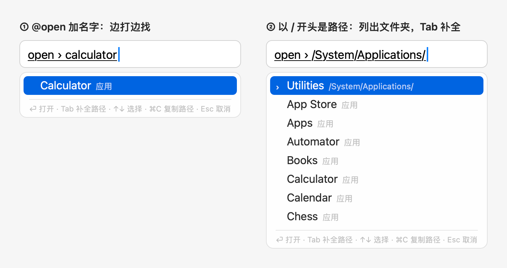
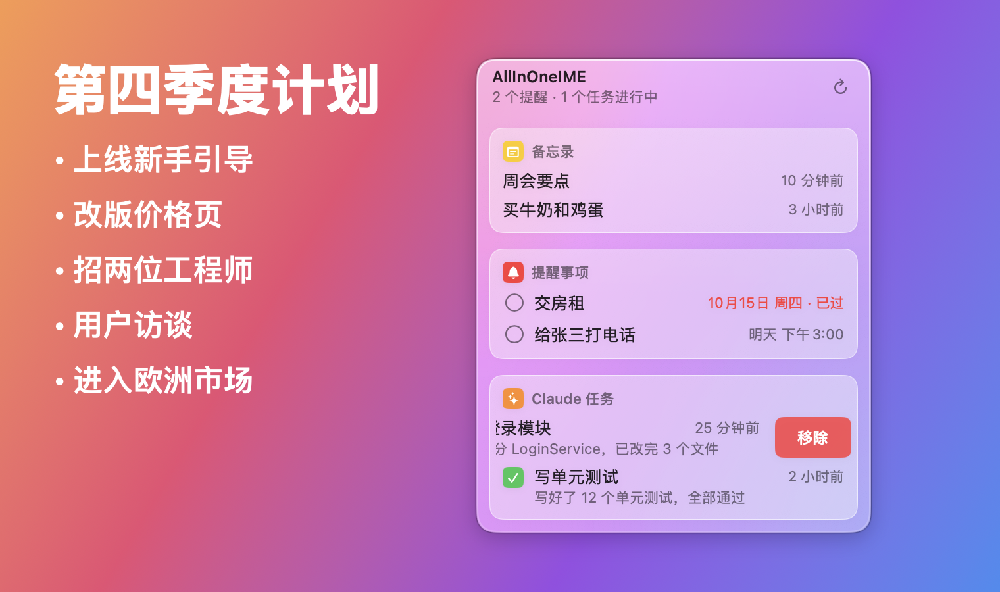
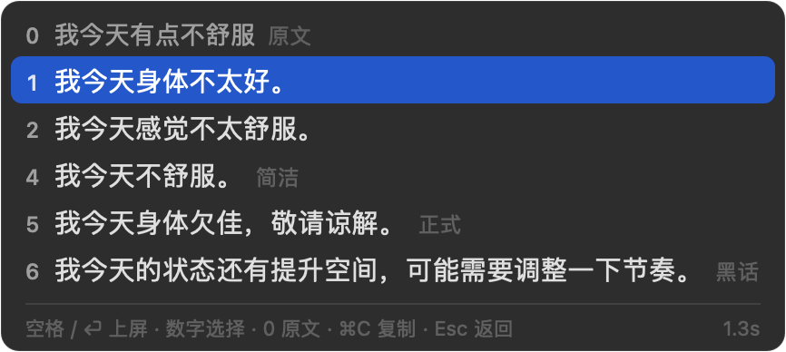
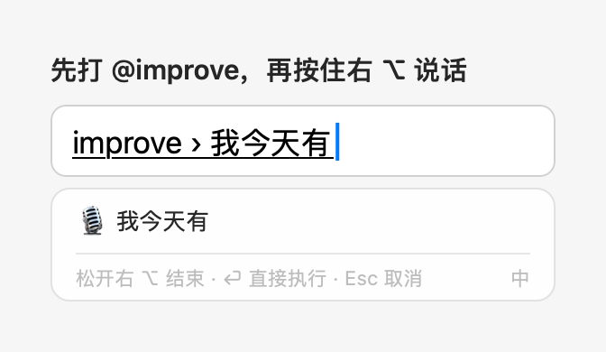
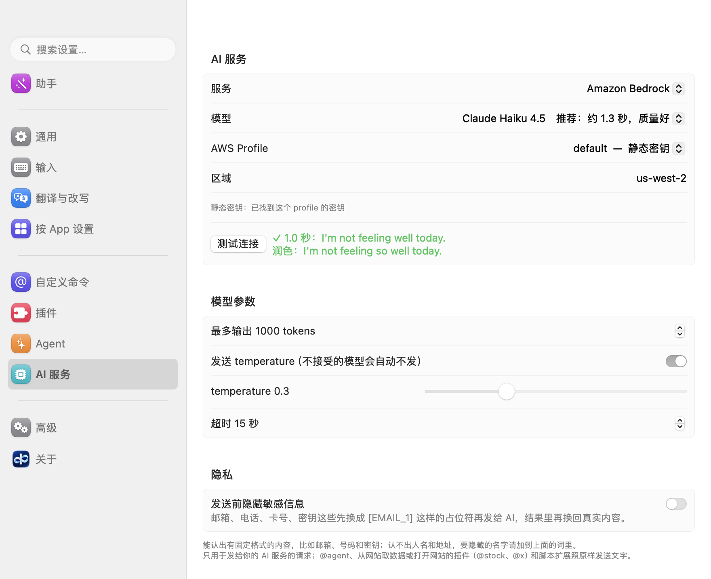

<div align="center">

[English](README.md) · **简体中文** · [繁體中文](docs/readme/README_zh-TW.md) · [日本語](docs/readme/README_ja.md) · [한국어](docs/readme/README_ko.md) · [Français](docs/readme/README_fr.md) · [Deutsch](docs/readme/README_de.md) · [Español](docs/readme/README_es.md) · [Português (Brasil)](docs/readme/README_pt-BR.md) · [Italiano](docs/readme/README_it.md) · [Русский](docs/readme/README_ru.md) · [Tiếng Việt](docs/readme/README_vi.md) · [ไทย](docs/readme/README_th.md) · [Bahasa Indonesia](docs/readme/README_id.md) · [हिन्दी](docs/readme/README_hi.md) · [العربية](docs/readme/README_ar.md) · [Türkçe](docs/readme/README_tr.md)

<br>


# AllInOneIME

### 在 Mac 上任何输入框里，都能用 AI 命令。

在任何 App 里打 `@improve`、`@translate` 或 `@question`，按 ⏎，选结果。<br>
不用复制到聊天窗口，不用切换 App。用你自己的 AI 服务和 key。

[](https://github.com/MicroZ-LLC/AllInOneIME/releases/latest)
[](#安装)
[](#安装)
[](#安装)
[](LICENSE)
[](https://github.com/MicroZ-LLC/AllInOneIME/releases)

**[下载](https://allinoneime.com/download)** · **[官网](https://allinoneime.com/zh/)** · **[文档](https://github.com/MicroZ-LLC/AllInOneIME/wiki/首页)** · **[扩展](docs/extensions.md)**

[怎么用](#怎么用) · [@ 命令](#-命令试用) · [自己加命令](#自己加命令) · [输入语言](#输入和翻译) · [语音](#语音输入) · [安装](#安装) · [隐私](#隐私)

<br>



</div>

> [!NOTE]
> 从 0.6.3 起，AllInOneIME 用 Developer ID 签名并经过 Apple 公证：不用再去 系统设置 → 隐私与安全性 里放行。
> 从旧版本更新后，AllInOneIME 存在钥匙串里的每个 key，macOS 都会问一次登录密码：输入后点「始终允许」。只从
> [GitHub Releases](https://github.com/MicroZ-LLC/AllInOneIME/releases) 或 [allinoneime.com](https://allinoneime.com/zh/) 下载。

一个 macOS 输入法。句子开头打 `@` 就是命令，写完按 ⏎ 执行：`@improve` 让 AI 润色、给几种改写，`@translate` 翻译成你选的语言，`@question` 提问，`@agent` 交给 Claude Code、Gemini CLI、Kiro CLI 等编程 agent，`@open` 找文件、App 或打开网址。也可以按住右 ⌥ 说话。不打 `@` 时，按键照常交给 App。它还能打中文（拼音，基于 Rime 和雾凇拼音）、法语、韩语（韩文）和印地语（用拉丁字母打出天城文），也能把你自己的脚本变成 @ 命令。





更详细的说明（每个命令和设置、安装排查、隐私）见 [Wiki](https://github.com/MicroZ-LLC/AllInOneIME/wiki/首页)。作者：[Weijian Zhang](https://weijianz.com)，MicroZ LLC。

## 怎么用

不打 `@` 的时候，它和别的拼音输入法一样：选词直接上屏，⏎ 就是回车，英文模式下字母直接上屏，不联网。

| 按键 | 作用 |
|---|---|
| 打拼音、空格 / 数字 | 选词，和普通拼音输入法一样 |
| `@`（句子开头） | 弹出命令列表：最近常用的在前，一次显示 5 个，↑↓、滚轮或触控板往下滚；也可以打字母找（名字完全一样的排第一，然后是名字开头的，也找名字里含这些字母的）。⏎、Tab、空格或数字选中 |
| ⏎ | 执行命令。拼音没选完也可以直接按，会先像按空格一样选完 |
| 空格、⏎ / 数字 | 出结果后：上屏高亮项 / 对应项，0 是原文。追问或要求打了一半时按 ⏎ 也是上屏（打的字不要了） |
| ⇧⏎ | 出了 AI 结果又打了字时：发出去（`@question` 对话的下一个问题，或修改要求）。正在写命令时，或 AI 结果出来后什么都没打时：照你打的原样上屏，连 `@命令` 在内。别的结果（`@open`、提醒等）上屏高亮的那一行，和 ⏎ 一样 |
| ⌘C | 复制高亮的结果（`@open` 是复制路径），候选框不关 |
| ⌃V | 在命令里（比如 `@improve ` 后面）：把剪贴板里的文字接到已经打的字后面，不贴进 App。多行合成一行，一次最多 2000 字（`@note` 保留换行，最多 20000 字）。哪个 App 里都能用；没有命令时照常交给 App |
| ⌘V | 和 ⌃V 一样，但有的 App 会自己处理 ⌘V（终端如 Ghostty、iTerm2、Terminal，还有备忘录），在那里会照常粘贴进 App，请用 ⌃V |
| Esc、⌫ | 回到这句话继续修改；出结果后打标点或数字就是接着往后写。改过结果后：回到改之前的那一版 |
| 出了 AI 结果后打字 | 接着说：`@question` 之后是下一个问题（见[对话](#question-接着问对话新)），`@improve` 或提示词命令之后是修改要求，比如「更短」（见[修改结果](#修改结果新)）；⇧⏎ 发出去。`@translate` 之后打字是接着写这句话，⏎ 重新翻译 |
| ⌘⏎、⌘1–⌘9 | 在 `@question` 对话里：列出可以接着聊的地方（装了的编程 agent，`@agent` 交给的那个在最前；Claude、ChatGPT、Gemini；或复制对话），⌘1、⌘2… 选一个 |
| 鼠标点一行 | 在候选框里：选中这一行，和按它的数字一样（词、命令列表里的命令、结果、`@open` 找到的文件、收件人、扩展列出的行）；鼠标指着的那一行会高亮。输入框不会失去焦点 |
| 单按 Shift | 有不止一种输入语言时：按顺序换到下一种（中文 → 英文 → 法语 → …，再回到第一个） |
| 按住右 ⌥ | 说话，松开结束。按你正在打的语言识别（中文、英文、法语、韩语或印地语）。在命令里就接在后面，否则直接上屏 |

## @ 命令（试用）

| 命令 | 作用 |
|---|---|
| `@improve` | 润色：1–3 是原文语言的三种说法，4 起是改写风格（设置里加、拖动排序），0 是原文。不翻译；设置里打开「@improve 同时翻译」就和 `@translate @improve` 一样 |
| `@translate` | 翻译成你加的语言（设置「翻译」里加、拖动排序），每种一行，只加了一种就出 3 个版本；和原文同一种语言的跳过。`@translate @improve` 写在一起就一次请求同时翻译和改写 |
| `@question` | 提问，答案出现在候选里，⏎ 或空格上屏，⌘C 复制。接着打字按 ⇧⏎ 就是追问：候选框变成最多 5 轮的对话，聊满后建议到 Claude 或别的 AI 里接着聊。后面不打字时，列出最近 5 个问题（最新的在前）；接着打字就按问题里任何位置的字筛选（不分大小写，中文也行）。按数字、↑↓ 再按 ⏎，或者点一下，马上显示当时保存的答案（不联网），照常上屏或复制；在那里按 ⌘R 重新问一遍，拿新的答案。没有匹配的、或者没选时，⏎ 照常问你打的问题 |
| `@reply` | 帮你写三条回复：用对方的语言，语气跟着 App 走（设置 →「App」里这个 App 的第一种改写风格，否则聊天软件随意、邮件正式，邮件里每条都是完整的正文）。把对方的消息选中、复制后在草稿里按 ⌃V，或截图（⌃⇧⌘4 或微信自带的截图）后按 ⌃V；后面写的字是你想回什么：`@reply 委婉拒绝`。⌘R 再写三条；见[回复消息](#用-reply-回复消息新) |
| `@agent` | 交给本机的编程 agent，在设置 →「Agent」里选：Claude Code（默认）、Gemini CLI、Kiro CLI，或你自己的命令（你打的字加在最后，作为最后一个参数）。这一页也列出每个 agent 装了没有、怎么启动。Claude Code 默认在后台做，做完弹系统通知（点通知在终端里打开这个会话接着聊），也可以用 `@tasks` 查看；关掉那里 Claude Code 下面的「在后台运行，做完通知我」就在终端打开。别的 agent 在终端打开，你打的字是第一句话。各自用自己的登录和设置。在 Google Chrome 里用时会带上网页：网址和标题、你打字的那个输入框和它所在的表单或区块（★ 标出你在哪）、选中的文字、窗口里看得到的内容——不读密码框，不发整页。所以在登录表单的用户名框里打 `@agent 为什么不行`，说的就是这个框；在 pipeline 页面上打 `@agent 为什么 block`，说的就是这个页面，由 agent 自己判断。网页的文字照读到的交给 agent，并注明它来自网页、不是你的指令。需要「辅助功能」权限；Chrome 只在你写 `@agent` 时为它建页面树，之后关回去（设置 →「Agent」→「@agent 和 @reply 带上 Chrome 里的网页」可以全部关掉）。第一次打开终端时 macOS 会问是否允许控制「终端」，点「好」。（0.6.4 以前叫 `@claude`。） |
| `@tasks` | 列出后台的 Claude 任务（进行中 / 完成 / 等你确认）和它们最后的回复；⏎ 在终端打开接着聊，⌘C 复制回复 |
| `@settings` | 直接打开设置窗口（选中就打开，不用再写内容） |
| `@open` | 边打边列出匹配的文件、文件夹和 App（聚焦搜索）。可以写几个关键词，用空格隔开：每个都要在路径里，至少一个在名字里（常用文件夹的中文名也算：`下载 pdf` 找下载文件夹里的 PDF）。App 也能用中文名找（计算器、系统设置；先单按 Shift 切到中文再打），访达和常用文件夹也是（下载、桌面、文稿），中文界面里也显示中文名。用 `@open` 打开过的排在最前，然后是 App、这些文件夹和最近用过、改过的文件；按名字只找到两个以内、也没有 App 或这些文件夹时，再按内容找主目录里的文件，这些标着「内容」；全是这种时，⏎ 先列出来让你选，不直接打开第一个。打网址（`github.com`、`localhost:3000`、`https://…`）时第一条是「在浏览器中打开」，不按内容找；有文件正好叫这个名字（比如 `MANIFEST.in`）时，它排在最前。以 `~/`、`/` 开头就是路径，Tab 补全，进文件夹；⏎ 打开，⌘C 复制路径 |
| `@note` | 存进「备忘录」App 的 AllInOneIME 文件夹（没有就新建），或者 设置 → 插件 →「笔记（@note）」里选的地方：Notion，或一个放 Markdown 文件的文件夹（Obsidian 库或任何文件夹）；不上屏。粘贴的文字保留换行，最多 20000 字 |
| `@reminder` | 加到「提醒事项」App 的 AllInOneIME 列表。时间直接写在里面，在本机读出：先出一行给你确认，⏎ 或空格加进去，Esc 回去改。写了时间就到点提醒，只写日期是全天的 |
| `@py` | 运行一行 Python（本机的 `python3`），上屏结果：代码以表达式结尾时是它的值，比如 `@py 2**100`、`@py import math; math.sqrt(2)`，否则是打印出来的内容。没装 `python3` 时不显示（装了 Xcode 命令行工具就有） |
| `@js` | 运行一行 JavaScript，同样上屏最后一个表达式的值或 `console.log` 打印的内容：`@js [1, 2, 3].map(x => x * 2)`。用 macOS 自带的 JavaScriptCore，不用装别的；读不到文件，也不能联网或运行别的程序 |
| `@reportissue` | 报告问题：在浏览器里打开 GitHub 的新问题页，命令后面写的就是标题，还有「What happened / What you expected」（发生了什么 / 你期望的结果）要你填。会附上 App 和 macOS 的版本、Mac 的架构、界面语言和输入语言、装了的语言包、用的哪一种 AI 服务（和模型，公开的模型才写名字，否则写 custom）、执行键，以及自定义命令、插件、扩展各有几个，但不带它们的名字、你打的字、路径和密钥。按 ⏎（或你的执行键）先在候选框里把这些都列出来；再按一次，或者用鼠标点那一行，才打开网页，你看过后用自己的 GitHub 账号点提交；Esc 返回。输入法菜单里的「报告问题…」和设置 →「关于」里也有 |
| `@imessage` | 发 iMessage：先打名字、拼音（全拼或首字母，如 `zs`）、手机号或邮箱，在候选框里选收件人（最近发过的排前面；也可以直接打完整的手机号或邮箱），再写消息（句中的 `@stock AAPL` 这类命令会先运行）。⏎ 在候选框里显示「发给 张三（…）：消息」，再按 ⏎ 才发出，Esc 回去修改；不会往输入框里写任何东西。第一次用时 macOS 会问能否访问通讯录、能否控制「信息」，都点「好」 |

例：`@q` ⏎，打 `什么是量子计算`，⏎。`@note 想看的书：《三体》` ⏎，存进备忘录。`@reminder 明天下午3点给张三打电话` ⏎，看一眼读出的时间，再按 ⏎ 加进提醒事项。选好命令后按住右 ⌥ 说话也行。`@open` 会临时切到英文字母，用完回到中文。

`@py` 和 `@js` 的代码同样用英文字母输入，全角标点会转成半角（`print（“牛逼”）` → `print("牛逼")`）；写成一行，多句用 `;` 隔开。
代码在单独的进程里运行，10 秒超时，Esc 随时停止；出错时显示错误的第一行，比如 `ZeroDivisionError: division by zero`。
打印出好几行时照原样上屏，在终端里合成一行（终端会把每一行都当成命令执行）。
编辑器里的终端（VS Code、Cursor、JetBrains）和编辑器本身分不出来，所以在那里，所有命令好几行的结果都照原样上屏。
它们也能放在别的命令的句子中间：`@reply 答案是 @py 2**100`；代码里有空格时用「」或引号括起来：`@question 解释一下 @py「sum(x * x for x in range(10))」`。
反过来不行：`@py`、`@js` 的代码总是照你打的原样运行，里面的 `@命令` 不会先运行。





`@` 后面跟的不是命令时，比如 `@张三`、`@john`，`@` 照常上屏，在聊天软件里 @ 人不受影响。
紧跟着刚打的英文字母、数字、`.`、`_` 或 `-` 打 `@` 时（比如 `bob@example.com`、`ssh user@host`），`@` 就是普通字符，不弹命令列表，哪个 App 里都一样，终端也是。
列表打开时，按 ← → 或者命令名里不会有的键（`.`、`:`、`/`）会关掉列表，打的字（`@`、`@im`）照原样留下；在终端里 ← → 这时只关掉列表。
`@question`、`@improve`、`@translate`、`@reply` 只在按执行键时发到你自己的 Bedrock（截图在本机识别，只发送认出的文字）；`@open` 只在本机搜索；`@note`、`@reminder` 只交给本机的「备忘录」和「提醒事项」（`@note` 选了文件夹或 Notion 就存到那里）；`@agent` 用的是你本机装的
agent（默认是 Claude Code 的 `claude` 命令）和它自己的账号，改文件、跑命令前它会照常先问你；没装这个 agent 时不显示
`@agent`。`@imessage` 只在本机读通讯录（姓名、电话、邮箱），不经过 AI，由「信息」发出；没有「信息」App 时不显示。

### 对选中的文字用命令（新）

在任何 App 里先选中一段文字（备忘录里的一句话、邮件里的一段），再打 `@improve`、`@translate`、`@question` 或别的处理文字的命令，按 ⏎：
命令处理的就是选中的文字，你选好的结果替换它。打字时选中的文字原样留着、一直选中：命令写在候选框里，第一行是你打的字，下一行是
「对选中的文字：“…”（N 字）」。按 Esc、⇧⏎ 或点到别处，文字都不变；中途改了选区，命令就取消，文字也不变。
命令后面再写的字，对 `@improve`、`@translate` 是要求（`@translate ja`、`@improve 更正式`），对 `@question` 是关于这段文字的问题
（`@question 这是什么意思`）。`@open`、`@agent`、`@tasks`、`@settings`、`@reminder`、`@imessage`、`@reportissue`、终端命令和脚本扩展不用它：它们只用你打的字，选中的文字不动。
最多 5000 字；系统安全输入时、终端里不读。哪个 App 里不正常，在设置 →「通用」→「使用选中的文字」里关掉。

### 用 @reply 回复消息（新）

`@reply` 帮你写三条可以直接发出去的回复。把对方的消息交给它，任选一种，然后按 ⏎：

- **选中**输入框里对方的消息，再打 `@reply`（选好的回复放在它后面，另起一行）。
- **复制**对方的消息，打 `@reply` 后按 ⌃V：候选框显示「复制的消息 · N 字」，草稿不变。
- **截图**到剪贴板（⌃⇧⌘4，或微信自带的截图），打 `@reply` 后按 ⌃V：候选框显示「截图 · N 行（本机识别）」。截图在本机识别
  （Apple 的 Vision，第一次稍慢），只发送认出的文字，图片不离开这台 Mac，也不保存。和聊天软件一样，左边的是对方说的，右边的是你说的；
  消息之间的时间不算。微信的窗口读不到文字，就用这个办法。

后面写你想回什么（`@reply 委婉拒绝`、`@reply politely decline`），不写就让它照常回。回复用对方的语言（你要别的语言也可以写上），
语气跟着 App 走：设置 →「App」里这个 App 的第一种改写风格，否则聊天软件随意、邮件正式，邮件里每条都是完整的正文。光标前后的文字也一起带上。
`@reply` 后面没打字时按 ⌫，去掉粘贴进来的消息或截图。⏎ 或数字上屏一条；⌘R 再写三条（Esc 回到这三条），打字再按 ⇧⏎ 照常修改结果。
在 Google Chrome 里，没有选中也没有粘贴时，它像 `@agent` 一样带上网页（设置 →「Agent」→「@agent 和 @reply 带上 Chrome 里的网页」）。
既没有要回的消息也没打字时，它会提示怎么做。隐藏敏感信息也管截图里的文字；系统安全输入时不读剪贴板，也不发送。
原来自己建的 `reply` 命令改名为 `@myreply`。

截图粘进别的命令也能用：`@translate` 按 ⌃V 就是翻译截图（结果放在光标处），`@question 这上面说了什么` 按 ⌃V 就是问截图，
不用 AI 的命令拿到的是截图里的文字，和复制来的一样（`@note` 保留换行）。选中了文字时，`@improve`、`@translate` 照旧处理选中的文字，
并提示截图没有用上。

### 修改结果（新）

`@improve`、提示词命令（你自己的或插件的）或改写选中文字出结果后，直接打想怎么改，比如「更短」「语气再热情点」「更正式」「加个笑话」
「用日语」「用更口语的说法」（可以打拼音，单按 Shift 换中英文），按 ⇧⏎：结果连同你的要求再发给 AI，新结果就在同一个候选框里替换旧的。
按 ⏎ 是上屏选中的结果，要求打了一半也一样（打的字不要了）。
可以一直改下去；候选框最上面一行列出改过的步骤（「已修改：更短 · 更正式」），随时照常选一行上屏。打第一个字母就开始写要求
（候选框顶上显示「修改 › …」）；没写要求时，数字、空格、⏎ 还是照常选结果，⇧⏎ 照你打的原样上屏。结果全部出来后才能修改：第一次的结果还在出来时打字，
和以前一样是接着写这句话。修改进行中也可以先打下一步要求，正在进行的修改不受影响，等结果出来按 ⇧⏎ 再改。Esc 先清掉要求，
再按退回上一版（最后一次修改之前的结果；修改进行中按就是停下），再按回到这句话；要求是空的时候按 ⌫ 也一样退回。对选中的文字用时，选好的结果照样正好替换选中的文字，在那之前文字不动。修改失败（或系统安全输入时被拒绝）时，
结果保持原样，要求还在，按 ⇧⏎ 再试。同样的结果按同样的要求再改一次，直接用缓存。`@translate` 不能修改结果：结果出来后打字就是接着写这句话，按 ⏎ 重新翻译。

### @question 接着问：对话（新）

`@question` 回答后，接着打的字就是下一个问题：按 ⇧⏎ 连同前面的问答一起问，候选框长成一段对话，前几轮用「问：」「答：」两行淡色显示，
最新的答案在最下面。顶上一行写着这是第几轮（「追问 2/5 › …」）。每一轮的答案都能上屏：按它的数字（1–5）、↑↓ 再按 ⏎，或者点一下；
默认选中最新的，⌘C 复制选中的那个。问题打了一半时按 ⏎ 也是上屏答案（打的字不要了）。Esc 先清掉打的字，再按退回上一轮；
在第一轮按就和以前一样退出。候选框最多长到大约半个屏幕高，再多就滚动，最新的总在最下面。

聊满 5 轮（配置里的 `questionRounds`，2–10）后，下一个问题的那一行换成「已经聊了 5 轮：在 Claude 或别的 AI 里接着聊」，
后面是用 ⌘1、⌘2… 选的几个地方；随时按 ⌘⏎ 也能列出来（答案还在出来时按它什么都不做，也不会传给 App）。这时打的字就是到那边的第一句话，
只有按 ⌘1、⌘2… 才发出去（⇧⏎ 不再追问，也不打开任何东西）。对选中文字的提问会把那段文字作为单独的引用块一起带过去。可以选：

- 这台 Mac 上**装了的编程 agent**，显示各自的名字：`@agent` 交给的那个在最前（⌘1），然后是别的（Claude Code、Gemini CLI、Kiro CLI、设置 →「Agent」里你自己的命令）。每个都在终端里开一个能接着聊的会话，启动方式和 `@agent` 一样，开头是这段对话和「Let's continue this discussion」。没装的不显示。
- 网页版 **Claude** 或 **ChatGPT**，对话直接填好（太长时放到剪贴板，粘贴进去就行）。
- 网页版 **Gemini**，对话在剪贴板里，粘贴进去。
- **复制对话**，Markdown 格式（**Q:** / **A:**）。

列哪几个、按什么顺序（第一个是默认）：设置 →「通用」→「对话接着在哪里聊」（配置里的 `questionContinueIn`）；超过 5 个时用 ⌘6…⌘9 选后面的。那里的「@agent 的 agent」就是设置 →「Agent」里选的那个，显示它的名字；暂时没装的 agent 在列表里改动时保留原来的位置。用本机的 Apple
Intelligence 时，长对话放不进它很小的上下文：先缩短最早的几个答案，再去掉最早的几轮，候选框里会写「前面几轮已缩短」。
对话按第一个问题存在「最近的问题」里，选出来就能看到所有轮次，接着聊。

### 最近的问题（新）

`@question` 后面不打字时，列出最近 5 个问题（最新的在前），右边是提问时间（「3 小时前」）。接着打字就筛选：每个词出现在问题里任何位置都算，
不分大小写（中文不用空格也行）。按数字、↑↓ 再按 ⏎，或者点一下，马上显示当时保存的答案，不联网：空格或 ⏎ 上屏，⌘C 复制，
⌘R 重新问一遍拿新的答案（对话就重新问最后一个问题），Esc 回到列表。保存的对话会显示所有轮次，接着打字就能继续聊。没有匹配的、或者没选时，⏎ 照常问你打的问题。
同一个问题有了新的答案，或者对话又聊了几轮，就替换保存的那个。

- 只存在这台 Mac 上（见「隐私」）：系统安全输入时不存，对选中文字的提问一律不存。
- 设置 →「通用」→「记住最近的问题」可以关掉（配置里的 `rememberQuestions`），在设置里关掉时会删掉已存的。用设置 → 助手
  关掉时保留已存的，这样撤销能原样恢复（预览里会说明）；「清除（N）」删掉已存的。

### 备忘录和提醒事项

`@note` 存成一条新的备忘录，第一行是标题。复制一段话后在 `@note ` 后面按 ⌃V（终端以外也可以按 ⌘V），换行照原样保留，在命令里显示成 ↵。
存到哪里在 设置 → 插件 →「笔记（@note）」→「存到」：

- **备忘录**（和以前一样）：AllInOneIME 文件夹里的一条新备忘录。
- **文件夹（Obsidian 等）**：你选的文件夹里，一条笔记一个 Markdown 文件，用第一行命名（`/\:*?"<>|#^[]` 换成 `-`；重名就加「 2」「 3」）。文件开头是 `created:` 的 front matter，后面是原样的全文。从不覆盖已有的文件；文件夹不在了（外接硬盘没接上、库挪走了）也不会新建，笔记回到命令里。在 Obsidian 库里（这个文件夹或上层有 `.obsidian`）提示说「已存到 Obsidian」，菜单栏面板用 Obsidian 打开。
- **Notion**：点「创建集成…」（新建集成 → 内部 → 复制令牌），粘贴令牌（存在钥匙串里），再在 Notion 里打开那个页面或数据库 → ··· → 连接 → 加上你的集成，把它的链接贴进来；「测试」显示「✓ “Inbox”（数据库）」。页面下面新建一个子页面，数据库里新加一行（第一行当标题），其余是正文，一次请求存完。没联网或被拒绝时不会留着以后再发：笔记回到命令里。系统安全输入时 `@note` 不发到 Notion。

提示会说存到了哪里（「已存到 Notion」「已存到 “Inbox”」）。
有换行的笔记还没存就离开了输入框（点到别处、换 App），或者按了 ⇧⏎（原样上屏），它不会打进 App（在终端里每一行都会当成命令执行），而是复制到剪贴板（「笔记还没存，原文已复制到剪贴板」）；只有一行的照原样上屏。

`@reminder` 认得这些写法：`明天下午3点`、`明晚7点`、`3点半`、`30分钟后`、`下周一 9:30`、`15号`、`周末`、`月底`、`下个月`（1号）、`月初`、`年底`、`元旦`、`圣诞节`、`1个月后`、`tomorrow at 3pm`、`in 2 hours`、`in 3 days at 3pm`、`next month`。
农历的节日（`春节`、`中秋`）每年日子不一样，不认，写上日期就行；`写3点建议` 这种是几点意见，不算时间。
日期和时间分开写也行（`明天开会，3点`）；一周从周一算起，`下周日` 是下一周的周日。
只写几点（`3点半`、`8点`）时取接下来最近的那个，不会是 0 点到 6 点之间，除非写了 `凌晨`；今天已经过了的时间算明天，只写了 `下午`、`今晚` 而还没过完的算今天（全天）；今年已经过了的日期算明年。
写成重复的（`每周一9点开会`）只加最近的一次，原话留在标题里，确认的那一行写着「只提醒这一次」。
确认的那一行显示读出的时间，比如「明天 15:00」（跟着系统的 12 / 24 小时制），不对就 Esc 回去改；什么时间都没写的，不设日期（「未设时间」）。

这两个命令里写的 `@stock` 之类不会先运行，照原样保存（打 `@` 也不弹命令列表）。第一次用时 macOS 会问：`@note` 要控制「备忘录」，`@reminder` 要访问「提醒事项」，允许就行；
当时没允许的话，到 系统设置 → 隐私与安全性 → 自动化（备忘录）或 → 提醒事项 里打开 AllInOneIME。
没存上时（比如没有权限）会提示原因，文字回到原来的命令里，改好再按 ⏎；没有权限、没有账户这种要你先去处理的，文字也同时复制到剪贴板（去系统设置时输入框会失去焦点）。如果已经换了输入框或者正在打别的字，就放到剪贴板（「没有存上，原文已复制到剪贴板。」）。

### 自己加命令

在设置的「自定义 @ 命令」里点「添加命令…」：起个名字，选它做什么（AI 指令、运行程序、在终端运行、打开网页、插入文字），也可以从例子开始。
命令排在内置命令后面，名字只能用英文字母，不能和内置命令重名；保存后下一句就能用。
它们存在配置文件（`~/.config/allinoneime/config.json`）的 `customCommands` 里，也可以直接改：

```json
"customCommands": [
  { "name": "python", "type": "run", "argv": ["python3", "-c", "{input}"], "summary": "运行 Python" },
  { "name": "bc", "type": "run", "argv": ["bc", "-l"], "stdin": "{input}\n" },
  { "name": "sh", "type": "terminal", "argv": ["zsh", "-c", "{input}"] },
  { "name": "reply", "type": "prompt", "prompt": "Write a short, polite reply to the user's message." },
  { "name": "google", "type": "link", "url": "https://www.google.com/search?q={input}" },
  { "name": "sig", "type": "snippet", "summary": "邮件签名", "text": "Best,\nWei\n{cursor}" }
]
```

| `type` | 做什么 |
|---|---|
| `prompt` | 发给 AI，`prompt` 是给它的指令；回答出现在候选里，可以上屏或 ⌘C 复制 |
| `run` | 在后台运行 `argv`，打印的内容出现在候选里（多行照原样上屏，在终端里合成一行）；出错时显示错误的最后一行 |
| `terminal` | 在新的终端窗口里运行 `argv`，不上屏 |
| `link` | 把内容填进网址 `url`，在默认浏览器里打开，不上屏 |
| `snippet` | 直接插入 `text`，里面的占位符先填好（见下）；不用 AI，不运行程序 |

- `{input}` 换成命令后面写的内容，而且永远只占它所在的那一个参数，不经过 shell。要用 shell 就像上面的 `sh` 那样明确写 `zsh -c`。
- `stdin`：给程序标准输入的内容，`{input}` 同样会被替换。
- `link` 的 `url` 必须是 `https://`，`{input}` 只能出现一次，而且要在 `?` 或 `#` 后面；内容会编码（空格是 `%20`，换行是 `%0A`），最多 4000 字。
- `run` 和 `terminal` 默认用英文字母输入（像 `@open`，用完回到中文），全角标点会转成半角：`print（“牛逼”）` → `print("牛逼")`。不想这样就设 `"ascii": false`。
- 程序在主目录里运行，用你的登录 shell 的 PATH（Homebrew、pyenv、nvm 装的都找得到）；`run` 默认 10 秒超时（`timeoutSeconds`），输出太多也会被停止，Esc 随时停止。
- `summary` 是命令列表里的说明，可以不写。
- 找不到 `argv` 里的程序时（比如没装 `python3`），这个命令不显示，`@python …` 照常当文字上屏；装好后切换一下输入框就会出现。

`run` 和 `terminal` 会在你的 Mac 上执行代码：只放你自己写的、信得过的命令；它们同样只在按执行键时运行，安全输入时不运行。

#### 片段：常用的文字（新）

`snippet` 命令（编辑器里的「插入文字」）插入存好的文字，比如签名、地址、会议链接：`@sig` ⏎ 直接上屏（Tab、空格只补全名字）。
`text` 里可以写占位符：

| 占位符 | 换成 |
|---|---|
| `{input}` | 名字后面写的全部内容：`#{input}` 配 `@tag foo bar` 插入 `#foo bar` |
| `{名字?}` | 要填的空，按你写的内容用逗号（`,` 或 `，`）分开依次填：`Dear {name?}, see you {day?}.` 配 `@meet 张三，周五`。少写了会提示缺哪个，不上屏 |
| `{clipboard}` | 剪贴板里的文字（macOS 可能先问一下） |
| `{selection}` | 打 `@` 时选中的文字（会被替换掉，和别的命令作用在选中文字上一样） |
| `{date}`、`{time}` | 今天 `2026-10-17`，时间 `14:05`；`{date:M月d日 EEEE}` 用[日期格式](https://unicode.org/reports/tr35/tr35-dates.html#Date_Field_Symbol_Table)，按界面语言显示 |
| `{cursor}` | 插入后光标停在这里（最多一个；终端里不移动） |

- `{{` 写出 `{`，和它配对的 `}}` 写出 `}`（`{{input}}` 插入 `{input}`）；别的 `}}` 和 `{…}` 原样保留，片段里放 JSON 或代码没问题：
  `{"a":{"b":1}}` 照原样插入。
- 没有 `{input}` 也没有空时，名字后面写的内容接在片段后面，中间一个空格。
- 在别的命令的文字里写 `@sig` 也会展开：`@question 总结一下 @zoom` 发出去的是链接本身。只有不含 `{clipboard}`、`{selection}`
  和空的片段能这样用；带 `{input}` 的取一个词或引号里的内容：`@meet「周五 3点」`。
- 只是纯文字（换行保留），最多 20000 字。片段只在这台 Mac 上处理，安全输入时、设成「不用 AI」的 App 里也能用。扩展包也能带片段
  （`extension.json` 里的 `snippets`，见 [docs/extensions.md](docs/extensions.md)）。

### 脚本扩展

用程序加自己的 @ 命令：任何语言的脚本（bash、Python、Node、Swift……），注释里写几行元数据。放进
`~/.config/allinoneime/extensions`，或者在 设置 → 自定义命令 → 脚本扩展 里添加的文件夹。Raycast 的脚本命令不用改就能用，
已经放着它们的文件夹会用聚焦（Spotlight）自动找到。

```bash
#!/bin/bash
# @allinoneime.schemaVersion 1
# @allinoneime.title Flights
# @allinoneime.argument1 {"type": "text", "placeholder": "from city"}
# @allinoneime.argument2 {"type": "text", "placeholder": "to city"}

echo "Flights from $1 to $2"
```

`flights.sh` 就是 `@flights`。参数写在命令后面，用逗号（`,` 或 `，`）隔开：`@flights beijing, new york` 运行时 `$1` 是
`beijing`，`$2` 是 `new york`（多出来的逗号留在最后一个里）；必填的没写会提示缺什么，不运行。输出按 `output` 处理：

| `output` | 结果 |
|---|---|
| `insert`（默认） | 全部输出和每一行都可以上屏 |
| `show` | 边运行边显示在面板里（进度），不上屏；离开输入框就转到后台继续（最多同时四个） |
| `list` | 输出 Alfred Script Filter 格式的列表，边打字边重新运行；选中一项可以上屏、打开（网址、文件或文件夹；不会打开会运行的东西）、复制或运行下一步 |
| `silent` | 最后一行显示在光标旁边，不上屏 |

命令还可以不要输入（`input none`：在列表里按 ⏎ 就运行）、在后台运行完成后通知你（`background`，期间菜单栏面板里能看到）、
在命令列表里名字旁边显示状态（`status`）、运行前先确认（`confirm`）。脚本在自己的文件夹里运行，用你的登录 shell 的 PATH，
还有 `ALLINONEIME_*` 环境变量：界面和输入的语言、正在打字的 App、命令后面的文字。**扩展包**是带 `extension.json` 的文件夹，
列出它的命令：它们共用代码和偏好设置，设置里能填（密码存在钥匙串里）。设置里每个命令都有开关，没加载的脚本会写明原因。

Raycast 的 mode 对应关系：`fullOutput` → `show`，`compact` 和 `silent` → `silent`，带 `refreshTime` 的 `inline` → 状态。
完整的协议见 [docs/extensions.md](docs/extensions.md)（英文），[Core/Examples/extensions](Core/Examples/extensions) 里每种都有例子。
扩展会在你的 Mac 上执行代码，只用信得过的；只在你运行时运行（状态和边打字边出的列表也算），安全输入时不运行，输入法退出时会停止。

#### 扩展来源（新）

扩展包可以来自一个 Git 仓库（你自己的或团队的），并从那里更新。设置 → 自定义命令 → 扩展来源 → **从链接添加…**：
粘贴仓库地址（`git@github.com:you/my-extensions.git`、`ssh://…`、`https://…`；可以另填分支、扩展包在仓库里的文件夹、
要固定的标签或提交）。AllInOneIME 用**你自己的 git 和 SSH 设置**（密钥、ssh-agent、~/.ssh/config、凭据助手）克隆，
私有仓库和在终端里一样能用；App 从不询问也不保存密码。克隆放在 `~/Library/Application Support/AllInOneIME/Sources/`，
先克隆进一个隐藏的暂存文件夹，不会直接克隆进扩展文件夹。（https 地址里不要写用户名、密码或令牌：交给 git 的凭据助手保存。）

- **先检查。** 加载任何东西之前，你会看到扩展包、每个命令（名字、标题、说明、输出方式）、它们要运行的程序、偏好设置和提交，
  上面是警告「这个来源没有签名：会运行来自 <地址> 的程序」。只有点**启用**才会加上；取消会删掉克隆。每个来源只需检查一次。
- **更新由你决定。** 每天一次（输入法启动后不久也会）拉取一下看有没有新东西：设置里显示「有 N 个更新」和这些提交（标题、作者、时间），
  页面上有角标。点**更新**之前什么都不变；更新只做快进，不运行任何钩子。强制推送之后来源要重新检查：**重新克隆**会再给你看一遍，
  点「启用」才换上改写过的历史（在那之前，检查过的版本照常能用）。固定到标签或提交的来源不检查。
  每个来源都可以关掉每天的检查（`autoCheck`）。
- **出错时**显示 git 自己的话，加上「这里用的是你自己的 git 和 SSH 设置；先在终端里确认 `git ls-remote <地址>` 能用」，
  如果你设了自己的提示（配置里的 `authHint`），也显示在下面。
- **移除**会把克隆移到废纸篓；扩展包的偏好设置会保留，下次加回来还在。
- 只加载检查过的代码：加载列表里有来源的文件夹、但没在这台 Mac 上检查过（比如复制来的配置），就不加载。git 从不等人回答：没有终端也不弹询问，
  遇到不认识的主机密钥或要密码时会立刻失败。
- 在终端里：`AllInOneIME --add-source <地址> [--path …] [--branch …] [--pin …]`（打印检查内容并启用；强制推送之后再运行一次就是重新检查）、
  `--update-sources`（快进每个检查过、没固定的来源）、
  `--list-extensions`（程序是 `~/Library/Input Methods/AllInOneIME.app/Contents/MacOS/AllInOneIME`）。

配置里是 `extensionSources`；仓库的结构见 [docs/extensions.md](docs/extensions.md#10-extension-sources)（英文）。

### 插件

插件是别人写好的 `@` 命令，不是人人都要的放在这里，比如 `@stock AAPL 600519 700` 查股价。
装好后和其他命令一样用；设置的「插件」里能看到装了哪些、它会把内容发到哪里，也能删除。
插件用 JavaScript 写，在单独的进程里运行：只能访问它声明的网站（HTTPS），读不到文件，也不能运行别的程序。
在设置的「插件」里点「浏览插件库…」，从[插件库](https://github.com/MicroZ-LLC/AllInOneIME-plugins)安装：
安装前会告诉你它会访问哪些网站；插件库的索引有签名，每个文件都要和索引核对上才装。有新版本时显示「更新」，手动点了才更新。
自己写的插件放进 `~/.config/allinoneime/plugins/`（设置里「打开插件文件夹」），算本地插件，插件库不会覆盖它。
也有不运行代码的「链接」插件：把内容填进网址，在浏览器里打开，比如 `@x 今天天气不错` 打开 X 的发帖框、文字已经填好，发不发由你在网页上决定。
插件库里有 `@x`、`@threads`、`@bsky`、`@weibo` 四个。
还有 `@xe` 换算汇率：`@xe 100 USD CNY`、`@xe 1000 日元 人民币`，一行结果带汇率日期（汇率来自 ExchangeRate-API）。
`@calculator` 是不联网也能用的计算器：`@calculator 23*17` → `391`（0.6.5 以前是内置的 `@calculate`）；`@calendar` 算日期：`@calendar +10` → 「周二 10月27日 · 10天后」。
写插件的说明见 [docs/plugins.md](docs/plugins.md)。

查数据的命令（插件和「运行程序」）也可以写在句子中间：`@reply 告诉他 @stock AAPL 现在多少钱`。
里面的先运行，结果替换回原文，再交给外面的命令。参数是紧跟的一个代码，后面再跟着的大写代码或数字也算（`@stock AAPL TSLA`、`@stock 600519 700`）；
小写的普通单词会结束参数（`@stock SNDK is good to buy` 只查 SNDK）。要明确圈定就用「」或引号：`@stock「aapl tsla」`。
`@calculator` 插件也能写在句子中间：`@reply 总价是 @calculator 23*17 元`。
`@agent` 和终端命令里写的不会先运行，照原样交给它们（打 `@` 也不弹命令列表）。

### 执行键

默认是 ⏎，可以在设置的「执行键」里换（config 里的 `actionKey`）：⏎、单按 ⌥（左右都行，按一下马上松开；
按住右 ⌥ 仍然是说话）、⌥空格，或者空格（词选完了再按一次空格，英文模式下连按两次）。
不管执行键是哪个，@ 命令都可以按 ⏎ 执行。⌥空格如果已经是 Alfred、Raycast 等的快捷键，会先被它们拿走。

### 逐字上屏

在设置 →「通用」里打开「逐字上屏」（配置里的 `typeOut`），命令的结果就像人打字一样一个字一个字打进 App，而不是一下子全部上屏；
打拼音选词还是马上上屏。滑块调速度，从 6 秒一个字到每秒 40 个字（`typeOutRate`）；「忽快忽慢（像真人打字）」一阵快一阵慢（`typeOutVaries`）。
按 Esc 停在那里，按别的键把剩下的一次打完。

「偶尔打错再改」（`typeOutMistakes`）更像真人：偶尔按到旁边的键，最多过三个字母才发现，删掉重打；一个字母或空格多打了一次再删掉；
或者一个短词打了又删掉重打。每 100 个字几处，不会挨着出现，也不会在一行的开头。代码、网址、邮箱和数字里只会打错一个字母或数字，
马上就改（不会打错括号、引号或空格，编辑器会在这些上自动配对或缩进）。打错的字母是你的键盘布局（QWERTY、AZERTY、QWERTZ…）上旁边的键。
中文、日文、韩文只会「犹豫」（两个字打了删掉再打），不会打出错字。

在能删掉打错的输入框里（苹果自己的文本框，比如文本编辑和备忘录，浏览器，大多数编辑器）：打完，或者按别的键把剩下的一次打完，
文字和结果一字不差；打错的时候按 Esc（或者离开这个输入框），先把打错的删掉，输入框里是结果开头的一段，一字不差。打错的时候光标被移走
（点了一下），打错的在原处删掉，剩下的不再打错。

终端里不打错，不告诉输入法光标在哪的 App 里也不打错。每次第一处打错都是最简单的一种（打错一个字母，一下就改对），直到这个输入框表明它
能删掉打错的；有打错的字在输入框里时，每按一个键前都核对输入框里是不是刚打的字。不管替换哪里的输入框删不掉打错的字：那里第一处打错会
留下，最后的文字差一个字（按 Esc 或别的键停下也一样），以后这个 App 不再打错。设置 →「通用」里打错开关下面列出这些 App，
「忘掉改不回来的 App」让它们再试一次。

### 按 App 设置（新）

在设置 →「按 App 设置」里，可以给某个 App 单独设置，每一项都可以不设；没设的跟全局设置一样：

| 设置 | 比如 | 配置里 |
| --- | --- | --- |
| 输入框用哪种输入语言开始 | Slack 里用英文，微信里用拼音 | `inputLanguage` |
| `@improve` 在那里给哪些改写风格 | 邮件里正式、委婉，Slack 里口语 | `rewriteStyles` |
| 逐字上屏开还是关 | 聊天 App 里开，邮件里关 | `typeOut` |
| 这个 App 里不用 AI | `@improve`、`@translate`、`@question`、`@agent` 和你的提示词命令在那里不发给 AI，并提示一下；打字和别的命令照常 | `noAI` |
| 总是边打边译 | 微信里一直开着边打边译（见[边打边译](#边打边译)） | `translateAlways` |

「添加 App…」列出最近打过字的 App，也可以在「应用程序」文件夹里选。输入法菜单里的「这个 App：<名字>」可以直接切换正在打字的
App 的「不用 AI」「逐字上屏」和开始的输入语言。配置里在 `appProfiles` 下，按 bundle ID 写：
`"appProfiles": {"com.tinyspeck.slackmacgap": {"inputLanguage": "en", "rewriteStyles": ["口语"], "noAI": false}}`。
bundle ID 不分大小写（手写的 `com.apple.Mail` 就是「邮件」的 `com.apple.mail`）。`@reportissue` 只写有几个 App 设了东西，
不写是哪些 App。

- 开始的输入语言和全局的默认输入语言一样：输入框激活时用它，之后按 Shift 切换的会在这个 App 的输入框里保持，直到设置改了。
- 设了「不用 AI」，AI 命令还在 @ 列表里；执行时提示一下，打的字留着。自定义的终端命令（`"type": "terminal"`）运行的是程序，不是 AI，
  在那里照常能用。

### 设置 → 助手（新）

设置打开时先显示「助手」，一页两部分。0.6.5 以前它们是 `@config` 和 `@doctor` 两个命令。

**用一句话改设置。** 写下想怎么改（「翻译成日语和英语」「微信里用中文，邮件里语气正式一点」「候选竖排」「关掉打字时的错字」「用 Claude」），
按「预览」（或 ⌘⏎）。要改的地方一行一项列出来，原来 → 改成，用的是设置里的名字（「翻译语言：英文、日语 → 英文、法语」
「按 App · 微信 · 开始的输入语言：跟全局一样 → 中文」），这时什么都还没改。「应用」写进去，「取消」放弃。之后显示「已改 N 项」和
「撤销」，10 分钟内都能撤销，这些设置原样恢复（之后又改过的那项不动，并写明是哪项）。

- **能改的：** 翻译语言、输入语言（和默认的那种）、改写风格、候选排列、逐字上屏（开关、速度、忽快忽慢、打错再改）、使用选中的
  文字、记住最近的问题、发送前隐藏敏感信息（开关、隐藏哪些、再加要隐藏的词）、自动检查更新、通过 iCloud 同步（开关；同步哪些只能在设置里选）、
  按 App 设置（App 按你叫它的名字或
  Bundle ID 在你的 App 里找），还有 AI 服务：用哪个、Bedrock 的 profile（来自 `~/.aws`）和区域、App 知道的模型、兼容 OpenAI 服务的
  Base URL（只能是 `https://`）。
- **不会碰的：** API 密钥和钥匙串里的东西、自定义命令、扩展文件夹和来源、插件、黑话库、会运行程序的东西，还有其他所有设置。这些
  会显示为不能改，写明原因，其余的照样可以应用。
- **和设置里一样检查：** 不认识的语言、超过 5 种翻译语言、超出范围的值、找不到的 App、语言包没装的语言都按行拒绝；绝不会写出无效的配置。
- **密钥：** 不会换到还没有密钥的服务（钥匙串和 shell 里都没有）：那一行写明需要 key，应用时打开设置 → AI 服务里填这个 key 的地方
  （保存，或「保存并使用」换过去），别的行照常应用。有密钥就换过去，并自动测试连接，结果显示在这一部分里。请求里打的密钥在发送前就去掉。
- **先用本机：** 这台 Mac 有 Apple 智能（macOS 26）就用它，不管你选的是哪个服务、甚至还没设置好，只能回答允许的设置和值，还能查你的
  App、AWS profile 和语言包。没有的话用你选的服务。

**检查问题。** 打开这一页时（窗口再回到前面时也会）检查这台 Mac 上的设置，一行一项列出来，✗ 问题在前，然后是 ⚠ 提醒，最后是 ✓ 正常的
（全都正常时合成一行「一切正常」）：输入法（安装、启用、在你的输入法列表里）、AI 服务（密钥有没有保存、Bedrock profile 的密钥找不找得到，
从不读出或显示密钥；Apple 智能）、权限（辅助功能、说话时用的麦克风、控制备忘录、提醒事项、终端和信息，问系统时不弹窗）、安全输入、
输入语言的语言包、`config.json`（能不能读、不认识的键、超出范围的值、重复的语言、超过 5 种翻译语言）、没加载的扩展和插件、更新，
通过 iCloud 同步（开没开、上次同步时间、上次的错误、iCloud 云盘不可用、iCloud 里没用在这台 Mac 上的设置），还有 App 自己日志里最近的错误。「检查」再检查一遍并测试连接；在「遇到什么问题？（可选）」里写了问题（「为什么翻译不了」）的话，
AI 会根据结果解释可能的原因，并标出建议修的几项。

能修的行有「修复」按钮。要改的设置先显示在上面那部分的预览里，可以「应用」和「撤销」；别的马上就做：重新启用输入法、打开系统设置的
某个面板、下载语言包、设置里填密钥的地方、检查更新，或者把终端里要运行的命令复制下来（显示「已复制」）。不会删除你的数据，也不会碰密钥。

### 通过 iCloud 同步（新）

设置 → 通用 →「**通过 iCloud 同步**」（默认关）让你所有的 Mac 用同样的设置、黑话库、自定义命令和拼音学到的词，经过你自己的
iCloud 云盘：不用另外登录，也不经过我们的服务器。需要打开 iCloud 云盘（系统设置 → Apple 账户 → iCloud）；没开的话开关保持关着并说明原因，
旁边有按钮打开那个设置面板。

| 开关 | 同步什么 | 默认 |
| --- | --- | --- |
| 设置 | `config.json` 里的设置：语言、改写风格、执行键、逐字上屏、按 App 设置、隐藏敏感信息（各个开关）、AI 服务和模型（不含密钥）… | 开 |
| 黑话库和自定义命令 | 你的黑话库和 `customCommands` | 开 |
| 学到的词 | 拼音从你的选择里学到的词（Rime 的用户词典，用 librime 的用户词典同步；你自己的 Rime 文件，比如自定义短语，只留在这台 Mac 上） | 开 |
| 隐藏的词 | 你对 AI 隐藏的词（「只有开了『高级数据保护』，iCloud 云盘才是端到端加密的」） | 关 |
| 最近的问题 | `@question` 最近的问题和答案（开着「记住最近的问题」时） | 关 |
| API 密钥和密码 | 你的 API key 和扩展的密码，经过 iCloud 钥匙串，始终端到端加密（需要在 系统设置 → Apple 账户 → iCloud 里打开「密码与钥匙串」） | 关 |

`iCloud 云盘/AllInOneIME/settings.json` 里每项设置都记着什么时候改的、在哪台 Mac 上改的（一个随机编号），每项按最新的改动为准：列表
（自定义命令、改写风格）算一个值，按 App 的设置一个 App 一个 App 地合并，删掉某个 App 的设置也算一次改动。输入法启动时、你改了东西
大约 5 秒后、iCloud 带来别的 Mac 的改动时（另外每 5 分钟看一次）以及点「**立即同步**」时同步；学到的词在输入法启动时、每 30 分钟
（等你停下打字时）和点「立即同步」时同步。状态那一行显示「上次同步：2 分钟前」「正在等 iCloud…」或出错的原因。

- 打开同步时，这台 Mac 先接收 iCloud 里已有的设置；它自己的设置只补上 iCloud 里还没有的。成组的内容则合并：最近的问题（两边的都留，
  新的在前，同一个问题只留一次）、隐藏的词、自定义命令（按名字合并，重名时用 iCloud 里的）和黑话库的每一行。第一次打开下面某个开关时也一样。
  之后在另一台 Mac 上删掉的（比如一条自定义命令或一个隐藏词）不会再回来。以下情况会回来一次，再删一次就不会再回来：它来自第一台开启同步的
  Mac，而另一台 Mac 合并自己的列表时那台 Mac 正在睡眠；它是在还在用 0.6.4 的 Mac 上删的；或者被还在用 0.6.4 的 Mac 带了回来。
  一台 Mac 打开同步的过程中在设置里保存的设置会保留，并同步到其他 Mac。
- 关掉后再打开：这期间 iCloud 里改过的用 iCloud 的（这台 Mac 也改过的同样如此），只有这台 Mac 改过的传上去，这台 Mac 这期间往成组内容里加的
  会合并进去，不会丢。
- 两台 Mac 的最近的问题会合并；在一台 Mac 上点「清除」，别的 Mac 上在那之前问的问题也会清掉。关掉「记住最近的问题」只删这台 Mac 上的，再打开时别的 Mac 上的问题会回来。
  这台 Mac 没在同步最近的问题（或不记住它们）时点的「清除」只对这台 Mac 有效。
- 关掉「隐藏的词」或「最近的问题」后，已经同步的仍留在 iCloud 里：每个开关下面的「**从 iCloud 移除…**」（先确认）把它们删掉；其他 Mac 上的保留，
  还开着的 Mac 会把自己的再放回去。
- 别的 Mac 来的值在这台 Mac 上用不了时（这里没有密钥的服务、这里没有的 AWS profile、超出范围的值）不会用上：状态那一行和设置 → 助手的「检查问题」会说是哪些。
- iCloud 还没下载下来的文件会等它下载，从不当成空的；读不了的 `settings.json` 会改名放到一边（`settings (unreadable …).json`），从不覆盖。
  新版本才有的设置原样保留。
- API 密钥和密码经过 iCloud 钥匙串，不经过 iCloud 云盘：开着「API 密钥和密码」（同步打开时）时，在一台 Mac 上保存或替换的密钥，别的 Mac 上也有。
  它默认关：只打开同步不会移动任何密钥，你打开这一项之前什么都不移。
  打开时，这台 Mac 的密钥从登录钥匙串移进 iCloud 钥匙串（之后更新时 macOS 不再为它们要登录密码）；关掉时，密钥复制回登录钥匙串，iCloud 钥匙串里的留给你别的 Mac。
  不同步的密钥照旧留在登录钥匙串里；AllInOneIME Cloud 的登录也是，它从不同步：每台 Mac 各自登录。两台 Mac 上的密钥不一样时，以最后保存的为准（按保存的时间，每个副本都带着）。
  另一个不会被删：作为替换下来的副本留在它那台 Mac 的登录钥匙串里（在「AllInOneIME replaced API key」下，名称以「(replaced)」结尾），从不使用。
  移进 iCloud 钥匙串的密钥也留一份这样的副本，以防别的 Mac 上不一样的密钥盖过它。每台 Mac 上每个密钥只留一份副本：后来的替换先前的。
  同步时删除密钥，每台同步密钥的 Mac 上都删除（确认时问「所有的 Mac」），这台 Mac 上的副本也删掉；关了「API 密钥和密码」的 Mac，或还在用 0.6.4 的 Mac，留着自己的那份，以后在那台 Mac 上打开密钥同步时会把它放回去（确认时也会说明）。
  关着它的 Mac 上点「删除…」，只删这台 Mac 上的密钥和副本（确认时问「这台 Mac」），iCloud 钥匙串里的留给你别的 Mac。
  要移动时 macOS 不给读、需要登录密码的密钥，会留在登录钥匙串里，直到下次用到：那时 macOS 问密码、你允许的话，它还会被用上，即使它已经在别的 Mac 上删掉了。
  每个密钥仍然只发给它保存时对应的主机。同步密钥时，`allinoneime-cli` 和 0.6.5 以前的版本读不到钥匙串里的这些密钥。没有描述文件的版本（开发版）把密钥留在登录钥匙串里，
  不能同步：那一行会写明。
- 从不同步：AllInOneIME Cloud 的登录，AWS 凭证（在 `~/.aws` 里），扩展来源（会运行代码：每台 Mac 自己决定），扩展文件夹和插件（每台 Mac 上的路径），
  不再打错的 App 和最近用过的 App，窗口状态，还有同步开关本身（每台 Mac 自己的）。
- 关掉同步就不再同步，这台 Mac 和 iCloud 里的东西都原样保留；「**从 iCloud 移除…**」（先确认）把那个文件夹移到废纸篓，并关掉这台 Mac 的同步。
- 在设置 → 助手里写「通过 iCloud 同步」可以打开或关掉同步；隐藏的词和最近的问题只能在设置 → 通用里选。配置里是 `iCloudSync`（`enabled`、`settings`、
  `jargon`、`learnedWords`、`hiddenWords`、`recentQuestions`、`keys`）。

## 菜单栏面板



点菜单栏的 AllInOneIME 图标（∞ 和光标的标志，不带方框；带方框的是输入法本身的图标），面板就从图标下面拉下来，点别处就收起：

- 笔记：用 `@note` 存的笔记，最新的 5 条；点一条就在存到的地方打开：「备忘录」、Obsidian 或文件自己的 App、Notion 页面。文件不在了就不再列出。
- 提醒事项：「提醒事项」里 AllInOneIME 列表中还没完成的提醒（`@reminder` 就加在这个列表里），快到期的在前，显示 8 个；点前面的圆圈就勾掉，点标题打开「提醒事项」。
- Claude 任务：和 `@tasks` 一样，列出后台的 Claude 任务（`@agent` 交给 Claude Code 的），最多 30 个，一次显示 5 个，多了可以滚动，也可以在搜索框里按标题或回复搜；带进度和最后回复的第一行，点一个在终端里打开接着聊。

一行（笔记、提醒、任务都可以）用触控板两指往左滑，露出「移除」按钮；一直滑到底就直接移除，用鼠标的话右键它。移除只是不在面板里显示：笔记还在「备忘录」里，提醒还在「提醒事项」里（不会被勾完成），任务还在 Claude Code 里。

标题栏写着数量（比如「2 个提醒 · 1 个任务进行中」，等你确认的任务另算，比如「1 个等你」），右边的按钮刷新。
它不抢输入焦点：勾提醒、刷新的时候，正在打字的 App 还在前面；只有点进 Claude 任务的搜索框时才接收键盘。
图标默认显示，设置的「菜单栏面板」里可以关掉。

它读什么、什么时候读：

- 笔记：列表是面板自己记的（面板收着时也记），不会启动「备忘录」：只有「备忘录」本来就开着、以前也允许过 AllInOneIME 控制它时，才顺便看一下标题改没改、笔记删没删。
- 提醒：拉下面板时、每 60 秒、提醒有变化时读 AllInOneIME 列表。面板自己不会让 macOS 弹出权限询问：macOS 还没问过你时显示「允许读取提醒事项」，点了才问；不允许的话显示「打开系统设置」。
- Claude 任务：面板拉下来时才运行 `claude agents`：拉下、点刷新和用 `@agent` 交出任务时各一次；还有任务没完成时每 15 秒一次，都完成了就不再定时运行。最后的回复读自 Claude Code 在本机的会话记录（`~/.claude/projects`），只读末尾一段，记录没变就不再读。
- 收起时这些都不运行，只记下用 `@note` 存了哪些笔记。

## 输入和翻译

在设置里：

- **输入语言**：从中文（拼音）、英文、法语、韩语、印地语里选一到五种，用 ＋ 添加（＋ 一直显示，满五种后变灰）。排序后第一个是新输入框的默认；单按 Shift 按顺序换到下一种，只有一种时 Shift 不切换。新装时默认只有英文，要打中文，在设置的「输入」里用 ＋ 加上「中文（拼音）」。
  - **法语**用它自己的键盘布局打字：默认 AZERTY，也可以在它的卡片里换一种；死键（^、¨、`、´、~）也按它组合。
  - **韩语**用两套式（두벌식）键盘打韩文，边打边组成音节（g k s → 한）；按住 Shift 打 ㄲ ㄸ ㅃ ㅆ ㅉ 和 ㅒ ㅖ。
  - **印地语**：用拉丁字母按发音打，出天城文（namaste → नमस्ते）。常用词按印地语的写法拼；其他词空格上屏第一种写法，数字选别的，⏎ 上屏原样的字母，「.」打出 ।。
  - 命令名、`@open` 的文字和代码（`@py`、`@js`）不管在哪种语言下都打字母，命令用完回到原来的语言。
  - `@improve` 润色韩语、印地语、法语句子时保留原来的语言，`@translate` 把它们翻译成你加的语言（法语是你的输入语言时，才会和英文区分开）。
- **语言包**：App 本身只带英文（还有法语，它只需要 macOS 自带的键盘布局）。中文、韩语、印地语是加上时才下载的语言包：加「中文（拼音）」会下载它的词库（约 34 MB，解压后 125 MB），有进度条，下载完马上能打拼音，不用重启；韩语的语言包（键位表和字母组成音节的规则）和印地语的（字母和常用词）只有几 KB。语言包只有数据（词库、表和方案，不含代码），和插件一样列在签名的索引里，用之前先核对 SHA-256。每种语言的卡片显示它的语言包（版本、大小、来源），可以「删除…」；移除这种语言时也会问要不要把语言包一起删掉。从 0.6.1 或更早的版本升级，中文不用重新下载：安装程序会留下旧版本自带的词库。
- **候选排列**：选词时拼音和印地语的候选词默认横排，像系统自带的输入法一样：← → 选词，↑↓（或 - =）翻页。想要竖排（↑↓ 选词），在「输入」页、输入语言下面选「竖排」。@ 命令列表和结果总是竖排。
- **拼音里的英文词**（中文输入时）：打几个字母，以它们开头的英文词就出现在候选里：bedr → Bedrock，打完 bedrock 时 Bedrock 排第一（空格上屏）。除了 rime-ice 自带的英文词，还有你的（「输入」页 →「中文（拼音）」→「英文词」，在那里添加、移除）、黑话库里的英文词，和 rime-ice 没有的约 220 个常用产品和技术词（Bedrock、SageMaker、DynamoDB、LangGraph…）。字母正好是整个词的排第一，除非这些字母也是拼音（xiaomi：第二）；更长的词排第二，打的还可能是拼音时排在这一页最后。原样上屏的字母（bedrock ⏎，或单按 Shift）会学成英文词，不用命令：密码框里、关了 AI 的 App 里不学，拼音不学，像密钥、号码的也不学（开关：「学习打出的英文词」）。它们和学到的词一起通过 iCloud 同步。
- **模糊音**（中文输入时）：分不清的音两种拼法都能打出来，比如 z ↔ zh、n ↔ l、in ↔ ing。在「输入」页的输入语言分段条里点「中文（拼音）」，打开「模糊音」，再勾要的几组；改完词库重新部署，一两秒。它写的是 Rime 用户目录里的 `rime_ice.custom.yaml`，那里如果有你自己的这个文件，不会覆盖。
- **翻译（@translate）**：加你要翻译成的语言（英文、日语、韩语、法语、繁体中文、印地语、孟加拉语、泰米尔语等印度主要语言…），拖动排序。用拉丁字母打的印地语（"aap kaise ho"）翻出来是天城文。`@translate` 按这个顺序每种语言出一行，只加了一种就出 3 个版本；和原文同一种语言的跳过。新装时默认翻译成系统偏好语言里第一个不是英文的语言；系统里只有英文的话，第一次用 `@translate` 会打开这一页，让你加一种。
- **键盘布局**：法语按它卡片里选的布局打字（配置里的 `keyboardLayouts`）。其他语言用这个输入法时，macOS 沿用你最近用的拉丁字母布局（法语 AZERTY、德语 QWERTZ、西班牙语、美国国际…），照常打字，`@` 在你的布局里在哪就按哪个；死键在命令的文字里也能组字（⌥E 再按 E → é，^ 再按 e → ê）。没有拉丁字母的布局（俄语、印地语 InScript）macOS 不让输入法用：用 ⌃空格 切过去打，或者把文字粘贴（⌃V）、说进命令里。
- `@improve` 只润色、给改写风格，不翻译；`@translate @improve` 写在一起，一次请求同时翻译和改写。设置里打开「@improve 同时翻译」，`@improve` 就一直这样。

## 改写风格

1–3 行之后是改写，**用原文的语言**：打中文出中文改写，打英文出英文改写。在设置里任选几种：

- 润色：语气不变，更自然
- 简洁
- 正式：发给领导、客户
- 口语
- 委婉
- 黑话：中文是大厂黑话（对齐、抓手、颗粒度…），英文是 Amazon 腔（bandwidth、circle back…）。坏消息会说得轻描淡写，比如 "this is a blocker bug" → "Oh! Looks like your team has the bandwidth to fix this minor issue!"

只改了标点、或者和其他行重复的改写不会显示。

### 黑话库（用你自己的词表）

黑话没有内置词库。你可以准备一个自己的词表（比如团队里常用的说法），模型会优先用里面的词。
候选里黑话那一行会注明用到的词是什么意思，例如「黑话 · PRFAQ＝新功能提案文档」。

词表是一个文本文件，每行一个词，后面可以加解释，用「：」「=」或 Tab 隔开（可以直接从表格复制两列粘贴）。
`#` 开头的行是注释：

```
PRFAQ：新功能提案文档（先写新闻稿和 FAQ）
COE：事故复盘文档
two-way door：可以随时撤回的决定
抓手：着力点
```

在设置的「改写风格 → 黑话库」里点「新建」，会在 `~/.config/allinoneime/jargon.txt` 建一个空词表并打开；
已经有词表文件的话，点「选择文件…」直接用它（config 里的 `jargonFile`）。改完马上生效。
最多读前 150 个词。勾上「黑话」时，词表会随请求一起发给 Bedrock。



## 边打边译

试用的原型。单独按住 Shift 1 秒，打开（或关闭）边打边译；轻按 Shift 照旧切换输入语言。按住 0.5 秒时光标旁提示
「继续按住 → 边打边译」，到 1 秒显示「边打边译 已开启：中文 → 英文 · 再长按 Shift 关闭」（写的是要翻译成的语言），约 1.5 秒后消失（关闭时先提示
「继续按住 → 关闭边打边译」，再显示「边打边译 已关闭」）；在这之前松开，什么都不变。Shift 加字母（大写）或别的键不会打开它。
开着时菜单栏图标右下角有个小圆点。它没有命令。

打开后，打的字先存成草稿，旁边的小标签显示翻译方向（「中 → 英」）。翻译成你上次在小标签（见下）上选的语言，所有 App 通用，重启后也记得；还没选过时，
是设置里的第一种翻译语言（选的那种后来不在翻译语言里了，也回到第一种）。打开时正在打的是哪种语言不影响它。
按 ⏎ 翻译，译文直接上屏，不用再选：翻译时草稿后面显示「翻译中…」，上屏后不会发送（再按 ⏎ 才是 App 自己的回车）。⇧⏎ 原文上屏；
翻译中按 Esc 取消，草稿留着（按 ⌫ 也取消，并像在草稿里一样删掉一个字）；失败时（网络、被拒绝、系统安全输入）草稿留着，提示一行原因，再按 ⏎ 重试。用要翻译成的语言打字（按一下 Shift
切到英文）就照原样上屏。

开着时，正在打字的那一行下面有个小标签「中 → 英」，在输入法自己的面板里（就是候选框：打拼音时在候选词上面），不会抢走 App 的焦点。
点「中」切换输入语言，和轻按 Shift 一样。点「英」列出你的翻译语言，当前的打了勾，点一种就马上翻译成它（小标签
和下一次翻译都跟着变），以后也一直用它。键盘操作和原来一样；按任意键就收起列表。

- **语气**：跟着 App 走：设置 →「按 App 设置」里给这个 App 设了改写风格的，用第一个；没设的，聊天 App（微信、Slack、信息、
  Telegram、Discord、Teams）口语，邮件 App（邮件、Outlook、Spark）正式，别的自然。
- **App**：切到别的 App（没有输入框的也算）就关闭，不提示，切回来也不会再打开，除非那个 App 在「按 App 设置」里勾了「总是边打边译」（配置里是它的 `translateAlways`）：
  切过去会自动打开。在「不用 AI」的 App 里不起作用：照原样上屏，并提示一下；系统安全输入开着（密码框）时打的字也照原样上屏。
- **隐私**：和 `@translate` 一样：只在你按 ⏎ 时发给你自己的 AI 服务，开了「隐藏敏感信息」就先隐藏。

## 语音输入



按住右 ⌥ 说话，松开后文字直接上屏。按你正在打的语言识别（中文、英文、法语、韩语或印地语）。先打好命令（比如 `@improve `、`@question `）再说的话，文字接在命令后面，按 ⏎ 执行；也可以不松开右 ⌥ 直接按 ⏎，说完马上执行。语音用 macOS 自带的语音识别（SpeechAnalyzer）在本机完成，音频不上传；需要 macOS 26 或更新版本。

第一次使用时：

- macOS 会问是否允许 AllInOneIME 使用麦克风。也可以先在设置里点「允许使用麦克风」。
- 如果这台 Mac 还没有这种语言的语音模型，会自动下载一次。在设置里也可以手动下载。

按住约 0.2 秒后才开始录音，所以轻点右 ⌥ 不会打开麦克风（执行键设成「单按 ⌥」时，轻点就是执行）。按住时如果按了别的键（比如 ⌥ 组合键、⌥←），就当作快捷键，也不会录音。录音中按其他键会取消录音。

## 安装

运行需要 macOS 14 以上，语音输入要 macOS 26 以上。安装包是通用版，Apple 芯片和 Intel 的 Mac 都能用；
目前只在 macOS 27、Apple 芯片上测试过（Intel 版只在 Rosetta 下跑过自测）。

1. 从 [Releases](https://github.com/MicroZ-LLC/AllInOneIME/releases/latest) 下载 `AllInOneIME-<版本>.dmg`（只从这里下载），双击打开。
2. 双击里面的「安装 AllInOneIME」，点「安装」。输入法装到 `~/Library/Input Methods`，
   「AllInOneIME 设置」装到 `~/Applications`（英文系统里叫 AllInOneIME Settings）。只装给当前用户，不需要管理员密码。
3. 安装程序用 Developer ID 签名并经过 Apple 公证，第一次打开时 macOS 只会问要不要打开这个从互联网下载的 App：点「打开」。
   （0.6.3 以前的版本没有公证，每个版本都要在 系统设置 → 隐私与安全性 里点「仍要打开」放行一次。）

装好后 AllInOneIME 已经启用，也在你的输入法列表里，用 Ctrl+空格 切换
（🌐 键要在 系统设置 → 键盘 里把「按下 🌐 键时」设成「更改输入法」才会切换）。
如果安装程序提示要手动添加，说明这台 Mac 不让程序启用，就自己加一次：
系统设置 → 键盘 → 文字输入 › 输入法「编辑…」→ 左下角 + → 英语 → AllInOneIME
（在它设置的「输入」里加上中文，就能打拼音）。

Ctrl+空格 切不到 AllInOneIME，或者切过去一会儿又变回 U.S.：再运行一次安装程序，它会把 AllInOneIME 加回输入法列表。

更新：设置 →「关于」→「检查更新」。有新版本时，「关于」里会写出来（菜单栏面板里也有一行），附上更新内容；点「更新到 <版本>」
就下载、用 AllInOneIME 的发布密钥签名的更新信息核对、安装，再重启输入法。设置、语言包、学到的词和扩展都保留，
中途出错就换回原来的版本。AllInOneIME 每天在后台自己看一次（在「关于」里关掉「自动检查更新」就不看）；不点就不会安装。
0.6.3 起才有这个功能；更旧的版本，或者你更喜欢的话，用新版的 DMG 直接装在上面，不用先卸载。
升级前看一下 [更新日志](CHANGELOG.zh-CN.md)，里面有每个版本的变化和升级须知。

从旧版本更新到 0.6.3：0.6.3 是第一个用 Developer ID 签名的版本，钥匙串还认不出它就是当初存 key 的那个 App。
它第一次用到自己存的每个 key（API key、AllInOneIME 云的登录、扩展的密码）时，macOS 会问登录密码：输入后点「始终允许」。
之后不会再问，以后更新也不会。Amazon Bedrock 的密钥在 `~/.aws/credentials` 里，不受影响。
辅助功能（系统设置 → 隐私与安全性 → 辅助功能）用于往终端里粘贴和读取选中的文字：如果列表里有 AllInOneIME，把它移除，等再问时重新打开。

以前装过 AI 拼音（AIPinyin）的话，直接安装就行：旧的 AIPinyin.app 和「AI 拼音设置」会被删掉，
输入法列表里那一项会换成新名字，不用重新添加。设置、黑话库和学到的词第一次启动时搬到新目录
（`~/.config/allinoneime` 等），旧目录留一个指向新目录的链接。

卸载：打开「安装 AllInOneIME」，点「卸载…」。设置和学到的词会保留。

### 从源码编译

编译需要 Xcode 26 以上，因为语音输入用到 macOS 26 SDK。

```sh
git clone https://github.com/MicroZ-LLC/AllInOneIME.git
cd AllInOneIME
make install
```

`make install` 会下载 librime 和雾凇拼音词库并校验，编译后装到同样的位置，同样加进输入法列表。
装上的 App 不带中文词库（那是中文语言包）：原来装的版本带着词库的话会留下来当语言包；否则用 `make install-pack` 从源码目录里的词库装上语言包，不用下载。
`make status` 显示装的是哪个版本（`version:`）、在不在输入法列表里（`listed:`）。卸载：`make uninstall`。

## 配置 AI

翻译和改写发给你在设置 →「AI 服务」里选的服务。新装默认是 AllInOneIME 云：登录就行，每天 20 次免费。支持 Apple Intelligence 的 Mac 也可以在本机运行，不用账号（见下面的「本机的 Apple Intelligence」）。也可以用你自己的 AI 服务，费用记在你的账号上：AWS 账号里的 Amazon Bedrock、Claude API、Gemini 或兼容 OpenAI 的服务（见下面的「其他 AI 服务」）。

### Amazon Bedrock

1. 在 AWS 控制台开通 Bedrock，确认能用所选的模型。默认是 Claude Haiku 4.5，第一次用 Anthropic 模型要填一次用途说明。
2. 用一个有 `bedrock:InvokeModelWithResponseStream` 权限的 AWS profile：`~/.aws/credentials` 里的固定密钥，或者能拿到临时凭证的
   profile（`credential_process`、角色、SSO；见下面的「AWS profile」）。
3. 打开「AllInOneIME 设置」，在聚焦搜索或「应用程序」里都能找到，也可以从菜单栏的输入法图标 → 设置… 打开。
   选好 profile、区域和模型，点「测试连接」。界面有简体中文、繁體中文、English、日本語、한국어、Deutsch、Français、Español 和 Português (Brasil)。默认（设置 →「通用」→「界面语言」里的「跟随系统」）跟随系统的首选语言（系统设置 → 通用 → 语言与地区）：用其中排在最前、App 带有的那一种，带地区的用它的语言（de-AT 用德语，es-MX 用西班牙语，fr-CA 用法语），zh-Hant、zh-TW 和 zh-HK 用繁体中文，别的中文用简体中文，葡萄牙的葡萄牙语也用巴西葡萄牙语（比英文好读），都没有时显示英文。也可以在那里直接选一种，每种都用它自己的语言写。
   设置窗口、候选框里的提示和输入法菜单都跟着它。
   设置打开时先显示「助手」：用一句话改设置，检查问题、能修的点「修复」（见[设置 → 助手](#设置--助手新)）。



#### AWS profile

AWS CLI 不用问你就能用的 profile 都可以，来自 `~/.aws/config` 和 `~/.aws/credentials`（或者 shell 里 `AWS_CONFIG_FILE`、
`AWS_SHARED_CREDENTIALS_FILE` 指定的文件）。一个 profile 里按 AWS CLI 的顺序，用它有的第一种（同时有 `role_arn` 和密钥的 profile 算角色）：

| 种类 | profile 里写的 | 怎么刷新 |
| --- | --- | --- |
| 角色 | `role_arn` 加 `source_profile`（这里任何一种都行，也可以串起来；指向自己的 profile 用它自己的密钥）或 `credential_source = Environment`；`role_session_name`、`external_id`、`duration_seconds` | 到期前 5 分钟再调用 STS `AssumeRole`（在 profile 的 `region`，没有就 us-east-1） |
| SSO | `sso_account_id`、`sso_role_name` 加 `sso_session` 和它的 `[sso-session …]`（或者老的 `sso_start_url`、`sso_region`） | 到期前 5 分钟用缓存的登录再取一次 |
| 固定密钥 | `~/.aws/credentials` 里的 `aws_access_key_id`、`aws_secret_access_key`（还有 `aws_session_token`） | 每次请求都重新读 |
| `credential_process` | `credential_process = /usr/local/bin/my-creds --profile dev`（像 shell 命令一样拆开，但不经过 shell 运行；用登录 shell 的 PATH，在主目录里，最多 60 秒） | 在它给的 `Expiration` 前 5 分钟再运行；没有 `Expiration` 时，等 AWS 不接受了再运行 |
| 固定密钥 | `~/.aws/config` 里的同样几个密钥 | 每次请求都重新读 |

profile 是「default」（或者没选）时，和 AWS CLI 一样先用 shell 里的密钥：`AWS_ACCESS_KEY_ID`、`AWS_SECRET_ACCESS_KEY`、
`AWS_SESSION_TOKEN`。选了别的 profile 时从不用它们。shell 里的 `AWS_REGION`（或 `AWS_DEFAULT_REGION`）和 AWS CLI 一样优先于
profile 的 `region`；设置里填的「区域」又优先于这两者。

- **自动：** 会过期的凭证只放在内存里（从不写到磁盘），到期前 5 分钟重新取；剩不到 10 分钟时，请求先用现有的，同时在后台取新的，
  打字不用等。同时来的请求只等同一次刷新。Bedrock 回答凭证过期（`ExpiredTokenException` 等）时，重新取一次凭证，请求再发一次。
- **SSO：** AllInOneIME 用 AWS CLI 存在 `~/.aws/sso/cache` 里的登录（只读不写），没法替你登录，因为那要用浏览器。登录过期时，
  候选框里会说「SSO 登录已过期：运行 aws sso login --profile X」：在终端里运行它（设置里有「复制命令」和「在终端里打开」，
  设置 → 助手也可以把命令复制下来），登录好后 AllInOneIME 自己会用上新的登录。
- **不支持：** `mfa_serial`（输入法没法问你要 MFA 验证码：请改用 `credential_process` 或 SSO，或者先用 AWS CLI 缓存好凭证）、
  `credential_source = Ec2InstanceMetadata` 或 `EcsContainer`（Mac 上没有），以及 web identity。
- **已知限制：** 从登录 shell 只取 PATH 和 AWS 文件的变量（`AWS_CONFIG_FILE`、`AWS_SHARED_CREDENTIALS_FILE`），`credential_process`
  也一样（不带 shell 里的其他环境变量）。AllInOneIME 不会续期 `sso_session` 的令牌（不用 AWS CLI 的 refresh token：SSO 缓存只读不写），
  所以缓存的令牌过期后要运行 `aws sso login`（平时用 AWS CLI 时它也会自己续期）。
- **设置 → AI 服务** 列出每个 profile 和它的种类（「dev — 通过 base 的角色」），并说明选中的那个的凭证什么时候到期（「通过 base 的角色：
  凭证 15:30 到期」「SSO（登录有效至 18:00）」）或者该怎么做。「测试连接」会顺着整条链重新取凭证；设置 → 助手的检查也会报告同样的内容。
- 只有请求或「测试连接」需要凭证时，才会运行程序、向 AWS 要凭证（`sts.<区域>.amazonaws.com`、`portal.sso.<区域>.amazonaws.com`）：
  列出 profile 时不会，设置 → 助手也不会。

### 其他 AI 服务：Claude API、Gemini、兼容 OpenAI 的服务

不用 AWS 也可以：在设置的「AI 服务」里选一个，粘贴 API key 点「保存」，再点「测试连接」。

| 服务 | 默认模型 | API key |
|---|---|---|
| Claude API | `claude-haiku-5-5`（最快最便宜；也可选 Sonnet 5.5、Opus 5.5，更用心但更慢更贵） | [Claude Console](https://platform.claude.com) |
| Gemini API | `gemini-3.8-flash` | Google AI Studio |
| 兼容 OpenAI 的服务 | OpenAI 的 `gpt-6-luna`（也可选 `gpt-5.4-mini`）；「常用服务…」里有 DeepSeek、通义千问、Kimi、智谱 GLM、硅基流动、OpenRouter、本机 Ollama，选了会填好 Base URL，再填它的模型 | 那个服务的 key；Base URL 填它的地址，比如 `https://api.deepseek.com/v1`，本机 Ollama 填 `http://localhost:11434/v1` |

- API key 存在登录钥匙串里，不写进配置文件；在「通过 iCloud 同步」里打开「API 密钥和密码」的话，改存在 iCloud 钥匙串里，`allinoneime-cli` 和 0.6.5 以前的版本读不到。钥匙串里没有时，也会用 shell 里设的 `ANTHROPIC_API_KEY`、`GEMINI_API_KEY`（或 `GOOGLE_API_KEY`）、`OPENAI_API_KEY`。
- API key 那一行直接写有没有 key：「✓ 已保存 · 结尾 a1b2」（最后 4 位，存 key 时一起记下，显示时不用读 key 本身），旁边是「替换…」「删除…」；用 shell 里的写「✓ 来自 $OPENAI_API_KEY」；没有就写「还没有 API key」，直接给出粘贴框。
- 「思考」默认是 low：输入法每句话都在等，思考越少越快。模型不支持这个参数时选「不设置」。
- 选 Claude Opus 5.5、Sonnet 5.5 时会带上 Claude API 的拒答兜底（`fallbacks: "default"`）：安全分类器拒绝时，服务端自动换一个模型重试。
- 配置文件里对应 `provider`（`"bedrock"`、`"anthropic"`、`"gemini"`、`"openai"`），以及 `anthropic`、`gemini`、`openai` 各自的 `model`、`baseURL`、`effort`、`temperature`（不填就用默认值）。

### 本机的 Apple Intelligence（macOS 26）

Mac 支持 Apple Intelligence（Apple 芯片、macOS 26 或更新，并在 系统设置 → Apple 智能与 Siri 里打开了）时，在「AI 服务」里选「Apple Intelligence（本机）」：不用 key，不花钱，打的字不离开这台 Mac。用的是 macOS 自带的模型（Foundation Models 框架），指令和回答格式和其他服务一样，但只带和这句话同一种语言的示例（小模型容易照着示例的语言回答）。

- 模型较小：上下文约 4K tokens（macOS 27 上 8K），太长的段落可能放不下；支持的语言也少一些（英文、中文、日文、韩文、法文、德文、西班牙文等，不支持印地语）。遇到这两种情况会直接说明。效果不如云端模型，`@question` 回答事实和代码问题常常出错。
- 用不了时，它在列表里是灰的，后面写着原因（这台 Mac 不支持、未打开、模型还没准备好），设置里有按钮打开 系统设置 → Apple 智能与 Siri。macOS 26 以前不显示。
- 「模型参数」里的输出 tokens、temperature、超时都对它有效。配置文件里是 `"provider": "apple"`。

### 隐藏敏感信息（新）

设置 → AI 服务 → 隐私 →「发送前隐藏敏感信息」（默认关）：请求发给 AI 之前，在你的文字里找到的内容先在本机换成 `[EMAIL_1]` 这样的占位符
（同一个值用同一个占位符），结果在显示和上屏前换回真实内容。候选框里说一句「已对 AI 隐藏 2 项」。每一类都能单独关掉：

| 类别 | 比如 | 配置里 |
| --- | --- | --- |
| 邮箱地址 | `bob@example.com` | `emails` |
| 电话号码 | `+1 (555) 123-4567`、`138 0013 8000` | `phones` |
| 银行卡号（做 Luhn 校验） | `4111 1111 1111 1111` | `cards` |
| API 密钥和令牌 | `sk-`、`ghp_` 这类已知前缀，长串随机字符 | `keys` |
| IP 地址 | `203.0.113.42`、`2001:db8::1` | `ips` |
| 你自己加的词，不分大小写 | 项目代号（比如 `Project Atlas`）、名字 | `customWords` |

- 用于 `@improve`、`@translate`、`@question`、你的 prompt 命令和 prompt 插件，以及修改它们的结果（用同样的占位符），所有 AI 服务都一样，
  包括 AllInOneIME 云和 Apple Intelligence。黑话库里含要隐藏内容的词条不发。
- 它能认出有固定格式的内容；认不出人名和地址，这些请加到自己的词里。`@agent`、从网站取数据（`@stock`）或打开网站（`@x`）的插件和脚本扩展照原样发送文字。详见「隐私」。
- 配置文件里是 `"redaction": {"enabled": true, "customWords": ["Project Atlas"]}`。

所有设置都存在 `~/.config/allinoneime/config.json`，改完后，下一次翻译就会用上新设置，不用重启。新加的几项：

| 键 | 作用 | 默认 |
|---|---|---|
| `inputLanguages` | 输入语言，一到五种，第一个是默认：`"en"` 英文、`"zh"` 中文（拼音）、`"fr"` 法语、`"ko"` 韩语、`"hi"` 印地语，比如 `["zh", "en"]`、`["fr", "en", "ko"]`。中文、韩语、印地语要装好语言包才能用 | `["en"]`（新装） |
| `keyboardLayouts` | 各输入语言用的键盘布局，按语言代码（目前只有法语）：`{"fr": "com.apple.keylayout.French-PC"}` | 法语：`com.apple.keylayout.French`（AZERTY） |
| `outputLanguages` | `@translate` 翻译成的语言，按顺序：`["en", "ja"]` 等 | `["en"]` |
| `improveTranslates` | `@improve` 同时翻译（等于 `@translate @improve`） | `false` |
| `voiceInput` | 按住右 ⌥ 说话 | `true` |
| `actionKey` | 执行键：`"enter"`（⏎）、`"optionTap"`（单按 ⌥）、`"optionSpace"`（⌥空格）、`"space"`（空格） | `"enter"` |
| `uiLanguage` | 界面语言（设置窗口、候选框提示、菜单）：`"zh"`（简体中文）、`"en"`，或 App 带的别的语言的代码：`"zh-Hant"`、`"ja"`、`"ko"`、`"de"`、`"fr"`、`"es"`、`"pt-BR"` | `null`（跟随系统） |
| `rewriteStyles` | 改写风格，例如 `["润色", "简洁", "黑话"]` | `["润色", "简洁", "正式"]` |
| `jargonFile` | 你自己的黑话词表文件 | `null`（即 `~/.config/allinoneime/jargon.txt`） |
| `menuBarIcon` | 菜单栏图标和它的下拉面板 | `true` |
| `candidateLayout` | 拼音和印地语的候选词：`"vertical"`（竖排）或 `"horizontal"`（横排；← → 选词，↑↓ 翻页） | `"horizontal"` |
| `fuzzyPinyin` | 模糊音：`["z-zh", "n-l", "in-ing"]`（z-zh、c-ch、s-sh、n-l、f-h、r-l、an-ang、en-eng、in-ing、ian-iang、uan-uang） | `[]` |
| `englishWords` | 你的英文词，出现在拼音候选里，按你写的样子：`["Bedrock", "OpenRouter Chat"]`（在设置里加，或学到的） | `[]` |
| `learnsEnglishWords` | 打拼音时原样上屏的字母（bedrock ⏎）学成英文词 | `true` |
| `useSelection` | @ 命令处理输入框里选中的文字（见「对选中的文字用命令」） | `true` |
| `checkForUpdates` | 每天在后台看一次有没有新版本；不点就不会安装 | `true` |
| `agent` | `@agent` 交给哪个编程 agent（设置 →「Agent」）：`claude`（Claude Code）、`gemini`（Gemini CLI）、`kiro`（Kiro CLI）或 `custom` | `claude` |
| `agentCommand` | 自定义 agent 的命令，你打的字加在最后，例如 `["muse", "--"]` | `[]` |
| `agentPageContext` | 在 Google Chrome 里 `@agent` 带上网页（输入框、它所在的表单或区块、选中的文字、看得到的内容；不读密码） | `true` |
| `claudeInBackground` | `@agent` 用 Claude Code 时在后台运行，做完通知你（别的 agent 总在终端打开） | `true` |
| `rememberQuestions` | 在这台 Mac 上记住最近 5 个 `@question` 问题和答案，列在 `@question` 下面（见「最近的问题」） | `true` |
| `questionRounds` | `@question` 对话在候选框里聊几轮后建议换个地方接着聊，2–10 | `5` |
| `questionContinueIn` | `@question` 对话可以接着在哪里聊，按顺序，第一个是默认：`agent`（`@agent` 交给的那个，代替它自己那一项）、`claudeCode`、`geminiCLI`、`kiroCLI`、`customAgent`（各个 agent，装了才有）、`claudeWeb`、`chatgpt`、`gemini`、`copy` | `agent`、别的装了的 agent、Claude、ChatGPT、复制 |
| `appProfiles` | 单个 App 的设置，按 bundle ID，每一项都可以不写：`inputLanguage`、`rewriteStyles`、`typeOut`、`noAI`、`translateAlways`（见「按 App 设置」） | `{}` |
| `notes` | `@note` 存到哪里（设置 → 插件 → 笔记）：`{"destination": "folder", "folder": "~/Vault/Inbox"}`，或者 `"notion"` 加上「测试」找到的页面或数据库；不通过 iCloud 云盘同步（令牌在钥匙串里，只有打开「API 密钥和密码」时才经过 iCloud 钥匙串） | `destination: "notes"` |
| `redaction` | 发送前对 AI 隐藏敏感信息（见「隐私」）：`{"enabled": true, "phones": false, "customWords": ["Phoenix"]}`；各类识别（`emails`、`phones`、`cards`、`keys`、`ips`）不设成 `false` 就开着 | `enabled: false` |

## 隐私

- 打拼音和 `@calculator` 插件的计算完全在本地。只有 `@improve`、`@translate`、`@question` 按执行键时，那一句话才会发到你选的 AI 服务（你自己的 Bedrock，或你填了 key 的服务）。勾上「黑话」并设了黑话库时，词表也会一起发过去。修改结果（结果出来后打要求再按 ⇧⏎）时，同样的请求连同显示的结果和你的要求再发一次；追问（⇧⏎）时连同前面的对话一起发。
- 设置 → 助手只在你按「预览」、或写了问题再按「检查」时把文字发给模型：这台 Mac 有 Apple 智能就用它（不离开这台 Mac），没有就用你选的服务。改设置的请求发出你写的那句话（里面打的密钥先去掉）和允许改的设置现在的值：从不发密钥，也不发你对 AI 隐藏的词（只说有几个）；AWS profile 的名字只在这句话说到 AWS 或 Bedrock 时才发。问题会和遮掉敏感内容的检查结果一起发出：路径只到 `~`，没有密钥，日志只留固定的短语。两者都和别的请求一样会隐藏敏感信息（如果打开了）。光检查什么都不发；「检查」只多发测试连接的那一次请求（服务有密钥或凭证可测时才测）。
- `@question` 对话换个地方接着聊（聊满后按 ⌘1…，或按 ⌘⏎）时，对话连同你打的字发给你选的服务：本机的编程 agent（Claude Code、Gemini CLI、Kiro CLI 或你自己的，各用自己的账号和服务）、claude.ai、chatgpt.com 或 gemini.google.com，放在网址里或经剪贴板。发过去的是你看到的样子：发给 AI 的请求里隐藏的内容（见下）在里面是原样的，因为是你自己选择发到那里。不选就什么都不发；「复制对话」只是放到剪贴板。
- 用 AllInOneIME 云时，那一句话经过开发者的服务器，再发给模型服务商（目前经 OpenRouter）：服务器只记次数，不保存也不记录内容。登录只保存你的邮箱。
- 发送前隐藏敏感信息（设置 → AI 服务 → 隐私，默认关）：任何请求发出前（`@improve`、`@translate`、`@question`、你的 prompt 命令和 prompt 插件，所有 AI 服务包括 AllInOneIME 云），邮箱、电话号码、银行卡号（做 Luhn 校验）、API 密钥和令牌（`sk-`、`sk-ant-`、`AKIA…`、`ghp_`、`xox…` 和长串随机字符）、IP 地址和你自己加的词（项目代号、名字）先在本机换成 `[EMAIL_1]`、`[PHONE_1]`、`[ITEM_1]` 这样的占位符，同一个值用同一个占位符。模型的结果在显示和上屏前换回真实内容，候选框里说一句「已对 AI 隐藏 2 项」。模型把占位符改得认不出来时，那一行照原样显示，标上「⚠ 占位符被改动」。黑话库里含被隐藏内容的词条不发。每一类都能单独关掉。全角写法（`zhang＠example.com`、`１３８…`）也认得出，值或词组中间换了行也行。它能认出有固定格式的内容，比如邮箱、号码和密钥；认不出人名和地址（这些请加到自己的词里），也认不出别的字母表里长得像的字母。只用于发给你的 AI 服务的请求；`@agent`（连同它带上的 Chrome 网页）、从网站取数据（`@stock`）或打开网站（`@x`）的插件和脚本扩展照原样发送文字。配置文件里是 `redaction`（`enabled`、`emails`、`phones`、`cards`、`keys`、`ips`、`customWords`）。
- 语音只在按住右 ⌥ 时录音，在本机识别；只有在上面这些命令里，识别出的文字才会在你按执行键时发出去。
- 只有在命令里按 ⌃V 或 ⌘V 时，输入法才读一次剪贴板里的文字；密码管理器标成隐藏的内容不读。读到的文字先显示在命令里，同样要你再按执行键才发出去。新版 macOS 会问是否允许 AllInOneIME 读取剪贴板，选「允许」；不想每次都问，可以在 系统设置 → 隐私与安全性 里把 AllInOneIME 的粘贴权限设成总是允许。
- 在密码框里 macOS 会临时切到系统键盘（U.S. 或 ABC），离开后切回来。只要你正在打字的应用开着安全输入，AllInOneIME 就不组字、也不能录音，按键原样输入。只要系统处于安全输入状态（密码框、终端的安全键盘输入等），就不会发任何内容给 AI。
- `@note`、`@reminder` 不发给 AI：AllInOneIME 只把文字交给这台 Mac 上的「备忘录」和「提醒事项」，提醒的时间也在本机读出（这两个 App 会不会把它同步到别的设备，看它们用的账户，比如 iCloud）。所以系统处于安全输入状态时，它们也照常能用。`@note` 存到文件夹是在这台 Mac 上写一个文件（文件夹本身同步的话，比如在 iCloud 云盘或用 Obsidian Sync，它也跟着同步）。`@note` 存到 Notion 会把笔记发给 Notion（api.notion.com，用你的集成令牌，令牌存在钥匙串里），只有这时才发；系统安全输入时不发。
- `@reportissue`（和「报告问题…」）自己不发送任何东西：它在浏览器里打开 GitHub 的新问题页，带着你写的标题和上面说的版本、语言、AI 服务的种类和数量，打开前先在候选框里列出来。你不在 GitHub 上点提交，什么都不会发出去。
- `@open` 只在本机搜索。它记得你用它打开过什么（最近 200 个），存在输入法自己的偏好设置里（不在 config.json 里），用来排序。
- 为了「按 App 设置」里的「添加 App…」，输入法记下最近打过字的 12 个 App 的 bundle ID，存在它自己的偏好设置里，别的都不记。
- `@question` 记着最近 5 个问题、答案和提问时间，只存在这台 Mac 上的 `~/Library/Application Support/AllInOneIME/recent-questions.json`（只有你的用户能读；除非你选了通过 iCloud 同步它们，见上面），用来在 `@question` 下面列出来；看保存的答案不联网。系统安全输入时什么都不存；对选中文字的提问一律不存（答案说的是选中的文字，存下来就会把那段文字写到磁盘上）。在设置 →「通用」里关掉「记住最近的问题」会删掉已存的；用设置 → 助手关掉（配置里的 `rememberQuestions`）时保留，这样能原样撤销。「清除」删掉已存的。
- 菜单栏面板为了列出笔记，记着用 `@note` 存过的最近 30 条笔记的编号（备忘录里的编号、文件的路径或 Notion 页面的地址）和第一行（最多 80 字），存在输入法自己的偏好设置里；面板收着时也记。打开面板从不访问 Notion。
- `@py`、`@js` 只在你按执行键时运行，运行的只是你自己打的或明确粘贴进来的代码：AI 的回答和其他命令的输出从来不会被当成代码执行。`@py` 用你本机的 `python3`，和在终端里运行一样能读写文件、联网；`@js` 在单独的进程里运行，读不到文件，也不能联网或运行别的程序。安全输入时它们都不运行。
- 检查更新：每天一次（关掉「自动检查更新」就不会），AllInOneIME 下载 https://allinoneime.com/update.json 和它的签名；请求里没有任何标识，也没有你打的字。只有点了「更新」，才会从 GitHub release 下载新版本。
- 扩展来源：git 在你的 Mac 上以你的身份运行，只针对你加的来源：自动检查的来源每天拉取一次（固定的不拉取），以及你点「立即检查」「更新」「重新克隆」时。
  它只连仓库所在的主机，用你自己的 git 和 SSH 设置登录；你打的字不会带上。
- 通过 iCloud 同步（默认关）：只放进你自己的 iCloud 云盘 `~/Library/Mobile Documents/com~apple~CloudDocs/AllInOneIME/`，由 Apple
  同步到你别的 Mac 上；不会发到开发者的服务器。放进去的有：`settings.json`（同步的设置，每项带着修改时间和每台 Mac 的随机编号；也包括
  会运行程序的自定义命令，它们仍然只在你选中时运行）、`jargon.txt`（你的黑话库）、`rime/`（每台 Mac 学到的词的快照，Rime 文件夹里
  别的都不放：你的自定义短语和 Rime 设置只留在这台 Mac 上），以及只在你打开时才有的：你对 AI 隐藏的词（在 `settings.json` 里）
  和 `questions.json`（最近的问题和答案，只有你的用户能读）。这两项关掉后仍留在 iCloud 里，直到你移除（每个开关下面的「从 iCloud 移除…」）。从不放进去：API 密钥、令牌和密码，扩展来源，扩展文件夹和插件，不再打错的 App，最近用过的 App，
  窗口状态，同步开关。只有开了「高级数据保护」，iCloud 云盘才是端到端加密的。这台 Mac 自己同步过什么，记在
  `~/Library/Application Support/AllInOneIME/iCloudSync/state.json`。
- 日志不记录输入内容。macOS 对所有第三方输入法都会提示"开发者能获取你输入的内容"，这是系统的通用提示。

## 开发

```sh
make test         # 单元测试，加上用真实 Rime 引擎跑的测试（和 make strings-check）
make strings      # 把新的界面文字加进 Resources/Localizable.xcstrings，不再用的标成 stale
make pack         # 中文语言包：build/packs/zh-pinyin-<版本>.tar.xz、它的 sha256 和 packs.json 里的条目
make packs        # 所有语言包：中文，以及 Core/LanguagePacks/ 里的韩语和印地语（ko-hangul、hi-phonetic）
make selftest     # 用模拟文本框驱动输入法：真实 Bedrock 调用，加上用合成语音测试本机识别
make realtest     # 在真实 App 的文本框里打字测试（需要屏幕已解锁，会占用前台约 1 分钟）
make screenshots  # 重新生成 docs/ 里的截图
make cli && .build/release/allinoneime-cli --styles 简洁,黑话 "我今天有点不舒服"   # 在终端里试翻译和改写
make icon         # 从 Resources/AppIcon.png 重新生成 App 图标和菜单栏图标
make dmg          # 发布用的安装包 build/AllInOneIME-<版本>.dmg（通用版；需要签名用的 Developer ID 证书和描述文件 DIST_PROFILE，可以顺便公证），和应用内更新用的 build/AllInOneIME-<版本>-update.zip
make app PROFILE=<描述文件> SIGN_IDENTITY=<它列出的证书>   # 带钥匙串权限的版本：可以经过 iCloud 钥匙串同步密钥
make update-test  # 应用内更新的端到端测试：临时的安装目录、127.0.0.1 上的测试服务器、测试密钥（不碰装好的 App）
```

`make selftest` 和 `make realtest` 不受你的设置影响。自测用它自己的配置（Amazon Bedrock，AWS profile 和区域取自你的配置，其余都是默认值）；真实 App 测试运行时把服务商设成 Bedrock，结束后换回你的。当时测不了的会跳过，不算失败：没有这个 profile 的 Bedrock 密钥时的在线检查，以及安全输入开着时（屏幕锁着、正在输密码）要打字的检查。最后一行列出通过、失败和跳过的数目；只有失败才算没通过，有跳过时结尾是 INCOMPLETE，什么打字的都没跑时是 SKIPPED（屏幕锁着时开始的真实 App 测试是 BLOCKED），不会是 PASSED。

界面文字写成 `tr("中文", "English")`：简体中文和英文来自代码，别的语言来自 String Catalog：核心的文字在
`Core/Resources/Localizable.xcstrings`，App 自己的在 `Resources/Localizable.xcstrings`（Makefile 把两个合在一起，用 Xcode 的
`xcstringstool` 编译进每个 App），以英文（插值写成 `%@`）为 key。加了或改了文字后运行 `make strings`（否则 `make test` 不通过；自测 `*SelfTest.swift` 里的文字不拿去翻译）。同一句英文有两种意思时（`make strings` 会列出来，`make strings-check` 会不通过），给其中一个单独的
key，用点分隔、写明用在哪里或怎么用：`tr("删除", "Remove", key: "remove.delete")`；catalog 里这个 key 的英文就是这句英文。加一种
语言，就是在 catalog 里加它的一列：审过的译文每种语言一个 JSON 文件（`"core\t<key>"` 或 `"app\t<key>"` → 译文），用
`Scripts/import-translations.py <文件夹>` 合进去；它从不改英文，占位符和 key 对不上的译文不收。核心里的文字也用界面语言的代码，用同一个查找表（`InterfaceText.lookup`，由各个 App 设置：macOS 上是它的
`.lproj`；别的平台用 `StringCatalog` 读 catalog 里的表）。

代码结构：根目录是 macOS App；`Core/` 是各平台共用的核心，是一个独立的 Swift 包（能单独在 macOS、Linux 和 Windows 上编译和测试）；`Windows/` 是 Windows App 的开头。

- `Core/Sources/AllInOneIMECore`：Bedrock 客户端、SigV4、提示词、两级输入状态机（含 @ 命令和语音手势），不依赖 AppKit
- `Core/Sources/AllInOneIMEText`：界面文字及其语言（`UIString`、`InterfaceText`、`InterfaceLanguage`，以及在没有 `.lproj` 的平台上直接读 catalog 的 `StringCatalog`）；设置启动器只链接它（`AllInOneIMECore` 重新导出它）
- `Core/Sources/AllInOneIMEQuickJS`：QuickJS-ng（C 源码在 `Core/Sources/CQuickJS`），没有 JavaScriptCore 的平台（Windows、Linux、Android）上插件和 `@js` 用的 JavaScript
- `Core/Sources/AllInOneIMERime`：librime 封装
- `Core/Sources/AllInOneIMECLI`：命令行 `allinoneime-cli`（`make cli`），由各平台自己的 `main` 运行
- `Sources/AllInOneIMEMac`：只有 Mac 才有的部分（键盘布局、代码签名、Spotlight、AppleScript、更新的安装）和 `Platform.mac`
- `Sources/AllInOneIME`：InputMethodKit 输入法、候选框、设置窗口、语音识别
- `Sources/AllInOneIMESettings`：「AllInOneIME 设置」启动器
- `Sources/AllInOneIMEInstaller`：DMG 里的「安装 AllInOneIME」：安装、更新和卸载

发布新版本（应用内更新读 https://allinoneime.com/update.json，用发布专用的密钥签名）：

1. 改版本号（`AppVersion.swift` 和三个 Info.plist，`AppVersionTests` 会检查它们一致）和更新日志。
2. `make dmg NOTARY_PROFILE=<profile>`：生成 `build/AllInOneIME-<版本>.dmg` 和 `.sha256`，以及 `build/AllInOneIME-<版本>-update.zip`（两个 App，和安装程序里的一样）。
   App 和磁盘映像用钥匙串里的 Developer ID Application 证书签名，磁盘映像再用这个 `xcrun notarytool` 钥匙串配置公证并装订（staple）。
   输入法带着 Developer ID 描述文件（`Resources/Signing/AllInOneIME-DeveloperID.provisionprofile`，`DIST_PROFILE`），钥匙串权限来自它；
   描述文件没列出签名用的证书、不是所有设备都能用、或剩下不到 30 天时，构建会停下（`Scripts/profile-entitlements.sh`），签名里没有钥匙串权限也会停下，
   签好后还会运行一次输入法（描述文件不对的话 macOS 会直接杀掉它）。`DIST_PROFILE` 为空也会停下：没有这些权限的版本，会看不到所有已经移进 iCloud 钥匙串的密钥。描述文件只列了两张 Developer ID G1 证书：换用别的证书（G2）签名前，先在开发者网站上手动做一个列出它的
   新描述文件（这个 App ID 的签名不要再交给 Xcode 自动管理），提交进来。
3. 把两个文件传到 GitHub 的 `v<版本>` release 并发布。
4. `make update-manifest UPDATE_SUMMARY_EN="…" UPDATE_SUMMARY_ZH="…"`（各一两句）：写出 `site/public/update.json`
   （版本、build 号和最低 macOS 从 App 里读，下载地址、大小、SHA-256、更新说明的地址和摘要），再用登录钥匙串里的密钥
   （`allinoneime-releases-signing`，macOS 可能会问是否允许）签名成 `update.json.sig`。两个文件都提交。
5. 等 release 的文件能下载了，再部署网站（`cd site && npx wrangler@4 deploy`）：App 每天看一次，`AllInOneIME --check-update` 能看到它们看到的。

App 先用内置的公钥核对签名再读 update.json，不会装不比现在新的版本，只通过 https 从 allinoneime.com 或本仓库的 GitHub release 下载；
压缩包的大小和 SHA-256 都对上、两个 App 的 bundle ID、版本和代码签名都没问题、新输入法能启动，才会安装。之后输入法把活交给
自己的可执行文件（`--apply-update`）：它等输入法退出，像安装程序一样换 App（旧的先挪开，出错就放回去），再注册新的。
在本机试：`make update-test`，或者用 `Scripts/build-update-manifest.swift` 的 `--test-key`，再
`AllInOneIME --install-update --manifest-url http://127.0.0.1:<端口>/update.json --key <测试公钥> --target-dir <目录>`。

Bundle ID 仍是 `com.aipinyin.inputmethod.AIPinyin`：macOS 按它记住已添加的输入法和麦克风权限，改了就要重新添加和授权。

## 许可证

Copyright © 2026 MicroZ LLC。源码公开，采用 [Functional Source License 1.1](LICENSE)（FSL-1.1-ALv2）：
除了做竞品，怎么用、读、改、分享都行。每个版本发布满两年后转为 Apache-2.0。0.6.1 及以前的版本以 GPL-3.0 发布，仍可按 GPL-3.0 使用。

用到的第三方组件（librime 及插件为 BSD-3-Clause；雾凇拼音的 Lua 脚本和中文语言包为 GPL-3.0）见 [THIRD_PARTY_NOTICES.md](THIRD_PARTY_NOTICES.md)。
