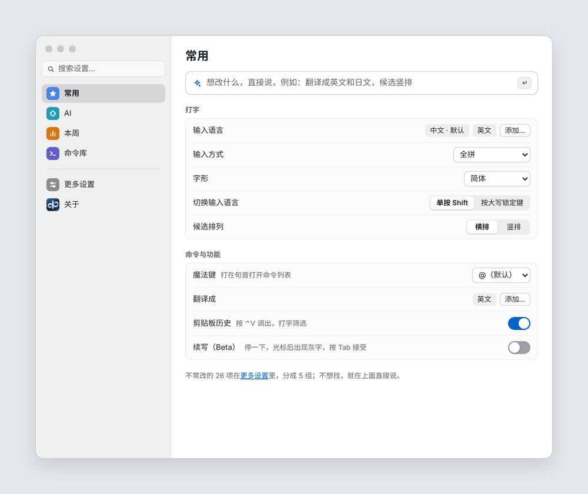
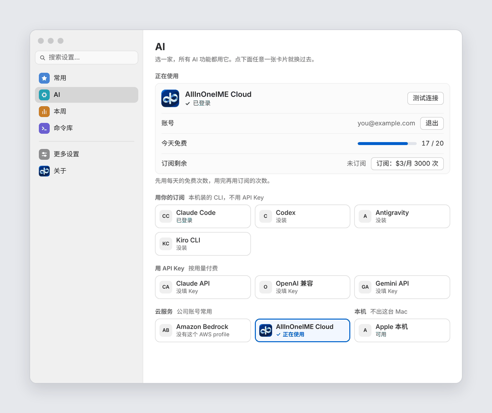
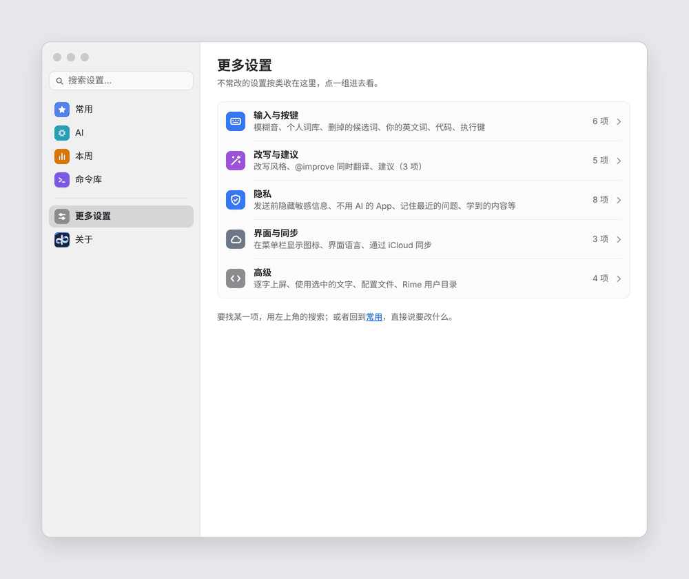
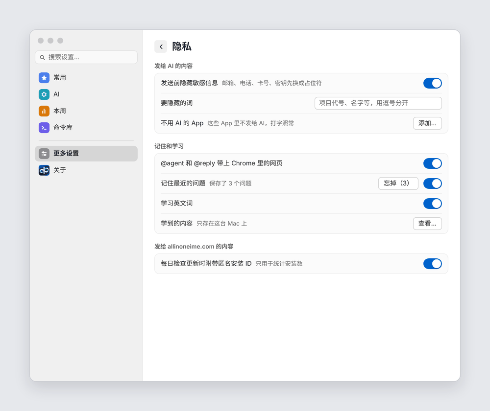

# 0.7.5 plan: fewer settings to read, AI on a page of its own, a three-step start

Status: planned for 0.7.5 at the owner's request (2026-11-15). Nothing here is built yet; this is the spec to build from.

## Why

A fresh install shows 46 rows on 8 settings pages (counted from `SettingsSpot` and its `isShown` on `release-0.7.5`,
signed in to AllInOneIME Cloud, Chinese and English as inputs). Users can't take that in, and most never need more
than ten of them. The installer then teaches a command name (`@improve`), while the product's point is the opposite:
after the magic key you type anything, and the list offers what can be done with it (one @, 0.7.0). This plan:

1. puts the ten rows people change on one page, **常用 / Common**, the first page;
2. gives **AI** its own page, with every choice visible;
3. moves the rest into **更多设置 / More Settings**: five groups, one row each, each group a short page of its own;
4. replaces "type @improve" with a **three-step start** that ends with the user trying one @ on their own sentence.

No setting, command, shortcut or config key is added or removed (rule 2): every row keeps its `SettingsSpot`, its
config key and its behaviour; only where it is shown changes. The settings search still finds every row and opens it
where it now lives. Nothing new leaves the Mac (rule 4).

## The sidebar

| Before (0.7.5 today) | After |
|---|---|
| 本周 · 通用 · 输入 · AI · 隐私 · 命令 · 高级 · 关于 | **常用** · **AI** · 本周 · **命令库** — **更多设置** · 关于 |

`SettingsWindow.firstPage` becomes 常用. 命令库 is today's 命令 page (custom commands, `@agent`, notes, plugins,
script extensions, extension sources), unchanged apart from its name.

## 常用 / Common

- On top, one field: "想改什么，直接说，例如：翻译成英文和日文，候选竖排". It is the search's last row ("修改：…",
  the AI changing the settings as typed) on a page of its own; nothing is sent before Return, as now.
- **打字 / Typing**: `inputLanguages`, `pinyinScheme`, `chineseCharacters`, `switchKey`, `candidateLayout`.
- **命令与功能 / Commands and features**: `magicKey`, `outputLanguages`, `clipboardHistory`, `autocomplete`.
- A footer line: "不常改的 22 项在更多设置里，分成 5 组；不想找，就在上面直接说。" (the count is computed, not written).

`outputLanguages` moves here from the AI page's AI commands (#92): it is the one AI-command option most people set.

## AI

- The chosen AI on top with its own rows, as today (AllInOneIME Cloud: account, today's free requests, subscription;
  an API-key provider: model, key, More…; a CLI: its session rows).
- Under it, **every choice as a card**, in the four groups `AIChoice.Group` has (用你的订阅 / 用 API Key / 云服务 /
  本机), always shown: no "更换 ▾" step. A click chooses it. The chosen card is outlined and says "正在使用".
- A card that isn't chosen shows "没装" / "没填 Key" in gray, not orange: on a fresh install most cards are not set up,
  and orange everywhere reads as an error. Orange stays for the chosen AI when it can't answer.
- Then **AI commands** (#92: `rewriteStyles`, `improveTranslates`, `jargonList`, `questionContinueIn`,
  `rememberQuestions`), then model parameters (only when not default), as on `release-0.7.5`.

The mockup was drawn before #92 merged and has no AI-commands section; the section goes under the cards. Its free
count says 20; the service gives 200 since 0.7.5, and the page shows whatever the account says.

## 更多设置 / More Settings

 

An index page: one row per group (icon, name, what's inside, how many, ›). A group opens as a page of its own, with a
back button left of its title; at most 7 rows, so each fits without scrolling.

| Group | Rows (`SettingsSpot`) | Shown on a fresh install |
|---|---|---|
| 输入与按键 / Input and keys | `fuzzyPinyin`, `personalDictionaries`, `removedCandidates`, `englishWords`, `codingLanguage`, `actionKey` | 6 |
| 建议 / Suggestions | `suggestions`, `suggestionsInsert`, `appInserts` | 3 |
| 隐私 / Privacy | `hideSensitive`, `wordsToHide`, `appsWithoutAI`, `pageContext`, `learnEnglishWords`, `learned`, `installID` | 7 |
| 界面与同步 / Interface and sync | `menuBarIcon`, `interfaceLanguage`, `iCloudSync` | 3 |
| 高级 / Advanced | `typeOut`, `configFile`, `rimeFolder` (+ `useSelection`, `previousAppSettings` only when they show today) | 3 |

The mockups predate #92: they show "改写与建议" with 5 rows and 隐私 with 8 (`rememberQuestions` in it). With #92,
rewrite styles and recent questions stay in AI → AI commands, so the groups are as in the table.

### The count, on a fresh install

| Page | Rows |
|---|---|
| 常用 | 9 |
| AI | 6 (`provider`, `testConnection`, `rewriteStyles`, `improveTranslates`, `questionContinueIn`, `rememberQuestions`) |
| 命令库 | 6 |
| 更多设置 | 22 in 5 groups |
| 关于 | 3 |
| **Total** | **46**, as today |

## The three-step start

| 1 | 2 | 3 |
|---|---|---|
|  |  |  |

A 560 × 440 window the installer's last dialog opens (its button, today "打开 AllInOneIME 设置"), shown once.

1. **先切到 AllInOneIME**: Control + Space or the Input menu. It shows the current input source and moves on by itself
   when it becomes AllInOneIME; no Next button. "跳过上手" closes it.
2. **接上 AI**: the existing sign-in buttons (Google, email), and "已经有自己的 AI？" with three ways to the AI page
   (subscription CLI, API key, Apple on this Mac). "稍后再说" goes on: typing works without signing in.
3. **@ 后面，想说什么就打什么**: a real text field in the window with the magic key and a sentence, where one @
   works as it does everywhere (↑↓ choose, Return does it, Esc as typed, → back to the app). Under it, three
   one-tap examples: a sum (`@200*15%`), a time (`@明天下午三点开会`), an app (`@weixin`). "完成" closes.

The installer's dialog text changes from "…然后在任意输入框里打 @improve" to saying that after @ you type anything and
pick what to do. Step 3 sends nothing until the user presses Return on a row that uses the AI, as anywhere else.

## Open for the owner

- Whether the start can be opened again later (from 关于, say), and where "shown once" is kept (not in `config.json`:
  it isn't a setting).
- 命令 / 指令: settings say 命令; the week stats (`WeekStatsText`) say 指令. One of them should change.

## How it will be checked

Acceptance tests, written from this document by a separate agent (rule 11):

- `SettingsWindow.firstPage` is 常用; the sidebar lists the six pages in the order above.
- Every `SettingsSpot` lives in exactly one place (a page, or a group of 更多设置), and the counts per page and per
  group on a fresh-install config are as in the tables.
- The search finds every row and opens the page or group it is in.
- The start's step 1 moves on when the input source becomes AllInOneIME and not otherwise; its examples produce the
  one-@ rows the list gives for that text everywhere else (a value, a reminder, an app).
- `make check` passes; the settings pages render with `--settings-image` in Chinese and English.
