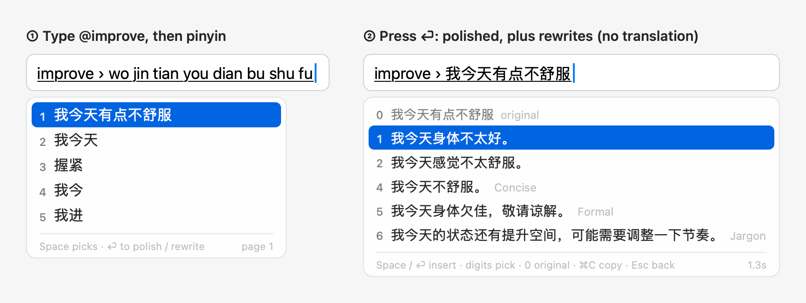
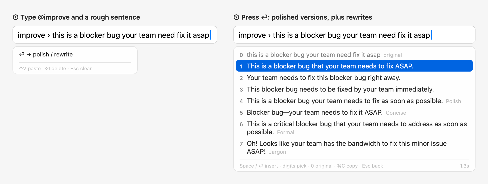
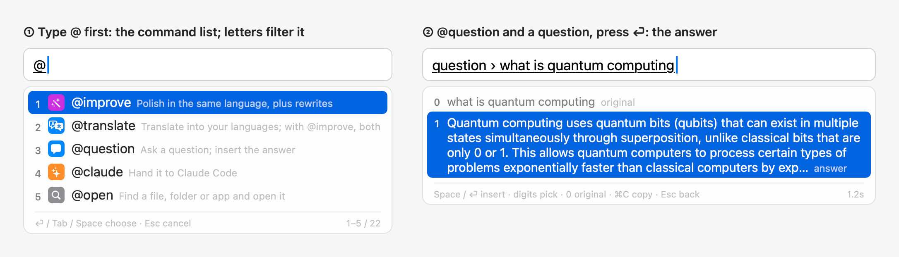
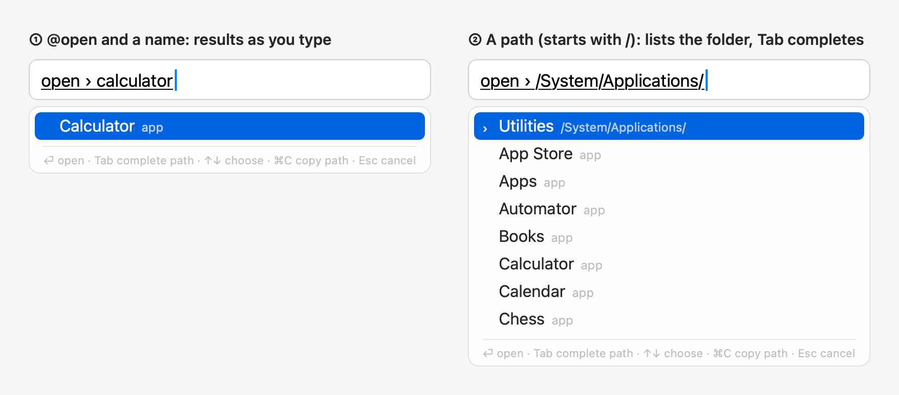
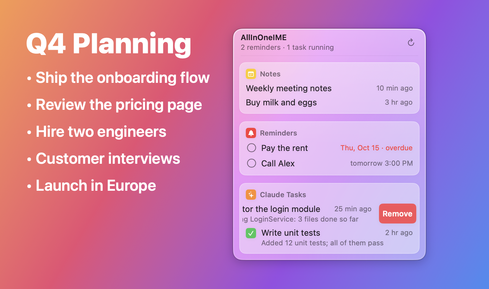
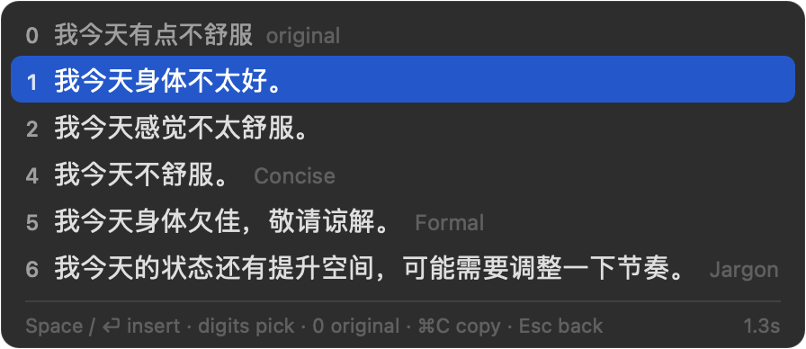
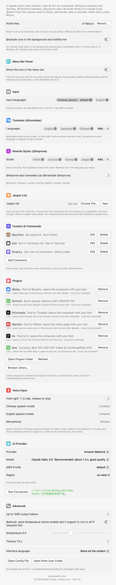

<div align="center">

[English](../../README.md) · [简体中文](../../README.zh-CN.md) · [繁體中文](README_zh-TW.md) · [日本語](README_ja.md) · [한국어](README_ko.md) · [Français](README_fr.md) · [Deutsch](README_de.md) · [Español](README_es.md) · [Português (Brasil)](README_pt-BR.md) · [Italiano](README_it.md) · [Русский](README_ru.md) · [Tiếng Việt](README_vi.md) · [ไทย](README_th.md) · [Bahasa Indonesia](README_id.md) · **हिन्दी** · [العربية](README_ar.md) · [Türkçe](README_tr.md)

<br>


# AllInOneIME

### आपके Mac के हर टेक्स्ट फ़ील्ड में AI कमांड।

किसी भी ऐप में `@improve`, `@translate` या `@question` टाइप करें, ⏎ दबाएँ और नतीजा चुनें।<br>
न चैट विंडो में कॉपी करना, न ऐप बदलना। AI प्रोवाइडर भी आपका, कुंजियाँ भी आपकी।

[](https://github.com/MicroZ-LLC/AllInOneIME/releases/latest)
[](#इंस्टॉलेशन)
[](#इंस्टॉलेशन)
[](#इंस्टॉलेशन)
[](../../LICENSE)
[](https://github.com/MicroZ-LLC/AllInOneIME/releases)

**[डाउनलोड](https://allinoneime.com/download)** · **[वेबसाइट](https://allinoneime.com)** · **[दस्तावेज़](https://github.com/MicroZ-LLC/AllInOneIME/wiki)** · **[एक्सटेंशन](../extensions.md)**

[इस्तेमाल कैसे करें](#इस्तेमाल-कैसे-करें) · [कमांड](#-कमांड-बीटा) · [अपने कमांड](#अपने-कमांड) · [भाषाएँ](#इनपुट-और-अनुवाद) · [इंस्टॉलेशन](#इंस्टॉलेशन) · [प्राइवेसी](#प्राइवेसी)

<br>



</div>

*यह अंग्रेज़ी README का अनुवाद है; जहाँ दोनों में अंतर हो, वहाँ अंग्रेज़ी वाला सही माना जाए।*

> [!NOTE]
> 0.6.3 से AllInOneIME पर Developer ID से हस्ताक्षर होते हैं और यह Apple से नोटराइज़ किया जाता है: अब इसे System Settings → Privacy & Security (सिस्टम सेटिंग्स → गोपनीयता और सुरक्षा) में अनुमति देने की ज़रूरत नहीं। किसी पुराने वर्शन से अपडेट करने के बाद, AllInOneIME ने कीचेन में जो भी कुंजी सहेजी है, उनमें से हर एक के लिए macOS एक बार आपका लॉगिन पासवर्ड पूछता है: पासवर्ड डालें और "Always Allow" (हमेशा अनुमति दें) पर क्लिक करें। AllInOneIME सिर्फ़ [GitHub Releases](https://github.com/MicroZ-LLC/AllInOneIME/releases) या [allinoneime.com](https://allinoneime.com) से डाउनलोड करें।

macOS के लिए एक इनपुट मेथड, जो हर टेक्स्ट फ़ील्ड में AI कमांड देता है। वाक्य `@` से शुरू करें और पूरा होने पर ⏎ दबाएँ: `@improve` आपके लिखे को निखारता है और कुछ नए रूप सुझाता है, `@translate` उसे आपकी चुनी भाषाओं में अनुवाद करता है, `@question` सवाल पूछता है, `@agent` उसे किसी कोडिंग एजेंट (Claude Code, Gemini CLI, Kiro CLI …) को सौंपता है, और `@open` फ़ाइलें और ऐप ढूँढ़ता है या कोई वेब पता खोलता है। `@` के बिना आपकी कुंजियाँ हमेशा की तरह ऐप तक जाती हैं। यह चीनी (पिनयिन, Rime और rime-ice पर आधारित), फ़्रेंच, कोरियाई (हंगुल) और हिन्दी (लैटिन अक्षरों से देवनागरी) भी टाइप करता है, और आपकी अपनी स्क्रिप्ट को @ कमांड के रूप में चलाता है।

कमांड ट्रिगर डिफ़ॉल्ट रूप से `@` है। Settings → General → Command trigger में आप कोई दूसरा चिह्न चुन सकते हैं: `#`, `%`, `&`, `*`, `+`, `|` या `~`; तब कमांड उसी से शुरू होते हैं (जैसे `~translate`), और `@` सामान्य रूप से टाइप होता है। अक्षर, अंक, स्पेस और वे चिह्न जिनकी टाइपिंग में ज़रूरत होती है (पिनयिन की कुंजियाँ जैसे `'` `-` `=` `[` `]` `` ` ``, और वे जिन्हें पिनयिन चीनी विराम-चिह्न के रूप में टाइप करता है, जैसे `,` `.` `?` `\`) स्वीकार नहीं किए जाते, और सेटिंग्स इसका कारण बताती हैं। कॉन्फ़िग फ़ाइल में: `"commandTrigger": "~"`।



ज़्यादा जानकारी (हर कमांड और सेटिंग, इंस्टॉलेशन की समस्याओं का हल, प्राइवेसी) के लिए [Wiki](https://github.com/MicroZ-LLC/AllInOneIME/wiki) देखें। इसे MicroZ LLC के [Weijian Zhang](https://weijianz.com) ने बनाया है।

## इस्तेमाल कैसे करें

`@` के बिना यह बीच में नहीं आता: अंग्रेज़ी में अक्षर सीधे टाइप होते हैं और ⏎ सामान्य Return है; कुछ भी ऑनलाइन नहीं जाता। नए इंस्टॉल में सिर्फ़ अंग्रेज़ी लिखी जाती है; चीनी (पिनयिन), फ़्रेंच, कोरियाई या हिन्दी भी टाइप करनी हो, तो उसे सेटिंग्स में जोड़ें ([इनपुट और अनुवाद](#इनपुट-और-अनुवाद) देखें)।

| कुंजी | क्या करती है |
|---|---|
| पिनयिन टाइप करें, Space / अंक | चीनी मोड में: किसी भी पिनयिन इनपुट मेथड की तरह शब्द चुनें |
| `@` (वाक्य की शुरुआत में) | कमांड सूची खोलता है: हाल में सबसे ज़्यादा इस्तेमाल हुए पहले, एक बार में 5, ↑↓, स्क्रॉल व्हील या ट्रैकपैड से स्क्रॉल करें; या कोई कमांड ढूँढ़ने के लिए अक्षर टाइप करें (पूरा टाइप किया गया नाम सबसे पहले, फिर उन अक्षरों से शुरू होने वाले नाम, फिर उन्हें शामिल करने वाले नाम)। ⏎, Tab, Space या कोई अंक चुनता है |
| ⏎ | कमांड चलाता है। पिनयिन अभी चुना न गया हो, तब भी काम करता है: Space की तरह पहले वह चुन लिया जाता है |
| Space, ⏎ / अंक | नतीजे आ जाने पर: हाइलाइट किया हुआ / उस नंबर वाला नतीजा डालें; 0 मूल वाक्य है। आगे की बात आधी टाइप की हो, तब भी ⏎ नतीजा डालता है (टाइप किया हिस्सा छोड़ दिया जाता है) |
| ⇧⏎ | AI के नतीजों के बाद आगे की बात टाइप की हो: उसे भेजता है (`@question` बातचीत का अगला सवाल, या कोई सुधार)। कमांड टाइप करते समय, या AI के नतीजों पर कुछ टाइप न किया हो तो: आपने जो टाइप किया उसे जैसा का तैसा डालता है, `@command` समेत। दूसरे नतीजों (`@open`, कोई रिमाइंडर …) पर यह ⏎ की तरह हाइलाइट की हुई पंक्ति डालता है |
| ⌘C | हाइलाइट किया हुआ नतीजा कॉपी करता है (`@open` में, पाथ); कैंडिडेट पैनल खुला रहता है |
| ⌃V | किसी कमांड में (जैसे `@improve ` के बाद): क्लिपबोर्ड का टेक्स्ट ऐप में पेस्ट करने के बजाय आपके टाइप किए के बाद जोड़ देता है। कई पंक्तियाँ एक हो जाती हैं, एक बार में ज़्यादा से ज़्यादा 2000 अक्षर (`@note` पंक्तियों के ब्रेक रखता है और 20000 तक लेता है)। किसी भी ऐप में काम करता है; कमांड के बिना कुंजी हमेशा की तरह ऐप तक जाती है |
| ⌘V | ⌃V जैसा ही, पर कुछ ऐप ⌘V को खुद संभालते हैं (Ghostty, iTerm2 और Terminal जैसे टर्मिनल, और Notes) और हमेशा की तरह ऐप में पेस्ट करते हैं; वहाँ ⌃V इस्तेमाल करें |
| Esc, ⌫ | संपादन जारी रखने के लिए वाक्य पर लौटें; नतीजों के बाद विराम चिह्न या अंक टाइप करने से वाक्य आगे बढ़ता है। किसी सुधार के बाद: उससे पहले के नतीजों पर लौटें |
| AI के नतीजे आने के बाद अक्षर | आगे की बात: `@question` के बाद अगला सवाल ([बातचीत](#question-के-साथ-बातचीत-नया) देखें), `@improve` या किसी प्रॉम्प्ट कमांड के बाद `shorter` जैसा निर्देश ([नतीजों को सुधारना](#नतीजों-को-सुधारना-नया) देखें); ⇧⏎ उसे भेजता है। `@translate` के बाद अक्षर वाक्य को आगे बढ़ाते हैं, और ⏎ उसका फिर से अनुवाद करता है |
| ⌘⏎, ⌘1–⌘9 | `@question` बातचीत में: दिखाता है कि उसे कहाँ जारी रखा जा सकता है (इंस्टॉल किए गए कोडिंग एजेंट, जिसे `@agent` काम सौंपता है वह सबसे पहले; Claude, ChatGPT, Gemini; या कॉपी करना); ⌘1, ⌘2 … कोई एक चुनते हैं |
| किसी पंक्ति पर क्लिक | कैंडिडेट पैनल में: उसे चुनता है, जैसे उसका अंक चुनता (कोई शब्द, सूची का कोई कमांड, कोई नतीजा, `@open` की कोई फ़ाइल, कोई प्राप्तकर्ता, किसी एक्सटेंशन की पंक्ति); पॉइंटर के नीचे वाली पंक्ति हाइलाइट होती है। टेक्स्ट फ़ील्ड पर फ़ोकस बना रहता है |
| Shift को हल्का-सा दबाएँ | एक से ज़्यादा इनपुट भाषाएँ हों तो: क्रम से अगली भाषा (अंग्रेज़ी → चीनी → फ़्रेंच → …, फिर वापस पहली) |

## @ कमांड (बीटा)

| कमांड | क्या करता है |
|---|---|
| `@improve` | निखारना: 1–3 वाक्य की अपनी भाषा में तीन संस्करण हैं, 4 से आगे रीराइट स्टाइल (सेटिंग्स में जोड़े और क्रम में लगाए जाते हैं), 0 मूल वाक्य है। अनुवाद नहीं करता; "@improve also translates" (@improve अनुवाद भी करे) चालू हो, तो यह `@translate @improve` की तरह काम करता है |
| `@translate` | आपकी जोड़ी हुई भाषाओं में अनुवाद करता है (सेटिंग्स → "Translate", क्रम बदलने के लिए खींचें), हर भाषा की एक पंक्ति, और सिर्फ़ एक भाषा हो तो तीन संस्करण; वाक्य की अपनी भाषा छोड़ दी जाती है। `@translate @improve` साथ में एक ही अनुरोध में अनुवाद और रीराइट करता है |
| `@question` | सवाल पूछें; जवाब कैंडिडेट में दिखता है, ⏎ या Space उसे डालता है, ⌘C कॉपी करता है। आगे टाइप करें और ⇧⏎ से अगला सवाल पूछें: पैनल 5 दौर तक की बातचीत बन जाता है, फिर Claude या किसी दूसरे AI में आगे बढ़ने का सुझाव देता है। इसके बाद कुछ टाइप न करें तो यह आपके आख़िरी 5 सवाल दिखाता है, सबसे नया पहले; टाइप करने से सूची छोटी होती है (सवाल में कहीं भी आए शब्द, बड़े-छोटे अक्षर का फ़र्क़ नहीं, चीनी भी)। कोई अंक, ↑↓ फिर ⏎, या क्लिक किसी सवाल का सहेजा हुआ जवाब तुरंत, ऑफ़लाइन दिखाता है, जिसे हमेशा की तरह डाला या कॉपी किया जा सकता है; वहाँ ⌘R नया जवाब पाने के लिए सवाल फिर से पूछता है। कोई मेल न हो, या कुछ न चुना हो, तो ⏎ वही पूछता है जो आपने टाइप किया |
| `@reply` | जिस संदेश का आप जवाब दे रहे हैं, उसके तीन जवाब लिखता है, सामने वाले की भाषा में और ऐप के लहजे में (Settings → Apps में उस ऐप की पहली रीराइट स्टाइल, वरना चैट ऐप में अनौपचारिक और मेल में औपचारिक, जहाँ हर जवाब एक पूरा ईमेल होता है)। संदेश देने के लिए उसे चुनें, उसे कॉपी करके ड्राफ़्ट में ⌃V दबाएँ, या स्क्रीनशॉट लेकर (⌃⇧⌘4, या WeChat का अपना) ⌃V दबाएँ; इसके बाद जो टाइप करें, वह बताता है कि क्या जवाब देना है: `@reply politely decline`। ⌘R तीन और लिखता है; [@reply से जवाब देना](#reply-से-जवाब-देना-नया) देखें |
| `@agent` | काम आपके Mac पर किसी कोडिंग एजेंट को सौंपता है, जिसे Settings → Agent में चुना जाता है: Claude Code (डिफ़ॉल्ट), Gemini CLI, Kiro CLI, या आपकी अपनी कोई कमांड (आपका टाइप किया उसके आख़िरी आर्ग्युमेंट के रूप में जुड़ता है)। यह पेज यह भी दिखाता है कि हर एक इंस्टॉल है या नहीं और कैसे शुरू होता है। Claude Code डिफ़ॉल्ट रूप से बैकग्राउंड में चलता है और पूरा होने पर सूचना देता है (Terminal में सेशन खोलकर आगे बढ़ने के लिए उस पर क्लिक करें), या `@tasks` देखें; Terminal में खोलने के लिए वहाँ Claude Code के नीचे "Runs in the background and notifies me" (बैकग्राउंड में चलता है और मुझे सूचना देता है) बंद करें। बाक़ी एजेंट Terminal में खुलते हैं, और आपका टाइप किया उनका पहला संदेश होता है। हर एक अपना साइन-इन और अपनी सेटिंग्स इस्तेमाल करता है। Google Chrome में यह पेज भी साथ ले जाता है: पता और शीर्षक, जिस फ़ील्ड में आपने टाइप किया वह अपने फ़ॉर्म या सेक्शन के साथ (★ बताता है कि आप कहाँ हैं), चुना हुआ टेक्स्ट और विंडो में जो दिख रहा है — कभी कोई पासवर्ड फ़ील्ड नहीं, कभी पूरा पेज नहीं — इसलिए साइन-इन फ़ॉर्म के यूज़रनेम फ़ील्ड में `@agent why doesn't this work` उसी फ़ील्ड के बारे में होता है, और किसी पाइपलाइन पेज पर `@agent why is this blocked` उस पेज के बारे में; कौन-सा, यह एजेंट तय करता है। पेज का टेक्स्ट एजेंट को जैसा पढ़ा गया वैसा जाता है, इस निशान के साथ कि वह वेब से आया है (आपके निर्देश के रूप में नहीं)। इसके लिए Accessibility (ऐक्सेसिबिलिटी) की अनुमति चाहिए; Chrome इसके लिए अपना पेज ट्री सिर्फ़ तब बनाता है जब वहाँ `@agent` लिखा जा रहा हो, और बाद में उसे फिर बंद कर दिया जाता है (Settings → Agent → "@agent and @reply take the Chrome page along" यह सब बंद करता है)। पहली बार Terminal खोलते समय macOS पूछता है कि क्या AllInOneIME Terminal को नियंत्रित कर सकता है: OK पर क्लिक करें। (0.6.4 से पहले यह `@claude` था।) |
| `@tasks` | बैकग्राउंड के Claude कामों (चल रहा / पूरा / आपके इंतज़ार में) की सूची, उनके आख़िरी जवाबों के साथ; ⏎ किसी एक को Terminal में खोलता है, ⌘C जवाब कॉपी करता है |
| `@settings` | सेटिंग्स विंडो तुरंत खोलता है (बस चुनना काफ़ी है) |
| `@open` | टाइप करते-करते मेल खाती फ़ाइलें, फ़ोल्डर और ऐप दिखाता है (Spotlight)। स्पेस से अलग किए कई कीवर्ड चलते हैं: हर कीवर्ड पाथ में होना चाहिए, और कम से कम एक नाम में (किसी मानक फ़ोल्डर का नाम उसके अंदर की चीज़ों पर भी लागू होता है: `downloads pdf` Downloads (डाउनलोड) में रखी PDF ढूँढ़ता है)। ऐप और मानक फ़ोल्डर उनके चीनी नामों से भी मिलते हैं, और चीनी इंटरफ़ेस उन्हें उसी नाम से दिखाता है। `@open` से खोली गई चीज़ें पहले आती हैं, फिर ऐप और वे फ़ोल्डर, फिर हाल में इस्तेमाल हुई या बदली गई फ़ाइलें; जब नामों से दो या कम फ़ाइलें मिलें और ऐसा कोई ऐप या फ़ोल्डर न मिले, तो आपके होम फ़ोल्डर की फ़ाइलें सामग्री के आधार पर भी खोजी जाती हैं, और उन पंक्तियों पर "content" (सामग्री) लिखा होता है; जब और कुछ न हो, तो ⏎ पहली चीज़ खोलने के बजाय उन्हें चुनने के लिए सूची में दिखाता है। वेब पते (`github.com`, `localhost:3000`, `https://…`) के साथ पहली पंक्ति "open in the browser" (ब्राउज़र में खोलें) होती है और सामग्री नहीं खोजी जाती; ठीक उसी नाम की फ़ाइल (जैसे `MANIFEST.in`) सबसे पहले आती है। `~/` या `/` से शुरू होने वाला टेक्स्ट एक पाथ है: Tab उसे पूरा करता है और फ़ोल्डरों के अंदर जाता है; ⏎ खोलता है, ⌘C पाथ कॉपी करता है |
| `@note` | टेक्स्ट को Notes ऐप में AllInOneIME नाम के फ़ोल्डर में सहेजता है (न हो तो बना देता है), या वहाँ जहाँ Settings → Plugins → Notes (@note) बताता है: Notion, या Markdown फ़ाइलों का कोई फ़ोल्डर (कोई Obsidian वॉल्ट या कोई भी फ़ोल्डर); कुछ भी डाला नहीं जाता। पेस्ट किया टेक्स्ट अपने लाइन ब्रेक रखता है, 20000 अक्षरों तक |
| `@reminder` | Reminders ऐप में AllInOneIME नाम की सूची में एक रिमाइंडर जोड़ता है। समय टेक्स्ट में ही लिखें; उसे Mac पर ही पढ़ा जाता है, और एक पंक्ति दिखाती है कि क्या पढ़ा गया: ⏎ या Space उसे जोड़ता है, Esc संपादन पर लौटाता है। समय हो तो उस समय अलार्म बजता है; सिर्फ़ तारीख हो तो वह पूरे दिन का होता है |
| `@py` | Python की एक पंक्ति चलाता है (Mac का `python3`) और नतीजा डालता है: कोड के आख़िरी एक्सप्रेशन का मान, जैसे `@py 2**100`, `@py import math; math.sqrt(2)`, वरना जो उसने प्रिंट किया। `python3` न हो तो यह उपलब्ध नहीं होता (Xcode के कमांड लाइन टूल में यह होता है) |
| `@js` | JavaScript की एक पंक्ति चलाता है और उसी तरह नतीजा डालता है: आख़िरी एक्सप्रेशन का मान या जो `console.log` ने प्रिंट किया, जैसे `@js [1, 2, 3].map(x => x * 2)`। यह macOS का बिल्ट-इन JavaScriptCore इस्तेमाल करता है, इसलिए कुछ इंस्टॉल नहीं करना पड़ता; यह फ़ाइलें नहीं पढ़ सकता, नेटवर्क तक नहीं पहुँच सकता और दूसरे प्रोग्राम नहीं चला सकता |
| `@reportissue` | किसी समस्या की रिपोर्ट करता है: आपके ब्राउज़र में GitHub का नया issue पेज खोलता है, कमांड के बाद टाइप किया गया टेक्स्ट उसका शीर्षक बनता है, और भरने के लिए "What happened / What you expected" (क्या हुआ / आपको क्या उम्मीद थी) होता है। यह ऐप और macOS के वर्शन, आपके Mac का आर्किटेक्चर, इंटरफ़ेस और इनपुट भाषाएँ, इंस्टॉल किए गए भाषा पैक, AI प्रोवाइडर का प्रकार (और मॉडल, अगर वह सार्वजनिक है; नहीं तो "custom"), ऐक्शन कुंजी, और आपके कितने कस्टम कमांड, प्लगइन और एक्सटेंशन हैं, यह जोड़ता है, पर कभी उनके नाम, आपका टेक्स्ट, पाथ या कुंजियाँ नहीं। ⏎ (या आपकी ऐक्शन कुंजी) पहले यह सब कैंडिडेट पैनल में दिखाता है; फिर से ⏎, या पंक्ति पर क्लिक, पेज खोलता है, जहाँ आप उसे पढ़कर Submit पर क्लिक करते हैं (अपने GitHub खाते से); Esc वापस जाता है। इनपुट मेन्यू ("Report an Issue…") और Settings → About में भी है |
| `@imessage` | iMessage भेजता है: कोई नाम, फ़ोन नंबर या ईमेल टाइप करें (चीनी नाम उसके पिनयिन से भी, पूरा या शुरुआती अक्षर) और कैंडिडेट पैनल में प्राप्तकर्ता चुनें (जिन्हें आपने हाल में संदेश भेजा, वे पहले आते हैं; पूरा नंबर या पता भी चलता है), फिर संदेश लिखें (उसके अंदर के कमांड, जैसे `@stock AAPL`, पहले चलते हैं)। ⏎ पैनल में "Send to Alex (…): message" दिखाता है, दोबारा ⏎ उसे भेज देता है, Esc संपादन पर लौटाता है; टेक्स्ट फ़ील्ड में कुछ टाइप नहीं होता। पहली बार macOS पूछता है कि क्या AllInOneIME को Contacts (संपर्क) तक पहुँचने और Messages (संदेश) को नियंत्रित करने दिया जाए: दोनों के लिए "OK" पर क्लिक करें |

उदाहरण: `@q` ⏎, `what is quantum computing` टाइप करें, ⏎। `@note books to read: The Three-Body Problem` ⏎ एक नोट सहेजता है। `@reminder call Bob tomorrow at 3pm` ⏎, उसने जो समय पढ़ा उसे जाँचें, फिर उसे जोड़ने के लिए दोबारा ⏎। चीनी मोड में `@open` कुछ देर के लिए अंग्रेज़ी अक्षरों पर चला जाता है और काम पूरा होने पर वापस चीनी पर आ जाता है।

`@py` और `@js` का कोड अंग्रेज़ी अक्षरों में टाइप होता है, और फ़ुल-विड्थ विराम चिह्न (चीनी मोड से) ASCII बन जाते हैं; उसे एक ही पंक्ति में लिखें, स्टेटमेंट के बीच `;` लगाकर। यह एक अलग प्रोसेस में चलता है, जो 10 सेकंड बाद या कभी भी Esc दबाने पर रुक जाती है; एरर होने पर एरर की पहली पंक्ति दिखती है, जैसे `ZeroDivisionError: division by zero`। कई पंक्तियों वाला आउटपुट जैसा प्रिंट हुआ वैसा ही डाला जाता है; टर्मिनल में वह एक पंक्ति बनकर जाता है (टर्मिनल उसे दी गई हर पंक्ति चला देता है)। किसी एडिटर के अंदर का टर्मिनल (VS Code, Cursor, JetBrains) खुद एडिटर से अलग नहीं पहचाना जा सकता, इसलिए वहाँ किसी भी कमांड का कई पंक्तियों वाला आउटपुट जैसा है वैसा ही जाता है। दोनों किसी दूसरे कमांड के वाक्य के अंदर भी काम करते हैं: `@reply the answer is @py 2**100`; स्पेस वाले कोड को उद्धरण चिह्नों में रखें: `@question explain @py "sum(x * x for x in range(10))"`। उलटा नहीं होता: `@py` और `@js` का कोड हमेशा ठीक वैसा ही चलता है जैसा आपने टाइप किया, और उसके अंदर के `@commands` पहले नहीं चलते।





जब `@` के बाद कोई कमांड न हो, जैसे `@john`, तो `@` हमेशा की तरह डल जाता है, इसलिए चैट ऐप में लोगों को @-मेंशन करना पहले जैसा ही चलता है। किसी अक्षर, अंक, `.`, `_` या `-` के ठीक बाद टाइप किया गया `@`, जैसे `bob@example.com` या `ssh user@host` में, सिर्फ़ टेक्स्ट है: कोई सूची नहीं खुलती, किसी भी ऐप में, टर्मिनल समेत। सूची खुली हो तो ← → या कोई ऐसी कुंजी जो किसी कमांड के नाम में नहीं आ सकती (`.`, `:`, `/`) उसे बंद कर देती है और आपका टाइप किया (`@`, `@im`) जैसा का तैसा छोड़ देती है; टर्मिनल में तब ← → सिर्फ़ सूची बंद करते हैं। `@question`, `@improve`, `@translate` और `@reply` आपके अपने Bedrock को सिर्फ़ तब भेजते हैं जब आप ऐक्शन कुंजी दबाते हैं (स्क्रीनशॉट इसी Mac पर पढ़ा जाता है और सिर्फ़ उसका टेक्स्ट भेजा जाता है); `@open` सिर्फ़ इसी Mac पर खोजता है; `@note` और `@reminder` सिर्फ़ इसी Mac के Notes और Reminders तक जाते हैं (आपने कोई फ़ोल्डर या Notion चुना हो, तो `@note` उसकी जगह वहाँ जाता है); `@agent` आपके Mac पर इंस्टॉल एजेंट (डिफ़ॉल्ट रूप से Claude Code की `claude` कमांड) और उसका अपना अकाउंट इस्तेमाल करता है, और फ़ाइलें बदलने या कमांड चलाने से पहले हमेशा की तरह आपसे पूछता है। वह एजेंट इंस्टॉल न हो, तो `@agent` उपलब्ध नहीं होता। `@imessage` सिर्फ़ इसी Mac के Contacts पढ़ता है (नाम, फ़ोन नंबर, ईमेल), कभी AI से होकर नहीं जाता, और संदेश Messages भेजता है; Messages ऐप न हो तो यह उपलब्ध नहीं होता।

### चुने हुए टेक्स्ट पर (नया)

किसी भी ऐप में कुछ टेक्स्ट चुनें (Notes में एक वाक्य, Mail में एक पैराग्राफ़), `@improve`, `@translate`, `@question` या टेक्स्ट लेने वाला कोई और कमांड टाइप करें, और ⏎ दबाएँ: कमांड चुने हुए हिस्से पर काम करता है, और आप जो नतीजा चुनते हैं वह उसकी जगह ले लेता है। आपके टाइप करते समय चुना हुआ हिस्सा जैसा है वैसा ही, चुना हुआ रहता है: कमांड कैंडिडेट पैनल में लिखा जाता है, जिसकी पहली पंक्ति वह है जो आप टाइप कर रहे हैं और अगली "On the selection: “…” (N characters)" (चुने हुए हिस्से पर: N अक्षर)। Esc, ⇧⏎ या कहीं और क्लिक करने से टेक्स्ट जैसा था वैसा ही रहता है; बीच में चुना हुआ हिस्सा बदलने पर भी ऐसा ही होता है, और कमांड रद्द हो जाता है। कमांड के बाद टाइप किया गया टेक्स्ट `@improve` और `@translate` के लिए निर्देश है (`@translate ja`, `@improve more formal`) और `@question` के लिए सवाल (`@question what does this mean`), चुने हुए हिस्से के बारे में। `@open`, `@agent`, `@tasks`, `@settings`, `@reminder`, `@imessage`, `@reportissue`, टर्मिनल कमांड और स्क्रिप्ट एक्सटेंशन इसका इस्तेमाल नहीं करते: वे वही लेते हैं जो आप टाइप करते हैं, और चुना हुआ हिस्सा जैसा है वैसा रहता है। अधिकतम 5000 अक्षर; सुरक्षित इनपुट के दौरान या टर्मिनल में कभी नहीं पढ़ा जाता। अगर किसी ऐप में यह ठीक से काम न करे, तो Settings → General → "Use the selected text" (चुना हुआ टेक्स्ट इस्तेमाल करें) में इसे बंद करें।

### @reply से जवाब देना (नया)

जिस संदेश का आप जवाब दे रहे हैं, `@reply` उसके तीन ऐसे जवाब लिखता है जिन्हें आप भेज सकें। संदेश इनमें से किसी भी तरह दें, फिर ⏎ दबाएँ:

- फ़ील्ड में उसे **चुनें**, फिर `@reply` टाइप करें (आपका चुना जवाब उसके बाद, अपनी अलग पंक्ति में डलता है)।
- उसे **कॉपी करें**, `@reply` टाइप करें और ⌃V दबाएँ: पैनल "Copied message · N characters" (कॉपी किया संदेश · N अक्षर) दिखाता है, और ड्राफ़्ट जैसा है वैसा रहता है।
- क्लिपबोर्ड पर **स्क्रीनशॉट लें** (⌃⇧⌘4, या WeChat का अपना स्क्रीनशॉट), `@reply` टाइप करें और ⌃V दबाएँ: पैनल "Screenshot · N lines (read on this Mac)" (स्क्रीनशॉट · N पंक्तियाँ, इसी Mac पर पढ़ा गया) दिखाता है। स्क्रीनशॉट इसी Mac पर पढ़ा जाता है (Apple का Vision; पहली बार थोड़ा धीमा) और सिर्फ़ उसका टेक्स्ट भेजा जाता है; तस्वीर कहीं नहीं जाती और रखी भी नहीं जाती। बाईं ओर की पंक्तियाँ सामने वाले की मानी जाती हैं और दाईं ओर की आपकी, जैसा चैट ऐप दिखाते हैं; संदेशों के बीच के समय छोड़ दिए जाते हैं। WeChat के लिए यही तरीका है, क्योंकि उसकी विंडो किसी और तरह पढ़ी नहीं जा सकती।

इसके बाद लिखें कि आप क्या कहना चाहते हैं (`@reply politely decline`, `@reply 委婉拒绝`), या कुछ न लिखें तो वह ख़ुद कोई उचित जवाब सुझाता है। जवाब सामने वाले की भाषा में होते हैं, जब तक आप कोई और भाषा न माँगें, और ऐप के लहजे में: उसकी प्रोफ़ाइल (Settings → Apps) की पहली रीराइट स्टाइल, वरना चैट ऐप में अनौपचारिक और मेल ऐप में औपचारिक, जहाँ हर जवाब एक पूरा ईमेल होता है। कर्सर के आसपास का टेक्स्ट भी साथ जाता है। `@reply` के बाद कुछ टाइप न किया हो, तो ⌫ पेस्ट किया हुआ हटा देता है। ⏎ या कोई अंक जवाब डालता है; ⌘R तीन और लिखता है (Esc पहले वाले वापस लाता है), और कोई निर्देश टाइप करने से वे किसी भी AI नतीजे की तरह सुधारे जाते हैं। Google Chrome में, कुछ चुना या पेस्ट न किया हो, तो यह `@agent` की तरह पेज साथ ले जाता है (Settings → Agent → "@agent and @reply take the Chrome page along")। जवाब देने को कुछ न हो और कुछ टाइप भी न किया हो, तो यह बताता है कि इसे क्या चाहिए। संवेदनशील जानकारी छिपाना स्क्रीनशॉट के टेक्स्ट पर भी लागू होता है; सुरक्षित इनपुट के दौरान क्लिपबोर्ड नहीं पढ़ा जाता और कुछ नहीं भेजा जाता। अगर आपका कोई कस्टम कमांड `reply` नाम का था, तो वह अब `@myreply` है।

किसी दूसरे कमांड में पेस्ट किया गया स्क्रीनशॉट भी काम करता है: `@translate` ⌃V उसका अनुवाद करता है (कर्सर की जगह पर), `@question what does this say` ⌃V उसके बारे में पूछता है, और बिना AI वाले कमांड को उसका टेक्स्ट ऐसे मिलता है जैसे उसे कॉपी किया गया हो (`@note` उसकी पंक्तियाँ बनाए रखता है)। टेक्स्ट चुना हुआ हो, तो `@improve` और `@translate` चुने हुए हिस्से पर ही काम करते रहते हैं, और एक सूचना बताती है कि स्क्रीनशॉट इस्तेमाल नहीं हुआ।

### नतीजों को सुधारना (नया)

जब `@improve`, किसी प्रॉम्प्ट कमांड (आपका अपना या किसी प्लगइन का) या चुने हुए टेक्स्ट को दोबारा लिखने के नतीजे दिख रहे हों, तब टाइप करें कि क्या बदलना है, जैसे `shorter`, `warmer`, `more formal`, `add a joke`, `in Japanese` या `用更口语的说法` (पिनयिन चलता है, और Shift को हल्का-सा दबाने से भाषा बदलती है), और ⇧⏎ दबाएँ: नतीजे आपके निर्देश के साथ फिर से AI के पास जाते हैं, और नए नतीजे उसी पैनल में उनकी जगह ले लेते हैं। ⏎ चुना हुआ नतीजा डालता है, निर्देश आधा टाइप किया हो तब भी (टाइप किया हिस्सा छोड़ दिया जाता है)। जितनी बार चाहें सुधारें; पैनल की सबसे ऊपरी पंक्ति चरणों की सूची दिखाती है ("Refined: shorter · more formal"), और आप हमेशा की तरह कभी भी कोई पंक्ति चुन सकते हैं। कोई अक्षर निर्देश शुरू करता है (पैनल के ऊपर "refine › …" के रूप में दिखता है); जब तक वह ख़ाली है, अंक, Space और ⏎ पहले की तरह चुनते हैं, और ⇧⏎ आपने जो टाइप किया उसे जैसा का तैसा डालता है। सुधार तभी शुरू होता है जब नतीजे पूरे आ चुके हों: पहले नतीजे आते समय टाइप करने से, पहले की तरह, वाक्य आगे बढ़ता है। सुधार चलते समय आप अगला निर्देश पहले से टाइप कर सकते हैं; सुधार चलता रहता है, और उसके नतीजे आते ही ⇧⏎ अगला चलाता है। Esc निर्देश मिटाता है, फिर एक कदम पीछे आख़िरी सुधार से पहले के नतीजों पर जाता है (सुधार के दौरान: उसे रोकता है), फिर वाक्य पर लौटता है; ख़ाली पंक्ति पर ⌫ भी इसी तरह पीछे जाता है। चुने हुए टेक्स्ट पर, आपका चुना नतीजा अब भी ठीक-ठीक चुने हुए हिस्से की ही जगह लेता है, जिसे तब तक छुआ नहीं जाता। जो सुधार विफल हो जाए (या सुरक्षित इनपुट के दौरान मना कर दिया जाए), वह नतीजों को जैसा था वैसा छोड़ देता है, और उसका निर्देश ⇧⏎ से फिर आज़माने के लिए तैयार रहता है। उन्हीं नतीजों पर वही सुधार कैश से जवाब पाता है। `@translate` में सुधार नहीं होता: उसके नतीजों के बाद टाइप करने से वाक्य आगे बढ़ता है, और ⏎ उसका फिर से अनुवाद करता है।

### @question के साथ बातचीत (नया)

`@question` के जवाब देने के बाद आप जो टाइप करते हैं, वह अगला सवाल होता है: ⇧⏎ उसे अब तक के सवालों और जवाबों के साथ पूछता है, और पैनल बढ़कर बातचीत बन जाता है, पिछले दौर धुंधली Q / A पंक्तियों के रूप में, और सबसे नया जवाब उनके नीचे। सबसे ऊपर की पंक्ति बताती है कि अगला कौन-सा दौर है ("question 2/5 › …")। हर जवाब डाला जा सकता है: उसके अंक (1–5) से, ↑↓ फिर ⏎ से, या क्लिक से; सबसे नया चुना हुआ होता है, और ⌘C चुने हुए को कॉपी करता है। सवाल आधा टाइप किया हो, तब भी ⏎ जवाब डालता है (टाइप किया हिस्सा छोड़ दिया जाता है)। Esc आपका टाइप किया मिटाता है, फिर एक दौर पीछे जाता है; पहले दौर पर, पहले की तरह बाहर निकलता है। पैनल लगभग आधी स्क्रीन तक बढ़ता है, फिर स्क्रॉल होता है, सबसे नया सबसे नीचे।

5 दौर के बाद (कॉन्फ़िग में `questionRounds`, 2–10) अगले सवाल की पंक्ति "5 rounds in: continue in Claude or another AI" (5 दौर हो गए: Claude या किसी दूसरे AI में जारी रखें) बन जाती है, और विकल्पों पर ⌘1, ⌘2 … नंबर होते हैं; ⌘⏎ इन्हें किसी भी दौर में दिखाता है (जब तक जवाब आ रहा हो, यह कुछ नहीं करता, और ऐप तक कभी नहीं पहुँचता)। तब आप जो टाइप करते हैं, वह वहाँ का पहला संदेश होता है; उसे सिर्फ़ ⌘1, ⌘2 … भेजते हैं (⇧⏎ अब कुछ नहीं पूछता, और कुछ नहीं खोलता)। चुने हुए टेक्स्ट पर पूछा गया सवाल उस टेक्स्ट को भी साथ ले जाता है, एक अलग ब्लॉक में उद्धृत करके। विकल्प:

- इस Mac पर **इंस्टॉल किए गए कोडिंग एजेंट**, हर एक अपने नाम से: जिसे `@agent` काम सौंपता है वह सबसे पहले (⌘1), फिर बाक़ी (Claude Code, Gemini CLI, Kiro CLI, Settings → Agent से आपकी अपनी कमांड)। हर एक Terminal में एक इंटरैक्टिव सेशन खोलता है, उसी तरह शुरू किया गया जैसे `@agent` उसे शुरू करता है, जो बातचीत और "Let's continue this discussion" से शुरू होता है। जो इंस्टॉल नहीं है, वह नहीं दिखता।
- वेब पर **Claude** या **ChatGPT**, बातचीत पहले से भरी हुई (लंबी बातचीत क्लिपबोर्ड पर जाती है: उसे पेस्ट करें)।
- वेब पर **Gemini**, बातचीत क्लिपबोर्ड पर, पेस्ट करने के लिए।
- **Copy the conversation** (बातचीत कॉपी करें), Markdown में (**Q:** / **A:**)।

कौन-से, और किस क्रम में (पहला डिफ़ॉल्ट है): Settings → General → "Continue a conversation in" (बातचीत कहाँ जारी रखें; कॉन्फ़िग में `questionContinueIn`); 5 से ज़्यादा हों तो ⌘6 … ⌘9 बाक़ी को चुनते हैं। वहाँ "@agent's agent" (@agent का एजेंट) वह एजेंट है जिसे Settings → Agent चुनता है, उसके नाम से; जो एजेंट अभी इंस्टॉल नहीं है, वह सूची बदलते समय सूची में अपनी जगह बनाए रखता है। इस Mac पर Apple Intelligence के साथ लंबी बातचीत उसके छोटे कॉन्टेक्स्ट में नहीं समाती: सबसे पुराने जवाब छोटे किए जाते हैं, फिर सबसे पुराने दौर छोड़ दिए जाते हैं, और पैनल "earlier rounds shortened" (पिछले दौर छोटे किए गए) बताता है। बातचीत हाल के सवालों में अपने पहले सवाल के नाम से सहेजी जाती है, और उसे चुनने पर दौर दिखते हैं ताकि आप उसे आगे बढ़ा सकें।

### हाल के सवाल (नया)

इसके बाद कुछ टाइप किए बिना `@question` आपके आख़िरी 5 सवाल, सबसे नया पहले, यह बताते हुए दिखाता है कि वे कब पूछे गए ("3 hours ago")। टाइप करने से सूची छोटी होती है: सवाल में कहीं भी आया हर शब्द, बड़े-छोटे अक्षर का फ़र्क़ किए बिना (बिना स्पेस वाली चीनी भी)। कोई अंक, ↑↓ फिर ⏎, या क्लिक किसी सवाल का सहेजा हुआ जवाब तुरंत, ऑनलाइन गए बिना दिखाता है: Space या ⏎ उसे डालता है, ⌘C कॉपी करता है, ⌘R नए जवाब के लिए सवाल फिर से पूछता है (बातचीत में: उसका सबसे नया सवाल), Esc सूची पर लौटता है। सहेजी गई बातचीत अपने सारे दौर दिखाती है: उसे आगे बढ़ाने के लिए टाइप करें। कोई मेल न हो, या कुछ न चुना हो, तो ⏎ वही पूछता है जो आपने टाइप किया। उसी सवाल का नया जवाब, या आगे बढ़ी बातचीत, सहेजे हुए की जगह ले लेती है।

- ये सिर्फ़ इसी Mac पर रखे जाते हैं (प्राइवेसी देखें): सुरक्षित इनपुट के दौरान नहीं, और चुने हुए टेक्स्ट पर पूछे गए सवालों के लिए कभी नहीं।
- Settings → General → "Remember recent questions" (हाल के सवाल याद रखें) इसे बंद करता है (कॉन्फ़िग में `rememberQuestions`); वहाँ बंद करने पर सवाल मिट भी जाते हैं। Settings → Assistant से बंद करने पर वे बने रहते हैं, ताकि बदलाव वापस लेने पर ठीक वही स्थिति लौट आए (उसका प्रीव्यू यह बताता है); "Clear (N)" (साफ़ करें) उन्हें मिटाता है।

### नोट्स और रिमाइंडर

`@note` एक नया नोट बनाता है; उसकी पहली पंक्ति शीर्षक होती है। कुछ टेक्स्ट कॉपी करने के बाद, `@note ` के बाद ⌃V (या टर्मिनल के बाहर ⌘V) दबाने से वह अपने लाइन ब्रेक के साथ सहेजा जाता है, जो कमांड में ↵ के रूप में दिखते हैं। नोट कहाँ जाता है, यह Settings → Plugins → Notes (@note) → Save to (कहाँ सहेजें) तय करता है:

- **Notes** (पहले की तरह): AllInOneIME फ़ोल्डर में एक नया नोट।
- **Folder (Obsidian or any)** (फ़ोल्डर: Obsidian या कोई भी): आपके चुने फ़ोल्डर में हर नोट की एक नई Markdown फ़ाइल, जिसका नाम उसकी पहली पंक्ति से बनता है (`/\:*?"<>|#^[]` की जगह `-` आता है; नाम पहले से लिया गया हो तो " 2", " 3" जुड़ता है)। फ़ाइल में पहले `created:` फ़्रंट मैटर होता है, फिर पूरा टेक्स्ट, जैसा टाइप किया गया। किसी फ़ाइल के ऊपर कभी नहीं लिखा जाता, और जो फ़ोल्डर मौजूद नहीं (अनमाउंट की हुई ड्राइव, खिसकाया गया वॉल्ट), वह बनाया नहीं जाता: नोट वापस आ जाता है। Obsidian वॉल्ट में (जिसके अंदर या ऊपर `.obsidian` फ़ोल्डर हो) सूचना "Saved to Obsidian" बताती है, और मेन्यू बार पैनल नोट को Obsidian में खोलता है।
- **Notion**: Create Integration… (New integration → Internal → टोकन कॉपी करें), टोकन पेस्ट करें (कीचेन में रखा जाता है), फिर Notion में पेज या डेटाबेस खोलें → ··· → Connections → अपना इंटीग्रेशन जोड़ें, और उसका लिंक पेस्ट करें; Test "✓ “Inbox” (database)" दिखाता है। पेज में एक नया चाइल्ड पेज बनता है, डेटाबेस में एक नई पंक्ति (पहली पंक्ति उसका शीर्षक); नोट का बाक़ी हिस्सा उसका मुख्य भाग होता है, एक ही अनुरोध में। ऑफ़लाइन हों या अनुरोध ठुकरा दिया जाए, तो बाद में भेजने के लिए कुछ नहीं रखा जाता: नोट वापस आ जाता है। सुरक्षित इनपुट के दौरान `@note` Notion को नहीं भेजता।

सूचना बताती है कि नोट कहाँ गया ("Saved to Notion", "Saved to “Inbox”")। अगर लाइन ब्रेक वाला नोट सहेजे जाने से पहले आप टेक्स्ट फ़ील्ड छोड़ दें (कहीं और क्लिक करें, ऐप बदलें) या ⇧⏎ (जैसा टाइप किया वैसा डालें) दबा दें, तो वह ऐप में टाइप नहीं होता (टर्मिनल में हर पंक्ति एक कमांड की तरह चल जाती): बल्कि क्लिपबोर्ड पर चला जाता है ("The note wasn't saved; its text is on the clipboard")। एक पंक्ति वाला नोट जैसा टाइप किया गया वैसा ही डाल दिया जाता है।

`@reminder` ऐसे समय पढ़ता है: `tomorrow at 3pm`, `in 2 hours`, `in 3 days at 3pm`, `on the 15th`, `this weekend`, `in 1 month`, `next month` (उसकी पहली तारीख), `end of the year` (चीनी में लिखे समय भी)। दिन और समय अलग-अलग जगह हो सकते हैं (`tomorrow call Bob at 5`); हफ़्ता सोमवार से शुरू होता है। am या pm के बिना लिखा समय (`at 5`) अगला आने वाला वह समय माना जाता है, और कभी भी आधी रात से सुबह 6 बजे के बीच नहीं; आज का बीत चुका समय कल का माना जाता है, पर दिन का जो हिस्सा अभी चल रहा है (`this afternoon`, `tonight`) वह आज का, पूरे दिन का माना जाता है; इस साल की बीत चुकी तारीख अगले साल की मानी जाती है। दोहराने के लिए लिखा गया (`standup every Monday at 9`) सिर्फ़ एक बार, अगली बार के लिए जोड़ा जाता है: वे शब्द शीर्षक में बने रहते हैं और पंक्ति पर "once only" (सिर्फ़ एक बार) लिखा होता है। पुष्टि वाली पंक्ति वह समय दिखाती है जो पढ़ा गया, जैसे "tomorrow 3:00 PM" (Mac की 12/24-घंटे की सेटिंग के अनुसार); ग़लत हो तो Esc टेक्स्ट पर लौटाता है। टेक्स्ट में कोई समय या तारीख न हो, तो रिमाइंडर बिना समय के होता है ("no date")।

इन दोनों के अंदर `@stock` जैसे कमांड नहीं चलते: टेक्स्ट जैसा लिखा है वैसा ही सहेजा जाता है (वहाँ `@` टाइप करने से कमांड की सूची नहीं खुलती)। पहली बार macOS पूछता है कि क्या AllInOneIME को Notes नियंत्रित करने (`@note`) या Reminders तक पहुँचने (`@reminder`) दिया जाए: अनुमति दें। अगर नहीं दी थी, तो System Settings → Privacy & Security → Automation (सिस्टम सेटिंग्स → गोपनीयता और सुरक्षा → ऑटोमेशन) (Notes) या → Reminders में AllInOneIME को अनुमति दें। सहेजना विफल होने पर (मान लीजिए अनुमति नहीं है), सूचना कारण बताती है और टेक्स्ट वापस कमांड में आ जाता है, ताकि आप उसे ठीक करके फिर भेज सकें; जब पहले कुछ ठीक करना ज़रूरी हो (कोई अनुमति, कोई अकाउंट), तो टेक्स्ट क्लिपबोर्ड पर भी रख दिया जाता है (System Settings में जाने से टेक्स्ट फ़ील्ड से फ़ोकस हट जाता है)। अगर आप किसी दूसरे टेक्स्ट फ़ील्ड में जा चुके हैं या कुछ और टाइप कर रहे हैं, तो टेक्स्ट क्लिपबोर्ड पर ही जाता है ("Not saved; the text is on the clipboard.")।

### अपने कमांड

सेटिंग्स में "Custom @ Commands" (कस्टम @ कमांड) के नीचे "Add Command…" (कमांड जोड़ें…) पर क्लिक करें: उसे एक नाम दें और चुनें कि वह क्या करे (AI के लिए एक निर्देश, एक प्रोग्राम, Terminal में चलने वाला एक प्रोग्राम, एक वेब पेज, या डालने के लिए कोई टेक्स्ट), या किसी उदाहरण से शुरू करें। आपके कमांड बिल्ट-इन कमांड के बाद आते हैं; नाम सिर्फ़ अंग्रेज़ी अक्षरों में हो सकते हैं और किसी बिल्ट-इन कमांड जैसे नहीं हो सकते; वे अगले वाक्य से काम करने लगते हैं। वे कॉन्फ़िग फ़ाइल (`~/.config/allinoneime/config.json`) में `customCommands` में रखे जाते हैं, जिसे आप खुद भी बदल सकते हैं:

```json
"customCommands": [
  { "name": "python", "type": "run", "argv": ["python3", "-c", "{input}"], "summary": "Run Python" },
  { "name": "bc", "type": "run", "argv": ["bc", "-l"], "stdin": "{input}\n" },
  { "name": "sh", "type": "terminal", "argv": ["zsh", "-c", "{input}"] },
  { "name": "reply", "type": "prompt", "prompt": "Write a short, polite reply to the user's message." },
  { "name": "google", "type": "link", "url": "https://www.google.com/search?q={input}" },
  { "name": "sig", "type": "snippet", "summary": "Email signature", "text": "Best,\nWei\n{cursor}" }
]
```

| `type` | क्या करता है |
|---|---|
| `prompt` | `prompt` को निर्देश बनाकर AI को जाता है; जवाब कैंडिडेट में आता है, डालने या कॉपी (⌘C) करने के लिए |
| `run` | `argv` को बैकग्राउंड में चलाता है; जो वह प्रिंट करता है वह कैंडिडेट में आता है (कई पंक्तियाँ जैसी प्रिंट हुईं वैसी डाली जाती हैं, टर्मिनल में एक पंक्ति बनकर)। एरर होने पर उसकी आख़िरी पंक्ति दिखती है |
| `terminal` | `argv` को एक नई Terminal विंडो में चलाता है; कुछ भी डाला नहीं जाता |
| `link` | टेक्स्ट को वेब पते `url` में रखकर डिफ़ॉल्ट ब्राउज़र में खोलता है; कुछ भी डाला नहीं जाता |
| `snippet` | `text` को तुरंत डालता है, उसके प्लेसहोल्डर भरकर (नीचे देखें); न AI, न कोई प्रोग्राम |

- `{input}` की जगह वह आता है जो आपने कमांड के बाद लिखा, और वह हमेशा उसी एक आर्ग्युमेंट के अंदर रहता है जिसमें वह है: कोई शेल शामिल नहीं होता। शेल चाहिए तो साफ़ बताएँ, जैसे ऊपर `sh` (`zsh -c`)।
- `stdin`: जो प्रोग्राम के स्टैंडर्ड इनपुट में जाता है, जिसमें `{input}` भी बदला जाता है।
- `link` का `url` `https://` होना चाहिए, जिसमें `{input}` एक बार हो, `?` या `#` के बाद; टेक्स्ट एनकोड किया जाता है (स्पेस `%20`, नई पंक्ति `%0A`), ज़्यादा से ज़्यादा 4000 अक्षर।
- `run` और `terminal` डिफ़ॉल्ट रूप से अंग्रेज़ी अक्षर टाइप करते हैं (`@open` की तरह; चीनी मोड में बाद में चीनी लौट आती है), और फ़ुल-विड्थ विराम चिह्न ASCII बन जाते हैं। टेक्स्ट को जैसा टाइप किया वैसा रखने के लिए `"ascii": false` सेट करें।
- प्रोग्राम आपके होम फ़ोल्डर में, आपके लॉगिन शेल के PATH के साथ चलते हैं (इसलिए Homebrew, pyenv और nvm से किए इंस्टॉल मिल जाते हैं)। `run` किसी प्रोग्राम को 10 सेकंड बाद (`timeoutSeconds`) या बहुत ज़्यादा प्रिंट करने पर रोक देता है; Esc उसे कभी भी रोक देता है।
- `summary` कमांड की सूची में दिखने वाला विवरण है (वैकल्पिक)।
- जब `argv` वाला प्रोग्राम न मिले (मान लीजिए `python3` नहीं है), तो कमांड उपलब्ध नहीं होता और `@python …` टेक्स्ट की तरह डाल दिया जाता है; प्रोग्राम इंस्टॉल होते ही कमांड अगले टेक्स्ट फ़ील्ड में दिखने लगता है।

`run` और `terminal` आपके Mac पर कोड चलाते हैं: सिर्फ़ वही कमांड जोड़ें जो आपने खुद लिखे हैं और जिन पर आपको भरोसा है। ये भी सिर्फ़ तब चलते हैं जब आप ऐक्शन कुंजी दबाते हैं, और सुरक्षित इनपुट (secure input) के दौरान कभी नहीं।

#### स्निपेट: बार-बार डाला जाने वाला टेक्स्ट (नया)

`snippet` कमांड (एडिटर में "Insert text", टेक्स्ट डालें) आपका सहेजा हुआ टेक्स्ट डालता है, जैसे कोई सिग्नेचर, पता या मीटिंग का लिंक: `@sig` ⏎ उसे तुरंत डाल देता है (Tab या Space सिर्फ़ नाम पूरा करते हैं)। उसके `text` में प्लेसहोल्डर हो सकते हैं:

| प्लेसहोल्डर | किसमें बदलता है |
|---|---|
| `{input}` | नाम के बाद आपने जो कुछ लिखा: `#{input}` हो, तो `@tag foo bar` से `#foo bar` डलता है |
| `{name?}` | एक ख़ाली जगह, जो आपके लिखे से भरी जाती है, कॉमा (`,` या `，`) से अलग करके, क्रम से: `Dear {name?}, see you {day?}.` के साथ `@meet Bob, Friday`। कोई ख़ाली रह जाए, तो सूचना में उसका नाम आता है और कुछ नहीं डाला जाता |
| `{clipboard}` | क्लिपबोर्ड का टेक्स्ट (macOS पहले पूछ सकता है) |
| `{selection}` | `@` टाइप करते समय चुना हुआ टेक्स्ट (स्निपेट उसकी जगह ले लेता है, जैसे चुने हुए टेक्स्ट पर कोई भी कमांड) |
| `{date}`, `{time}` | आज की तारीख `2026-10-17` के रूप में, समय `14:05` के रूप में; किसी [तारीख़ पैटर्न](https://unicode.org/reports/tr35/tr35-dates.html#Date_Field_Symbol_Table) के साथ `{date:EEEE, MMM d}`, इंटरफ़ेस की भाषा में |
| `{cursor}` | डलने के बाद कर्सर कहाँ जाए (ज़्यादा से ज़्यादा एक बार; टर्मिनल में नहीं) |

- `{{` से `{` लिखा जाता है, और उसे बंद करने वाले `}}` से `}` (`{{input}}` से `{input}` डलता है); बाक़ी कोई भी `}}` या `{…}` जैसा है वैसा रहता है, इसलिए स्निपेट में JSON या कोड से कोई दिक़्क़त नहीं: `{"a":{"b":1}}` जैसा लिखा है वैसा ही डलता है।
- `{input}` और ख़ाली जगहें न हों, तो नाम के बाद आप जो लिखते हैं, वह स्निपेट के बाद, एक स्पेस छोड़कर, डलता है।
- किसी दूसरे कमांड के टेक्स्ट में `@sig` लिखें, तो वह उसमें शामिल हो जाता है: `@question summarize this @zoom` लिंक ही भेजता है। वहाँ सिर्फ़ वही स्निपेट चलते हैं जिनमें `{clipboard}`, `{selection}` या ख़ाली जगहें न हों; `{input}` हो, तो वह एक शब्द होता है या उद्धरण चिह्नों में कोई वाक्यांश: `@meet「Friday 3pm」`।
- सिर्फ़ सादा टेक्स्ट (लाइन ब्रेक बने रहते हैं), ज़्यादा से ज़्यादा 20,000 अक्षर। स्निपेट इसी Mac पर रहते हैं, इसलिए वे सुरक्षित इनपुट के दौरान और No AI वाले ऐप में भी काम करते हैं। एक्सटेंशन बंडल भी इन्हें दे सकते हैं (`extension.json` में `snippets`, [docs/extensions.md](../extensions.md) देखें)।

### स्क्रिप्ट एक्सटेंशन

अपने @ कमांड प्रोग्राम के रूप में जोड़ें: किसी भी भाषा की स्क्रिप्ट (bash, Python, Node, Swift, …), जिसकी टिप्पणियों में कुछ पंक्तियों का मेटाडेटा हो। उसे `~/.config/allinoneime/extensions` में रखें, या उस फ़ोल्डर में जिसे आप "Settings → Custom Commands → Script Extensions" (सेटिंग्स → कस्टम कमांड → स्क्रिप्ट एक्सटेंशन) में जोड़ते हैं। Raycast Script Commands जैसे हैं वैसे ही काम करते हैं, और जिन फ़ोल्डरों में वे पहले से हैं, वे Spotlight से मिल जाते हैं।

```bash
#!/bin/bash
# @allinoneime.schemaVersion 1
# @allinoneime.title Flights
# @allinoneime.argument1 {"type": "text", "placeholder": "from city"}
# @allinoneime.argument2 {"type": "text", "placeholder": "to city"}

echo "Flights from $1 to $2"
```

`flights.sh` का मतलब है `@flights`। उसके आर्ग्युमेंट उसके बाद लिखें, बीच में कॉमा लगाकर: `@flights beijing, new york` उसे `beijing` और `new york` को `$1` और `$2` बनाकर चलाता है (बाक़ी कॉमा आख़िरी आर्ग्युमेंट में ही रहते हैं); कोई ज़रूरी आर्ग्युमेंट ख़ाली छूटा हो, तो चलने के बजाय यह बताता है कि क्या छूटा है। जो वह प्रिंट करता है, उसका इस्तेमाल उसके `output` के मुताबिक़ होता है:

| `output` | क्या होता है |
|---|---|
| `insert` (डिफ़ॉल्ट) | पूरा आउटपुट, और उसकी हर पंक्ति, डालने के लिए |
| `show` | जैसे-जैसे प्रिंट होता है, पैनल में दिखता है (प्रगति); कुछ भी डाला नहीं जाता। फ़ील्ड छोड़ दें तो यह बैकग्राउंड में चलता रहता है (एक साथ चार तक) |
| `list` | Alfred के Script Filter JSON में एक सूची, जो टाइप करते-करते फिर से चलती है; कोई पंक्ति चुनने पर वह डाली जाती है, खुलती है (कोई वेब पता, फ़ाइल या फ़ोल्डर; कभी भी ऐसी चीज़ नहीं जो चल जाए), कॉपी होती है या दूसरा चरण चलता है |
| `silent` | उसकी आख़िरी पंक्ति कर्सर के पास; कुछ भी डाला नहीं जाता |

कोई कमांड बिना इनपुट के भी हो सकता है (`input none`: उसके नाम पर ⏎ उसे चला देता है), `background` में चलकर पूरा होने पर आपको सूचना दे सकता है (तब तक मेन्यू बार पैनल उसे दिखाता है), कमांड की सूची में उसके नाम के बगल में एक `status` दिखा सकता है, या पहले पूछ सकता है (`confirm`)। यह अपने फ़ोल्डर में, आपके लॉगिन शेल के PATH और `ALLINONEIME_*` वेरिएबल के साथ चलता है: इंटरफ़ेस और इनपुट की भाषा, जिस ऐप में आप टाइप कर रहे हैं, और टेक्स्ट। **बंडल** एक फ़ोल्डर है जिसमें एक `extension.json` अपने कमांड गिनाता है: वे कोड और प्राथमिकताएँ साझा करते हैं, जो सेटिंग्स में दिखती हैं (पासवर्ड कीचेन में जाते हैं)। सेटिंग्स हर कमांड को एक स्विच के साथ दिखाती हैं, और छोड़ी गई स्क्रिप्ट को कारण के साथ।

Raycast के मोड इस तरह मेल खाते हैं: `fullOutput` → `show`, `compact` और `silent` → `silent`, `refreshTime` वाला `inline` → एक status। पूरा प्रोटोकॉल [docs/extensions.md](../extensions.md) में है; [Core/Examples/extensions](../../Core/Examples/extensions) में हर तरह का एक उदाहरण है। एक्सटेंशन आपके Mac पर कोड चलाते हैं: उन्हीं का इस्तेमाल करें जिन पर आपको भरोसा है। वे सिर्फ़ तब चलते हैं जब आप उन्हें चलाते हैं (status या सूची आपके टाइप करते समय), सुरक्षित इनपुट के दौरान कभी नहीं, और इनपुट मेथड बंद होने पर रुक जाते हैं।

#### एक्सटेंशन के स्रोत (नया)

कोई बंडल किसी Git रिपॉज़िटरी से आ सकता है, आपकी या आपकी टीम की, और वहीं से अपडेट रह सकता है। Settings → Custom Commands → Extension Sources → **Add from Link…** (लिंक से जोड़ें): रिपॉज़िटरी का पता पेस्ट करें (`git@github.com:you/my-extensions.git`, `ssh://…`, `https://…`; चाहें तो एक ब्रांच, रिपॉज़िटरी में बंडल का फ़ोल्डर, और उसे टिकाने के लिए कोई टैग या कमिट)। AllInOneIME इसे **आपके अपने git और SSH सेटअप** (कुंजियाँ, एजेंट, ~/.ssh/config, क्रेडेंशियल हेल्पर) से क्लोन करता है, इसलिए निजी रिपॉज़िटरी वैसे ही काम करती है जैसे Terminal में; ऐप कभी पासवर्ड न माँगता है, न सहेजता है। क्लोन `~/Library/Application Support/AllInOneIME/Sources/` में जाता है: पहले एक छिपे हुए स्टेजिंग फ़ोल्डर में, कभी सीधे किसी एक्सटेंशन फ़ोल्डर में नहीं। (https पते में नाम, पासवर्ड या टोकन न डालें: उन्हें git का क्रेडेंशियल हेल्पर रखता है।)

- **पहले समीक्षा।** कुछ भी लोड होने से पहले आप बंडल, हर कमांड (नाम, शीर्षक, विवरण, आउटपुट), वे जो प्रोग्राम चलाते हैं, उसकी प्राथमिकताएँ, और कमिट देखते हैं, इस चेतावनी के नीचे: "This source isn't signed: it will run programs from <address>" (यह स्रोत हस्ताक्षरित नहीं है: यह उस पते से प्रोग्राम चलाएगा)। सिर्फ़ **Enable** (चालू करें) इसे जोड़ता है; Cancel (रद्द करें) क्लोन मिटा देता है। किसी स्रोत की समीक्षा एक बार ही होती है।
- **अपडेट लागू करना आपके हाथ में है।** दिन में एक बार (और इनपुट मेथड शुरू होने के थोड़ी देर बाद) स्रोत को fetch किया जाता है ताकि पता चले क्या नया है: सेटिंग्स कमिट (विषय, लेखक, तारीख़) के साथ "N updates" (N अपडेट) और पेज पर एक बैज दिखाती हैं। जब तक आप **Update** (अपडेट करें) पर क्लिक न करें, कुछ नहीं बदलता; यह सिर्फ़ fast-forward करता है और कोई हुक नहीं चलाता। force push होने पर स्रोत की फिर से समीक्षा ज़रूरी हो जाती है: **Re-clone** (फिर से क्लोन करें) उसे दिखाता है, और सिर्फ़ Enable दोबारा लिखा गया इतिहास लागू करता है (तब तक समीक्षा किया हुआ वर्शन चलता रहता है)। किसी टैग या कमिट पर टिका स्रोत जाँचा नहीं जाता। रोज़ की जाँच हर स्रोत के लिए अलग से बंद की जा सकती है (`autoCheck`)।
- **त्रुटियाँ** git के अपने शब्दों में होती हैं, साथ में "This uses your own git and SSH setup; check that `git ls-remote <url>` works in Terminal" (यह आपके अपने git और SSH सेटअप का इस्तेमाल करता है; जाँचें कि वह कमांड Terminal में चलती है), और अगर आपने अपना कोई रिमाइंडर सेट किया है तो वह नीचे (कॉन्फ़िग में `authHint`)।
- **Remove** (हटाएँ) क्लोन को ट्रैश में ले जाता है; बंडल की प्राथमिकताएँ अगली बार के लिए रखी जाती हैं।
- टर्मिनल से: `AllInOneIME --add-source <url> [--path …] [--branch …] [--pin …]` (समीक्षा छापता है और स्रोत चालू करता है; force push के बाद फिर से), `--update-sources` (हर समीक्षा किए गए, बिना टिकाए स्रोत को fast-forward करता है), `--list-extensions` (`~/Library/Input Methods/AllInOneIME.app/Contents/MacOS/AllInOneIME` पर)।
- सिर्फ़ समीक्षा किया हुआ कोड लोड होता है: लोड सूची में ऐसा स्रोत फ़ोल्डर जिसकी इस Mac पर समीक्षा नहीं हुई (कॉपी किया हुआ कॉन्फ़िग), छोड़ दिया जाता है। git कभी जवाब का इंतज़ार नहीं करता: न टर्मिनल, न कोई प्रॉम्प्ट, इसलिए अनजान होस्ट कुंजी या पासवर्ड का प्रॉम्प्ट तुरंत विफल हो जाता है।

कॉन्फ़िग इन्हें `extensionSources` के रूप में रखता है; रिपॉज़िटरी की बनावट [docs/extensions.md](../extensions.md#10-extension-sources) में है।

### प्लगइन

प्लगइन ऐसी चीज़ों के लिए तैयार `@` कमांड हैं जिनकी हर किसी को ज़रूरत नहीं होती, जैसे शेयर के भाव के लिए `@stock AAPL 600519 700`। इंस्टॉल होने पर वे किसी भी कमांड की तरह काम करते हैं; सेटिंग्स में "Plugins" (प्लगइन) दिखाता है कि क्या इंस्टॉल है और हर प्लगइन आपका टेक्स्ट कहाँ भेजता है, और उन्हें हटाता भी है। प्लगइन एक अलग प्रोसेस में चलने वाली JavaScript हैं: वे सिर्फ़ उन्हीं वेबसाइटों तक पहुँच सकते हैं जिन्हें वे घोषित करते हैं (HTTPS), और फ़ाइलें नहीं पढ़ सकते या दूसरे प्रोग्राम नहीं चला सकते। सेटिंग्स में Plugins के नीचे "Browse Library…" (लाइब्रेरी देखें…) उन्हें [प्लगइन लाइब्रेरी](https://github.com/MicroZ-LLC/AllInOneIME-plugins) से इंस्टॉल करता है: इंस्टॉल करने से पहले यह दिखाता है कि कोई प्लगइन किन वेबसाइटों से संपर्क करता है; लाइब्रेरी का इंडेक्स साइन किया हुआ है और हर फ़ाइल को उससे मेल खाना चाहिए। नया संस्करण आने पर "Update" (अपडेट) बटन दिखता है; कुछ भी अपने-आप अपडेट नहीं होता। आपके अपने प्लगइन `~/.config/allinoneime/plugins/` ("Open Plugins Folder", प्लगइन फ़ोल्डर खोलें) में जाते हैं: ये लोकल प्लगइन हैं, जिन्हें लाइब्रेरी कभी ओवरराइट नहीं करती। "Link" (लिंक) प्लगइन कोई कोड नहीं चलाते: वे टेक्स्ट को एक वेब पते में रखकर ब्राउज़र में खोलते हैं, जैसे `@x nice weather today`, जो X का कंपोज़र टेक्स्ट भरा हुआ खोलता है; पोस्ट करना या न करना पेज पर आपके हाथ में है। लाइब्रेरी में ऐसे चार हैं (`@x`, `@threads`, `@bsky`, `@weibo`)। `@xe` मुद्रा बदलता है: `@xe 100 USD CNY`, `@xe 1000 JPY EUR`, दर की तारीख के साथ एक पंक्ति (दरें ExchangeRate-API से)। `@calculator` एक कैलकुलेटर है जो ऑफ़लाइन काम करता है, `@calculator 23*17` → `391` (0.6.5 से पहले बिल्ट-इन `@calculate`), और `@calendar` तारीख़ों का हिसाब करता है: `@calendar +10` → "Tue, Oct 27 · in 10 days"। प्लगइन लिखना: [docs/plugins.md](../plugins.md)।

कुछ लाकर देने वाले कमांड (प्लगइन और प्रोग्राम) वाक्य के अंदर भी काम करते हैं: `@reply tell her @stock AAPL is up today`। अंदर वाले पहले चलते हैं, उनका आउटपुट उनकी जगह ले लेता है, और बाहर वाला कमांड उस नतीजे पर काम करता है। आर्ग्युमेंट कमांड के बाद वाला शब्द है, और उसके ठीक बाद आने वाले बड़े अक्षरों के कोड या संख्याएँ (`@stock AAPL TSLA`, `@stock 600519 700`); छोटे अक्षरों वाला कोई शब्द उसे ख़त्म कर देता है (`@stock SNDK is good to buy` SNDK खोजता है)। उद्धरण चिह्न उसे ठीक-ठीक बताते हैं: `@stock "aapl tsla"`। `@calculator` प्लगइन भी वहाँ काम करता है: `@reply the total is @calculator 23*17 dollars`। `@agent` और टर्मिनल कमांड के अंदर ये नहीं चलते: उन्हें टेक्स्ट जैसा लिखा है वैसा ही मिलता है (वहाँ `@` टाइप करने से कमांड की सूची नहीं खुलती)।

### ऐक्शन कुंजी

डिफ़ॉल्ट रूप से ⏎; इसे सेटिंग्स में "Action key" (ऐक्शन कुंजी) के नीचे बदलें (कॉन्फ़िग में `actionKey`): ⏎, "Tap ⌥" (⌥ हल्का-सा दबाना; किसी भी तरफ़ का: दबाएँ और तुरंत छोड़ दें), ⌥Space, या Space (शब्द चुने जाने के बाद Space एक बार और दबाएँ; अंग्रेज़ी मोड में दो बार)। ऐक्शन कुंजी जो भी हो, @ कमांड ⏎ से भी चलते हैं। अगर ⌥Space पहले से Alfred, Raycast या ऐसे किसी ऐप का शॉर्टकट है, तो उसे पहले वही पाते हैं।

### नतीजे टाइप करके डालना

Settings → General में "Type results out" (नतीजे टाइप करके डालें) चालू करें (कॉन्फ़िग में `typeOut`), तो किसी कमांड का नतीजा एक साथ डालने के बजाय ऐप में अक्षर-दर-अक्षर टाइप होता है, जैसे कोई इंसान टाइप कर रहा हो; पिनयिन से चुने शब्द अब भी एक साथ जाते हैं। स्लाइडर रफ़्तार तय करता है, हर अक्षर पर 6 सेकंड से लेकर प्रति सेकंड 40 अक्षर तक (`typeOutRate`), और "Speed up and slow down (like a person)" (इंसान की तरह तेज़ और धीमा) बदलती रफ़्तार के छोटे-छोटे झोंकों में टाइप करता है (`typeOutVaries`)। Esc उसे वहीं रोक देता है; कोई और कुंजी बाक़ी एक साथ टाइप कर देती है।

"Make occasional typos and fix them" (कभी-कभी टाइपो करें और ठीक करें, `typeOutMistakes`) इसे और भी इंसान जैसा बनाता है: कभी-कभार सही कुंजी के बगल वाली कुंजी, जिस पर ज़्यादा से ज़्यादा तीन अक्षर बाद ध्यान जाता है, मिटाई जाती है और फिर से टाइप होती है; कोई अक्षर या स्पेस दो बार टाइप होकर मिटाया जाता है; या कोई छोटा शब्द टाइप, मिटाया और फिर टाइप किया जाता है। 100 अक्षरों में कुछ ही, कभी दो पास-पास नहीं, और कभी पंक्ति की शुरुआत में नहीं। कोड, वेब और ईमेल पतों और संख्याओं में टाइपो सिर्फ़ एक ग़लत अक्षर या अंक होता है, जो तुरंत ठीक होता है (कभी ग़लत ब्रैकेट, कोट या स्पेस नहीं, जिन पर एडिटर जोड़ी बनाते या इंडेंट करते हैं)। ग़लत अक्षर आपके कीबोर्ड लेआउट (QWERTY, AZERTY, QWERTZ…) पर पड़ोसी अक्षर होते हैं। चीनी, जापानी और कोरियाई सिर्फ़ झिझकते हैं (दो अक्षर टाइप, मिटाए और फिर टाइप), कभी ग़लत अक्षर के साथ नहीं।

ऐसे फ़ील्ड में जो टाइपो वापस ले सकता है (Apple के टेक्स्ट व्यू जैसे TextEdit और Notes, ब्राउज़र, ज़्यादातर एडिटर): अंत तक टाइप होने पर, या बाक़ी एक साथ टाइप करने के लिए कोई और कुंजी दबाने पर, टेक्स्ट ठीक-ठीक नतीजा होता है; टाइपो के बीच में Esc (या फ़ील्ड छोड़ना) पहले टाइपो हटाता है, ताकि फ़ील्ड में नतीजे की बिल्कुल सही शुरुआत रहे। अगर टाइपो दिखते समय कर्सर हिल जाए (कोई क्लिक), तो टाइपो वहीं से हटाया जाता है जहाँ वह था, और बाक़ी बिना टाइपो के टाइप होता है।

टर्मिनल में टाइपो कभी नहीं होते, न ही उन ऐप में जो इनपुट मेथड को नहीं बताते कि कर्सर कहाँ है। हर बार पहला टाइपो सादा होता है (एक ग़लत अक्षर, एक बार में ठीक), जब तक फ़ील्ड यह न दिखा दे कि वह टाइपो वापस ले सकता है; टाइपो दिखते समय, इनपुट मेथड हर कुंजी से पहले जाँचता है कि फ़ील्ड में वही है जो उसने टाइप किया। जो फ़ील्ड यह अनदेखा करता है कि टेक्स्ट कहाँ बदलना है, वह टाइपो वापस नहीं ले सकता: वहाँ वह पहला टाइपो रह जाता है, यानी टेक्स्ट एक अक्षर से अलग रह जाता है (Esc या किसी और कुंजी के बाद भी), और उस ऐप में फिर टाइपो नहीं होते। Settings → General टाइपो स्विच के नीचे ऐसे ऐप दिखाता है; "Forget apps where typos couldn't be fixed" (जिन ऐप में टाइपो ठीक नहीं हो सके उन्हें भूल जाएँ) उन्हें फिर से कोशिश करने देता है।

### हर ऐप की अपनी सेटिंग (नया)

Settings → Apps किसी ऐप को उसकी अपनी सेटिंग देता है, हर एक वैकल्पिक; जो ऐप तय नहीं करता, वह सभी ऐप की सेटिंग के हिसाब से चलता है:

| सेटिंग | उदाहरण | कॉन्फ़िग में |
| --- | --- | --- |
| इनपुट भाषा जिसमें उसके टेक्स्ट फ़ील्ड शुरू होते हैं | Slack में अंग्रेज़ी, WeChat में पिनयिन | `inputLanguage` |
| रीराइट स्टाइल जो `@improve` वहाँ देता है | Mail में औपचारिक और विनम्र, Slack में अनौपचारिक | `rewriteStyles` |
| नतीजे टाइप करके डालें या नहीं | चैट ऐप में चालू, Mail में बंद | `typeOut` |
| इस ऐप में AI नहीं | `@improve`, `@translate`, `@question`, `@agent` और आपके प्रॉम्प्ट कमांड वहाँ कुछ नहीं भेजते और यह बताते हैं; टाइपिंग और बाक़ी कमांड चलते हैं | `noAI` |
| हमेशा Translate as You Type | WeChat हमेशा Translate as You Type में ([टाइप करते-करते अनुवाद](#टाइप-करते-करते-अनुवाद) देखें) | `translateAlways` |

"Add App…" (ऐप जोड़ें) उन ऐप की सूची दिखाता है जिनमें आपने हाल में टाइप किया, या /Applications में से कोई एक चुनता है। इनपुट मेन्यू का "This App: <नाम>" उस ऐप के लिए तुरंत बदलने वाले स्विच देता है जिसमें आप टाइप कर रहे हैं (No AI, Type Results Out, शुरुआती भाषा)। कॉन्फ़िग में ये `appProfiles` के नीचे, bundle ID के हिसाब से होते हैं: `"appProfiles": {"com.tinyspeck.slackmacgap": {"inputLanguage": "en", "rewriteStyles": ["casual"], "noAI": false}}`। bundle ID बड़े-छोटे अक्षर का फ़र्क़ किए बिना मिलाए जाते हैं (`com.apple.Mail` ही Mail का `com.apple.mail` है)। `@reportissue` सिर्फ़ गिनता है कि कितने ऐप ने कुछ तय किया है, उनके नाम कभी नहीं बताता।

- शुरुआती भाषा डिफ़ॉल्ट इनपुट भाषा की तरह काम करती है: कोई टेक्स्ट फ़ील्ड सक्रिय होने पर उसे लेता है, और उसके बाद Shift से किया गया बदलाव उस ऐप के फ़ील्ड के लिए तब तक बना रहता है जब तक सेटिंग न बदले।
- No AI के साथ, AI कमांड @ सूची में बने रहते हैं; कोई चलाने पर सूचना दिखती है और आपका लिखा बना रहता है। आपके अपने टर्मिनल कमांड (`"type": "terminal"`) प्रोग्राम चलाते हैं, AI नहीं, इसलिए वे वहाँ भी चलते रहते हैं।

### Settings → Assistant (नया)

सेटिंग्स **Assistant** पर खुलती हैं, दो हिस्सों वाला एक पेज (0.6.5 से पहले ये `@config` और `@doctor` कमांड थे)।

**एक वाक्य में सेटिंग बदलें** ("Change settings in a sentence"): जो चाहिए वह लिखें ("translate into Japanese and English", "candidates in a column", "use Claude") और Preview (या ⌘⏎) दबाएँ। हर बदलाव पुराना → नया दिखता है; Apply उन्हें लागू करता है, और Undo 10 मिनट के भीतर उन्हें वापस करता है। यह iCloud से सिंक भी चालू या बंद कर सकता है (क्या सिंक हो, यह सिर्फ़ सेटिंग्स में चुना जाता है)। API keys, आपके अपने कमांड, प्लगइन और प्रोग्राम चलाने वाली कोई भी चीज़ वहाँ कभी नहीं बदली जाती; बिना key वाला प्रोवाइडर Settings → AI Provider में अपनी key का फ़ील्ड खोलता है, और प्रोवाइडर बदलने के बाद Test Connection चलता है। यह Apple Intelligence पर चलता है अगर इस Mac में है, नहीं तो आपके प्रोवाइडर पर।

**समस्याएँ जाँचें** ("Check for problems"): पेज खुलते ही इस Mac पर इनपुट मेथड, AI प्रोवाइडर, अनुमतियाँ, सुरक्षित इनपुट, भाषा पैक, `config.json`, एक्सटेंशन, अपडेट, iCloud से सिंक (चालू है या नहीं, आख़िरी सिंक कब हुआ, आख़िरी त्रुटि) और हाल की त्रुटियाँ जाँची जाती हैं, समस्याएँ पहले (सब ठीक हो तो: "Everything looks good")। Check इन्हें Test Connection के साथ फिर जाँचता है; "What's wrong? (optional)" में सवाल लिखें तो AI संभावित कारण समझाता है। जिस पंक्ति को ठीक किया जा सकता है उसमें Fix बटन होता है: सेटिंग्स के बदलाव ऊपर के प्रीव्यू में Apply और Undo के साथ दिखते हैं; बाकी तुरंत हो जाते हैं (जैसे System Settings का कोई पेन खोलना, भाषा पैक डाउनलोड करना, या Terminal के लिए कोई कमांड कॉपी करना)।

### iCloud से सिंक (नया)

Settings → General → **Sync through iCloud** (iCloud से सिंक करें; डिफ़ॉल्ट रूप से बंद) आपकी सेटिंग्स, Jargon सूची, कस्टम कमांड और पिनयिन के सीखे हुए शब्द आपके सभी Mac पर एक जैसे रखता है, आपके अपने iCloud Drive के ज़रिए: न किसी और चीज़ में साइन इन करना, न कुछ हमारे सर्वर से होकर जाता है। इसके लिए iCloud Drive चाहिए (System Settings → Apple Account → iCloud, यानी सिस्टम सेटिंग्स → Apple खाता → iCloud); वह न हो तो स्विच बंद रहता है और यही बताता है, साथ में उस पेन को खोलने वाला एक बटन होता है।

| स्विच | क्या सिंक होता है | डिफ़ॉल्ट |
| --- | --- | --- |
| Settings (सेटिंग्स) | `config.json` की सेटिंग्स: भाषाएँ, रीराइट स्टाइल, ऐक्शन कुंजी, नतीजे टाइप करके डालना, हर ऐप की अपनी सेटिंग, संवेदनशील जानकारी छिपाना (उसके स्विच), AI प्रोवाइडर और मॉडल (कभी कोई कुंजी नहीं) … | चालू |
| Jargon and custom commands (Jargon और कस्टम कमांड) | आपकी Jargon सूची और `customCommands` | चालू |
| Learned words (सीखे हुए शब्द) | पिनयिन ने आपके चुनावों से जो सीखा (Rime की यूज़र डिक्शनरी, librime के यूज़र-डिक्शनरी सिंक से; आपकी अपनी Rime फ़ाइलें, जैसे कस्टम वाक्यांश, Mac पर ही रहती हैं) | चालू |
| Hidden words (छिपाए गए शब्द) | वे शब्द जो आप AI से छिपाते हैं ("iCloud Drive is end-to-end encrypted only with Advanced Data Protection": उन्नत डेटा सुरक्षा के बिना iCloud Drive एंड-टू-एंड एन्क्रिप्टेड नहीं होता) | बंद |
| Recent questions (हाल के सवाल) | `@question` के हाल के सवाल और जवाब (जब तक "Remember recent questions" चालू है) | बंद |
| API keys and passwords (API कुंजियाँ और पासवर्ड) | आपकी API कुंजियाँ और एक्सटेंशन के पासवर्ड, iCloud कीचेन के ज़रिए, जो हमेशा एंड-टू-एंड एन्क्रिप्टेड होता है (इसके लिए System Settings → Apple Account → iCloud में Passwords & Keychain, यानी पासवर्ड और कीचेन, चालू होना चाहिए) | बंद |

`iCloud Drive/AllInOneIME/settings.json` में हर सेटिंग इस जानकारी के साथ रखी जाती है कि वह कब और किस Mac पर (एक रैंडम id) बदली, और हर सेटिंग में सबसे नया बदलाव जीतता है: कोई सूची (आपके कस्टम कमांड, रीराइट स्टाइल) एक ही मान मानी जाती है, हर ऐप की सेटिंग ऐप-दर-ऐप चलती है, और किसी ऐप की सेटिंग हटाना भी एक बदलाव है। सिंक तब होता है जब इनपुट मेथड शुरू होता है, आपके कुछ बदलने के लगभग 5 सेकंड बाद, जब iCloud किसी दूसरे Mac से कोई बदलाव लाता है (और हर 5 मिनट पर), और **Sync Now** (अभी सिंक करें) पर; सीखे हुए शब्द इनपुट मेथड शुरू होने पर, हर 30 मिनट पर (टाइपिंग में ठहराव के बाद) और Sync Now पर। स्टेटस लाइन "Last synced 2 min ago" (आख़िरी सिंक 2 मिनट पहले), "Waiting for iCloud…" (iCloud का इंतज़ार…) या त्रुटि बताती है।

- इसे चालू करने पर Mac वे सेटिंग्स ले लेता है जो iCloud में पहले से हैं; उसकी अपनी सेटिंग्स सिर्फ़ वही भरती हैं जो वहाँ अभी नहीं है। पर उसके संग्रह मिला दिए जाते हैं: हाल के सवाल (दोनों सूचियाँ, सबसे नया पहले, हर सवाल एक बार), छिपाए गए शब्द, कस्टम कमांड (नाम के हिसाब से; टकराव होने पर iCloud वाला) और Jargon सूची की पंक्तियाँ। इसके नीचे का कोई स्विच पहली बार चालू करने पर भी ऐसा ही होता है। उसके बाद आप किसी दूसरे Mac पर जो हटाते हैं (कोई कस्टम कमांड या छिपाया गया शब्द), वह हटा ही रहता है। वह एक बार लौट आता है, और फिर से हटाने पर हटा रहता है, अगर: वह उस पहले Mac से आया था जिसने सिंक चालू किया और वह Mac तब स्लीप में था जब किसी दूसरे Mac ने अपनी सूची उसमें मिलाई; उसे किसी ऐसे Mac पर हटाया गया जो अभी 0.6.4 पर है; या 0.6.4 वाला कोई Mac उसे वापस ले आया। किसी Mac पर सिंक चालू होते समय सेटिंग्स में सहेजी गई सेटिंग बनी रहती है, और दूसरे Mac तक भी जाती है।
- बंद रहने के बाद फिर चालू करने पर: इस बीच iCloud में जो बदला, वह आ जाता है (वहाँ भी जहाँ इस Mac ने भी उसे बदला), जो सिर्फ़ इस Mac ने बदला वह iCloud में जाता है, और जिस संग्रह में इस बीच इसने कुछ जोड़ा, वह मिलाया जाता है, कभी छोड़ा नहीं जाता।
- दो Mac के हाल के सवाल मिला दिए जाते हैं; एक Mac पर "Clear" उससे पहले पूछा गया हर सवाल बाक़ी Mac पर भी मिटा देता है। "Remember recent questions" बंद करने से वे सिर्फ़ उसी Mac पर मिटते हैं, और फिर चालू करने पर दूसरे Mac के सवाल उस पर लौट आते हैं। जब कोई Mac हाल के सवाल सिंक नहीं करता (या उन्हें याद नहीं रखता), तब किया गया Clear सिर्फ़ उसी Mac का होता है।
- Hidden words या Recent questions बंद करने पर जो सिंक हो चुका है, वह iCloud में बना रहता है: हर स्विच के नीचे **Remove from iCloud…** (iCloud से हटाएँ…; पहले पूछता है) उन्हें वहाँ से निकाल देता है; दूसरे Mac अपने रखते हैं, और जो Mac अब भी उन्हें सिंक करता है, वह अपने वापस डाल देता है।
- किसी दूसरे Mac का ऐसा मान जिसे यह Mac इस्तेमाल नहीं कर सकता (ऐसा प्रोवाइडर जिसकी कुंजी यहाँ नहीं, ऐसी AWS प्रोफ़ाइल जो इसके पास नहीं, सीमा से बाहर का मान), लागू नहीं होता: स्टेटस लाइन और Settings → Assistant का "Check for problems" बताते हैं कि कौन-सा।
- जो फ़ाइल iCloud ने अभी डाउनलोड नहीं की, उसका इंतज़ार किया जाता है, उसे कभी ख़ाली नहीं माना जाता; जो `settings.json` पढ़ी न जा सके, वह `settings (unreadable …).json` के नाम से अलग रख दी जाती है, उसके ऊपर कभी नहीं लिखा जाता। नए वर्शन की सेटिंग्स जैसी हैं वैसी रखी जाती हैं।
- API कुंजियाँ और पासवर्ड iCloud Drive से नहीं, iCloud कीचेन से जाते हैं: "API keys and passwords" चालू हो (और सिंक चालू हो), तो एक Mac पर सहेजी या बदली गई कुंजी बाक़ी Mac पर भी आ जाती है। यह डिफ़ॉल्ट रूप से बंद है: सिर्फ़ सिंक चालू करने से कोई कुंजी नहीं जाती, और जब तक आप यह स्विच चालू न करें, कुछ नहीं जाता। इसे चालू करने पर इस Mac की कुंजियाँ लॉगिन कीचेन से iCloud कीचेन में चली जाती हैं (तब किसी अपडेट के बाद macOS उनके लिए आपका लॉगिन पासवर्ड नहीं पूछता); बंद करने पर वे लॉगिन कीचेन में वापस कॉपी हो जाती हैं और आपके दूसरे Mac के लिए iCloud कीचेन में भी बनी रहती हैं। जो कुंजियाँ सिंक नहीं होतीं, वे पहले की तरह लॉगिन कीचेन में रहती हैं, और AllInOneIME Cloud का साइन-इन भी, जो कभी सिंक नहीं होता: हर Mac ख़ुद साइन इन करता है। जब दो Mac पर अलग-अलग कुंजियाँ हों, तो जो आख़िर में सहेजी गई वह जीतती है (सहेजने के समय से, जो हर कॉपी अपने साथ रखती है)। दूसरी मिटाई नहीं जाती: वह अपने Mac के लॉगिन कीचेन में बदली गई कॉपी के रूप में रखी जाती है ("AllInOneIME replaced API key" के तहत, जिसका नाम "(replaced)" पर ख़त्म होता है), जो कभी इस्तेमाल नहीं होती। iCloud कीचेन में जाने वाली कुंजी की भी ऐसी एक कॉपी रहती है, इस हाल के लिए कि किसी दूसरे Mac की अलग कुंजी उसके ऊपर आ जाए। हर Mac पर हर कुंजी की एक ही बदली गई कॉपी होती है: बाद वाली उसकी जगह ले लेती है। सिंक होते समय कोई कुंजी हटाने पर वह कुंजियाँ सिंक करने वाले हर Mac से हट जाती है (पुष्टि के सवाल में "all your Macs", यानी आपके सभी Mac, लिखा होता है), और इस Mac की बदली गई कॉपी भी; जिस Mac पर "API keys and passwords" बंद है, या जो अभी 0.6.4 पर है, वह अपनी कॉपी रखता है, और अगर बाद में वहाँ कुंजियों का सिंक चालू हो तो उसे वापस डाल देता है (सवाल यह भी बताता है)। जिस Mac पर यह बंद है, वहाँ Remove… कुंजी और उसकी बदली गई कॉपी सिर्फ़ उसी Mac से हटाता है (सवाल में "this Mac", यानी यह Mac, लिखा होता है), और iCloud कीचेन वाली कॉपी आपके दूसरे Mac के लिए बनी रहती है। जिस कुंजी को ले जाते समय macOS ने AllInOneIME को आपके लॉगिन पासवर्ड के बिना पढ़ने नहीं दिया, वह अगली बार इस्तेमाल होने तक लॉगिन कीचेन में रहती है: तब macOS पूछे और आप अनुमति दें, तो वह फिर से इस्तेमाल होती है, भले ही उसे किसी दूसरे Mac पर हटा दिया गया हो। हर कुंजी अब भी सिर्फ़ उसी होस्ट को भेजी जाती है जिसके लिए वह सहेजी गई थी। जब तक कुंजियाँ सिंक होती हैं, `allinoneime-cli` और 0.6.5 से पहले के वर्शन उन्हें कीचेन में नहीं देखते। प्रोविज़निंग प्रोफ़ाइल के बिना बना बिल्ड (डेवलपमेंट बिल्ड) कुंजियाँ लॉगिन कीचेन में रखता है और उन्हें सिंक नहीं कर सकता: स्विच की पंक्ति यही बताती है।
- कभी सिंक नहीं होते: AllInOneIME Cloud का साइन-इन, AWS क्रेडेंशियल (`~/.aws` में), एक्सटेंशन के स्रोत (वे कोड चलाते हैं: हर Mac ख़ुद तय करता है), एक्सटेंशन फ़ोल्डर और प्लगइन (हर Mac पर अपने पाथ), बिना टाइपो वाले ऐप और हाल के ऐप, विंडो की स्थिति, और ख़ुद सिंक के स्विच (हर Mac के अपने)।
- इसे बंद करने से सिंक रुक जाता है और सब कुछ जैसा है वैसा रहता है, इस Mac पर भी और iCloud में भी; **Remove from iCloud…** (पहले पूछता है) फ़ोल्डर को ट्रैश में ले जाता है और इस Mac पर सिंक बंद कर देता है।
- Settings → Assistant ("sync through iCloud") इसे चालू या बंद करता है; छिपाए गए शब्द और हाल के सवाल सिर्फ़ Settings → General में चुने जाते हैं। कॉन्फ़िग में: `iCloudSync` (`enabled`, `settings`, `jargon`, `learnedWords`, `hiddenWords`, `recentQuestions`, `keys`)।

## मेन्यू बार पैनल



मेन्यू बार में AllInOneIME के आइकन पर क्लिक करें (∞ और कर्सर वाला निशान, बिना बॉक्स के; बॉक्स वाला इनपुट सोर्स है) और उसके नीचे पैनल खुल जाता है; कहीं और क्लिक करने पर बंद हो जाता है:

- Notes (नोट्स): `@note` से सहेजे गए नोट, सबसे नए 5; किसी पर क्लिक करें तो वह वहीं खुलता है जहाँ वह गया: Notes में, Obsidian या फ़ाइल के अपने ऐप में, या Notion पेज पर। जो फ़ाइल अब नहीं है, वह सूची में नहीं दिखती।
- Reminders (रिमाइंडर): Reminders की AllInOneIME सूची के वे रिमाइंडर जो अभी पूरे नहीं हुए (`@reminder` इसी सूची में जोड़ता है), जिनकी तारीख सबसे पास है वे पहले, 8 दिखाए जाते हैं; किसी को पूरा मार्क करने के लिए गोले पर क्लिक करें, या Reminders खोलने के लिए शीर्षक पर।
- Claude Tasks (Claude के काम): `@tasks` की तरह, बैकग्राउंड के Claude काम (जो `@agent` Claude Code को सौंपता है), 30 तक, एक बार में 5 दिखते हैं: और देखने के लिए स्क्रॉल करें, या सर्च बॉक्स में उनके शीर्षक और जवाब खोजें; उनकी प्रगति और आख़िरी जवाब की पहली पंक्ति के साथ; किसी पर क्लिक करें तो वह Terminal में खुलता है और आप आगे बढ़ सकते हैं।

किसी पंक्ति (नोट, रिमाइंडर या काम) को दो उँगलियों से बाईं ओर स्वाइप करें तो उसका "Remove" (हटाएँ) बटन दिखता है, या पूरा स्वाइप करें तो वह तुरंत हट जाती है; माउस से उस पर राइट-क्लिक करें। हटाने से वह सिर्फ़ पैनल से हटती है: नोट Notes में रहता है, रिमाइंडर Reminders में (पूरा मार्क हुए बिना), और काम Claude Code में।

हेडर में गिनती होती है (जैसे "2 reminders · 1 task running"; आपके इंतज़ार वाले काम अलग गिने जाते हैं, जैसे "1 waiting for you") और एक रिफ़्रेश बटन। यह उस ऐप से कभी फ़ोकस नहीं लेता जिसमें आप टाइप कर रहे हैं: रिमाइंडर पूरा मार्क करने या रिफ़्रेश करने पर वह ऐप सामने ही रहता है; सिर्फ़ Claude कामों का सर्च बॉक्स, क्लिक करने के बाद, कीबोर्ड लेता है। आइकन डिफ़ॉल्ट रूप से दिखता है; इसे सेटिंग्स में "Menu Bar Panel" (मेन्यू बार पैनल) के नीचे बंद करें।

यह क्या पढ़ता है, और कब:

- Notes: सूची पैनल का अपना रिकॉर्ड है (पैनल बंद होने पर भी रखा जाता है), और Notes कभी लॉन्च नहीं किया जाता: सिर्फ़ तब, जब Notes पहले से चल रहा हो और AllInOneIME को पहले उसे नियंत्रित करने की अनुमति मिल चुकी हो, पैनल उसमें बदले गए शीर्षक और हटाए गए नोट जाँचता है।
- Reminders: AllInOneIME सूची पैनल खुलने पर, हर 60 सेकंड पर और रिमाइंडर बदलने पर पढ़ी जाती है। पैनल खुद कभी macOS से अनुमति नहीं मँगवाता: अगर macOS ने अभी तक आपसे नहीं पूछा, तो वह "Allow Access to Reminders" (Reminders तक पहुँच की अनुमति दें) दिखाता है, और सिर्फ़ वही बटन पूछता है; अगर आपने मना किया था, तो वह "Open System Settings" (सिस्टम सेटिंग्स खोलें) दिखाता है।
- Claude के काम: पैनल `claude agents` सिर्फ़ तभी चलाता है जब वह खुला हो: खुलने पर एक बार, Refresh पर, और जब `@agent` कोई काम सौंपता है; और जब तक कोई काम पूरा न हुआ हो, हर 15 सेकंड पर, सब पूरे होने के बाद नहीं। आख़िरी जवाब इसी Mac पर Claude Code की ट्रांसक्रिप्ट (`~/.claude/projects`) के अंत से पढ़े जाते हैं, और सिर्फ़ तब, जब कोई ट्रांसक्रिप्ट बदली हो।
- पैनल बंद होने पर इनमें से कुछ नहीं चलता; यह सिर्फ़ `@note` से सहेजे गए नोट्स का रिकॉर्ड रखता है।

## इनपुट और अनुवाद

सेटिंग्स में:

- **Input languages** (इनपुट भाषाएँ): अंग्रेज़ी, चीनी (पिनयिन), फ़्रेंच, कोरियाई और हिन्दी में से एक से पाँच तक, + से जोड़ी जाती हैं (+ हमेशा रहता है; पाँच होने पर धुँधला हो जाता है)। नया इंस्टॉल सिर्फ़ अंग्रेज़ी से शुरू होता है। नए टेक्स्ट फ़ील्ड पहली भाषा में शुरू होते हैं; अगली के लिए Shift हल्का-सा दबाएँ, उनके क्रम में; एक ही भाषा हो तो Shift भाषा नहीं बदलता।
  - **फ़्रेंच** अपने कीबोर्ड लेआउट से टाइप होती है: AZERTY, जब तक आप उसके कार्ड पर कोई दूसरा न चुनें। उसकी डेड कीज़ (^, ¨, `, ´, ~) भी उसी से अक्षर बनाती हैं।
  - **कोरियाई** हंगुल को 2-सेट (Dubeolsik) लेआउट में टाइप करती है, हर अक्षर-समूह आपके टाइप करते-करते जुड़ता है (g k s → 한); Shift से ㄲ ㄸ ㅃ ㅆ ㅉ और ㅒ ㅖ मिलते हैं।
  - **हिन्दी**: शब्दों को जैसे बोले जाते हैं वैसे लैटिन अक्षरों में टाइप करें और देवनागरी पाएँ (namaste → नमस्ते)। आम शब्द वैसे ही लिखे जाते हैं जैसे हिन्दी में लिखे जाते हैं; वरना Space पहली वर्तनी डालता है, कोई अंक दूसरी, ⏎ टाइप किए गए अक्षर जस के तस, और "." पूर्ण विराम (।)।
  - कमांड का नाम, `@open` का टेक्स्ट और कोड (`@py`, `@js`) भाषा कोई भी हो, अक्षरों में ही टाइप होते हैं; कमांड के बाद भाषा लौट आती है।
  - `@improve` कोरियाई, हिन्दी या फ़्रेंच वाक्य को उसकी अपनी भाषा में रखता है, और `@translate` उसे आपकी भाषाओं में अनुवाद करता है (फ़्रेंच आपकी इनपुट भाषाओं में से एक हो, तो उसे अंग्रेज़ी से अलग पहचाना जाता है)।
- **Language packs** (भाषा पैक): ऐप के साथ अंग्रेज़ी आती है (और फ़्रेंच, जिसे सिर्फ़ macOS का लेआउट चाहिए)। चीनी, कोरियाई और हिन्दी ऐसे पैक हैं जिन्हें आप जोड़ते समय डाउनलोड करते हैं: चीनी (पिनयिन) जोड़ने पर उसके शब्दकोश (लगभग 34 MB, खोलने पर 125 MB) एक प्रोग्रेस बार के साथ डाउनलोड होते हैं, और पूरा होते ही पिनयिन काम करने लगता है, बिना रीस्टार्ट के; कोरियाई का पैक (उसकी कुंजी-तालिका और जामो से अक्षर कैसे बनते हैं) और हिन्दी का पैक (उसके अक्षर और आम शब्द) कुछ किलोबाइट के हैं। पैक में सिर्फ़ डेटा होता है (शब्दकोश, तालिकाएँ और स्कीमा, कभी कोड नहीं), जो एक साइन किए हुए इंडेक्स में दर्ज होता है और इस्तेमाल से पहले उसके SHA-256 से जाँचा जाता है, प्लगइन की तरह। हर भाषा का कार्ड उसका पैक दिखाता है (संस्करण, आकार, कहाँ से आया) "Delete…" (हटाएँ…) के साथ, और भाषा हटाने पर उसका पैक भी हटाने का विकल्प मिलता है। 0.6.1 या उससे पुराने संस्करण से अपडेट करने पर चीनी बिना डाउनलोड के बनी रहती है: इंस्टॉलर पुराने संस्करण के साथ आए शब्दकोश रख लेता है।
- **कैंडिडेट लेआउट**: शब्द चुनने के लिए पिनयिन और हिन्दी के कैंडिडेट डिफ़ॉल्ट रूप से अगल-बगल होते हैं (Horizontal), सिस्टम के अपने इनपुट मेथड की तरह: ← → चुनते हैं और ↑↓ (या - =) पेज बदलते हैं। एक के नीचे एक (↑↓ से चुनना) के लिए Input पेज पर, इनपुट भाषाओं के नीचे Vertical चुनें। @ कमांड सूची और नतीजे हमेशा खड़े (वर्टिकल) होते हैं।
- **Fuzzy pinyin** (फ़ज़ी पिनयिन, चीनी इनपुट के साथ): जिन ध्वनियों में आप फ़र्क़ नहीं करते, वे किसी भी तरह टाइप करें, जैसे z ↔ zh, n ↔ l, in ↔ ing। "Input" (इनपुट) पेज पर इनपुट भाषाओं की पट्टी में चीनी (पिनयिन) चुनें, "Fuzzy pinyin" चालू करें और जोड़े चुनें; शब्दकोश एक-दो सेकंड में फिर से डिप्लॉय हो जाते हैं। यह Rime यूज़र फ़ोल्डर में `rime_ice.custom.yaml` लिखता है, और वहाँ आपकी अपनी किसी फ़ाइल के ऊपर कभी नहीं।
- **Personal Dictionaries** (निजी शब्दकोश, चीनी इनपुट में): Settings → Input → Chinese (pinyin) → Personal Dictionaries → **Import or Update…** rime-ice के साथ एक UTF-8 Rime शब्दावली फ़ाइल (`.dict.yaml`) जोड़ता है (पहले चीनी भाषा पैक इंस्टॉल होना चाहिए)। सूची में हर एक का Rime `name`, फ़ाइल का नाम और प्रविष्टियों की संख्या दिखती है; वही `name` फिर से इंपोर्ट करने पर उसकी सहेजी गई कॉपी बदल जाती है (सिर्फ़ मूल फ़ाइल बदलने से नहीं)। हर इंपोर्ट, अपडेट या हटाने पर पिनयिन का शब्दकोश फिर से कंपाइल होता है (rime-ice के सारे शब्द और आपके), जिसमें लगभग एक मिनट लग सकता है; तब तक चीनी इनपुट रुका रहता है, और पेज प्रगति या त्रुटि दिखाता है। कॉपियाँ इसी Mac पर रहती हैं, iCloud सिंक और AI अनुरोधों से बाहर; लेकिन उनमें से चुना गया शब्द बाकी शब्दों की तरह Rime के उपयोगकर्ता शब्दकोश में सीखा जाता है, जो चालू होने पर सीखे गए शब्दों के साथ सिंक होता है और शब्दकोश हटाने के बाद भी रहता है। अगर आपकी अपनी `rime_ice.custom.yaml` है, तो किसी फ़ाइल के बदलने से पहले ही इंपोर्ट अस्वीकार कर दिया जाता है।
- **Translate (@translate)** (अनुवाद): वे भाषाएँ जोड़ें जिनमें अनुवाद करना है (स्पैनिश, फ़्रेंच, जर्मन, जापानी, कोरियाई, चीनी, हिन्दी, बांग्ला, तमिल और दूसरी मुख्य भारतीय भाषाएँ…) और उन्हें खींचकर क्रम में लगाएँ। लैटिन अक्षरों में टाइप की गई हिन्दी ("aap kaise ho") देवनागरी में लौटती है। `@translate` इसी क्रम में हर भाषा में एक पंक्ति लिखता है (सिर्फ़ एक भाषा हो तो तीन संस्करण); वाक्य की अपनी भाषा छोड़ दी जाती है। नया इंस्टॉल आपके Mac की पसंदीदा भाषाओं में से पहली ग़ैर-अंग्रेज़ी भाषा में अनुवाद करता है; सिर्फ़ अंग्रेज़ी हो, तो `@translate` बताता है कि अनुवाद के लिए अभी कोई भाषा नहीं है, और उस सूचना पर ⏎ दबाने से यही पेज खुलता है, जिसमें "Add…" (जोड़ें…) के चारों ओर फ़्रेम होता है (वाक्य जैसा टाइप किया था, वैसा ही डाला जाता है)। तब टाइप करते-करते अनुवाद चालू नहीं होता, और बताता है कि भाषा कहाँ जोड़ें।
- **Keyboard layouts** (कीबोर्ड लेआउट): फ़्रेंच उसके कार्ड पर चुने गए लेआउट से टाइप होती है (कॉन्फ़िग में `keyboardLayouts`)। दूसरी भाषाओं के लिए, इनपुट मेथड के नीचे macOS आपका आख़िरी लैटिन लेआउट (AZERTY, QWERTZ, स्पैनिश, US International…) रखता है, ताकि आप हमेशा की तरह टाइप करें, `@` भी वहीं जहाँ आपके लेआउट में है, और डेड कीज़ कमांड के टेक्स्ट में भी अक्षर बनाती हैं (⌥E फिर E → é, ^ फिर e → ê)। बिना लैटिन अक्षरों वाले लेआउट (रूसी, हिन्दी InScript) इनपुट मेथड के नीचे इस्तेमाल नहीं हो सकते: ⌃Space से उन पर जाएँ, या टेक्स्ट को कमांड में पेस्ट (⌃V) करें।
- `@improve` अनुवाद किए बिना निखारता और रीराइट करता है; `@translate @improve` साथ में एक ही अनुरोध में अनुवाद और रीराइट करता है। `@improve` से हमेशा ऐसा कराने के लिए सेटिंग्स में "@improve also translates" चालू करें।

निजी शब्दकोश ऐसा दिखता है (हर प्रविष्टि के फ़ील्ड **टैब** से अलग होते हैं):

```yaml
---
name: my_vocabulary
version: "1"
columns: [text, code, weight]
...
星河项目	xing he xiang mu	100
蓝杉团队	lan shan tuan dui	200
```

पिनयिन छोटे लैटिन अक्षरों में लिखें, सिलेबल के बीच स्पेस और `ü` के लिए `v`; वज़न (weight) वैकल्पिक है (एक ऋणेतर संख्या)। `columns` के बिना क्रम `text`, `code`, `weight` है। `name` में लैटिन अक्षर, अंक, `-`, `_` और `.` हो सकते हैं; फ़ाइल अधिकतम 32 MiB की हो सकती है। जो फ़ाइलें `import_tables` पर निर्भर हैं या जिनमें पिनयिन कोड नहीं हैं, वे कुछ भी बदले बिना अस्वीकार कर दी जाती हैं।

## रीराइट स्टाइल

पंक्तियों 1–3 के बाद रीराइट आते हैं, **उसी भाषा में जिसमें आपने टाइप किया**: अंग्रेज़ी के लिए अंग्रेज़ी रीराइट, चीनी के लिए चीनी रीराइट। सेटिंग्स में इनमें से कोई भी चुनें:

- Polish (निखार): वही लहजा, ज़्यादा स्वाभाविक
- Concise (संक्षिप्त)
- Formal (औपचारिक): मैनेजरों और क्लाइंट के लिए
- Casual (अनौपचारिक)
- Tactful (सधा हुआ)
- Jargon (कॉरपोरेट भाषा): अंग्रेज़ी में Amazon वाली बोली (bandwidth, circle back…), चीनी में बड़ी टेक कंपनियों की भाषा। बुरी ख़बर को हल्का करके कहा जाता है, जैसे "this is a blocker bug" (यह काम रोकने वाला बग है) → "Oh! Looks like your team has the bandwidth to fix this minor issue!" (अरे! लगता है आपकी टीम के पास यह छोटी-सी समस्या ठीक करने का समय है!)

जो रीराइट सिर्फ़ विराम चिह्न बदलते हैं या किसी दूसरी पंक्ति को दोहराते हैं, वे नहीं दिखाए जाते।

### Jargon शब्द-सूची (आपके अपने शब्द)

Jargon की कोई बिल्ट-इन शब्द-सूची नहीं है। आप अपनी सूची बना सकते हैं (उदाहरण के लिए, आपकी टीम में चलने वाले वाक्यांश), और मॉडल उसके शब्दों को प्राथमिकता देता है। कैंडिडेट में Jargon वाली पंक्ति यह बताती है कि उसने जो शब्द इस्तेमाल किए उनका क्या मतलब है।

सूची एक टेक्स्ट फ़ाइल है, हर पंक्ति में एक शब्द, जिसके बाद चाहें तो उसका मतलब, "=", कोलन या Tab से अलग करके (आप किसी स्प्रेडशीट से दो कॉलम कॉपी करके पेस्ट कर सकते हैं)। `#` से शुरू होने वाली पंक्तियाँ टिप्पणियाँ हैं:

```
PRFAQ = a new-feature proposal: the press release and FAQ, written first
COE = an incident review
two-way door = a decision you can undo at any time
```

सेटिंग्स में "Rewrite Styles → Jargon list" (रीराइट स्टाइल → Jargon सूची) के नीचे "New" (नई) पर क्लिक करें, ताकि `~/.config/allinoneime/jargon.txt` पर एक ख़ाली सूची बने और खुल जाए; अगर आपके पास पहले से कोई सूची-फ़ाइल है, तो उसे उसी जगह इस्तेमाल करने के लिए "Choose File…" (फ़ाइल चुनें…) पर क्लिक करें (कॉन्फ़िग में `jargonFile`)। बदलाव तुरंत लागू होते हैं। सिर्फ़ पहले 150 शब्द पढ़े जाते हैं। "Jargon" चुना हो, तो सूची हर अनुरोध के साथ Bedrock को भेजी जाती है।



## टाइप करते-करते अनुवाद

एक प्रोटोटाइप, आज़माने के लिए। Translate as You Type (टाइप करते-करते अनुवाद) चालू (या बंद) करने के लिए अकेले Shift को 1 सेकंड दबाए रखें; Shift को हल्का-सा दबाना अब भी इनपुट भाषा बदलता है। 0.5 सेकंड पर कर्सर के पास एक संकेत "Keep holding → Translate as You Type" (दबाए रखें → टाइप करते-करते अनुवाद) दिखता है, और 1 सेकंड पर "Translate as You Type on: Chinese → English · hold Shift again to turn off" (चालू: चीनी → अंग्रेज़ी · बंद करने के लिए Shift फिर दबाए रखें; इसमें उस भाषा का नाम होता है जिसमें अनुवाद होगा) लगभग 1.5 सेकंड तक इसकी पुष्टि करता है (बंद करते समय: "Keep holding → Translate as You Type off", फिर "Translate as You Type off"); उससे पहले छोड़ दें तो कुछ नहीं बदलता। किसी अक्षर के साथ Shift (बड़ा अक्षर) या किसी दूसरी कुंजी के साथ Shift इसे कभी चालू नहीं करता। इसके चालू रहते मेन्यू बार आइकन पर एक छोटा बिंदु होता है। इसके लिए कोई कमांड नहीं है।

चालू रहने पर आप जो टाइप करते हैं, वह एक ड्राफ़्ट में जमा होता है, जिसके पास एक चिप पर भाषाएँ लिखी होती हैं ("ZH → EN"; चीनी इंटरफ़ेस में 「中 → 英」)। अनुवाद उस भाषा में होता है जो आपने आख़िरी बार उसकी चिप पर चुनी (नीचे देखें), हर ऐप में और रीस्टार्ट के बाद भी; जब तक आप कोई न चुनें, सेटिंग्स की आपकी पहली अनुवाद भाषा में (और चुनी हुई भाषा उनमें न रहे, तो फिर उसी में)। अगर आप सिर्फ़ एक भाषा में टाइप करते हैं, तो वह छोड़ दी जाती है: सिर्फ़ अंग्रेज़ी टाइप करते हुए, अनुवाद भाषाएँ पहले अंग्रेज़ी फिर फ़्रेंच हों, तो फ़्रेंच में। इसे चालू करते समय आप जिस भाषा में टाइप कर रहे हों, उससे यह नहीं बदलता। ⏎ ड्राफ़्ट का अनुवाद करता है और अनुवाद तुरंत डल जाता है, चुनने के लिए कोई कैंडिडेट नहीं: इस बीच ड्राफ़्ट पर "Translating…" (अनुवाद हो रहा है…) लिखा होता है, और ऐप में कुछ भेजा नहीं जाता (अगला ⏎ ऐप का अपना है)। ⇧⏎ ड्राफ़्ट को जैसा टाइप किया वैसा डालता है; अनुवाद के दौरान Esc उसे रोकता है और ड्राफ़्ट बनाए रखता है (⌫ भी रोकता है, और ड्राफ़्ट की तरह एक अक्षर मिटाता है); विफल होने पर (नेटवर्क, इनकार, सुरक्षित इनपुट) ड्राफ़्ट एक पंक्ति की सूचना के साथ बना रहता है और ⏎ फिर से कोशिश करता है। जिस भाषा में अनुवाद होता है, उसी में टाइप किया टेक्स्ट (Shift हल्का-सा दबाकर अंग्रेज़ी) जैसा टाइप किया वैसा डलता है।

चालू रहने पर, जिस पंक्ति में आप टाइप कर रहे हैं उसके नीचे एक छोटी चिप "ZH → EN" (चीनी इंटरफ़ेस में 「中 → 英」) दिखती है, इनपुट मेथड के अपने पैनल में (कैंडिडेट पैनल में: पिनयिन टाइप करते समय कैंडिडेट के ऊपर), इसलिए यह ऐप से कभी फ़ोकस नहीं लेती। इनपुट भाषा बदलने के लिए "ZH" पर क्लिक करें, जैसे Shift हल्का-सा दबाने पर होता है। "EN" पर क्लिक करें तो आपकी अनुवाद भाषाओं की एक छोटी सूची खुलती है, मौजूदा भाषा पर सही का निशान; किसी एक पर क्लिक करें: अनुवाद तुरंत उसी में होने लगता है (चिप और अगला अनुवाद उसी के हिसाब से) और आगे भी। कुंजियाँ पहले की तरह काम करती हैं; कोई भी कुंजी सूची बंद कर देती है।

- **लहजा**: ऐप के हिसाब से: Settings → Apps में ऐप की पहली रीराइट स्टाइल, वरना चैट ऐप (WeChat, Slack, Messages, Telegram, Discord, Teams) में अनौपचारिक, मेल ऐप (Mail, Outlook, Spark) में औपचारिक, और बाक़ी जगह स्वाभाविक।
- **ऐप**: दूसरे ऐप पर जाने से (बिना टेक्स्ट फ़ील्ड वाले पर भी) यह बिना किसी सूचना के बंद हो जाता है, और वापस आने पर बंद ही रहता है, जब तक उस ऐप के लिए Settings → Apps में "Always Translate as You Type" (हमेशा टाइप करते-करते अनुवाद; चीनी इंटरफ़ेस में 「总是边打边译」) चालू न हो (उसकी प्रोफ़ाइल में `translateAlways`): वहाँ यह अपने-आप चालू हो जाता है। No AI वाले ऐप में यह कुछ नहीं करता: टेक्स्ट जैसा टाइप किया वैसा, एक सूचना के साथ, डलता है; सुरक्षित इनपुट चालू रहते (पासवर्ड फ़ील्ड) आप जो टाइप करते हैं, वह भी।
- **प्राइवेसी**: `@translate` की तरह: सिर्फ़ ⏎ दबाने पर, आपके अपने AI प्रोवाइडर को भेजा जाता है, और संवेदनशील जानकारी छिपाना चालू हो तो वह छिपाई जाती है।

## इंस्टॉलेशन

चलाने के लिए macOS 14 या बाद का संस्करण चाहिए। इंस्टॉलर यूनिवर्सल है: यह Apple silicon और Intel वाले Mac पर चलता है। अभी तक इसका परीक्षण सिर्फ़ Apple silicon पर macOS 27 में हुआ है (Intel बिल्ड का सिर्फ़ Rosetta के तहत उसके सेल्फ़-टेस्ट से)।

1. [Releases](https://github.com/MicroZ-LLC/AllInOneIME/releases/latest) से `AllInOneIME-<version>.dmg` डाउनलोड करें (सिर्फ़ वहीं से) और उसे खोलें।
2. उसमें "Install AllInOneIME" पर डबल-क्लिक करें और "Install" (इंस्टॉल करें) पर क्लिक करें। इनपुट मेथड `~/Library/Input Methods` में और "AllInOneIME Settings" `~/Applications` में जाता है। सिर्फ़ इसी यूज़र के लिए; एडमिनिस्ट्रेटर पासवर्ड की ज़रूरत नहीं।
3. इंस्टॉलर पर Developer ID से हस्ताक्षर हैं और यह Apple से नोटराइज़ है, इसलिए पहली बार macOS बस यह पूछता है कि इंटरनेट से डाउनलोड किया गया ऐप खोलना है या नहीं: खोलें पर क्लिक करें। (0.6.3 से पहले के वर्शन नोटराइज़ नहीं थे: हर एक को सिस्टम सेटिंग्स → गोपनीयता और सुरक्षा → फिर भी खोलें में एक बार अनुमति देनी पड़ती थी।)

इसके बाद AllInOneIME चालू हो जाता है और आपके इनपुट सोर्स में होता है; Ctrl+Space से उस पर जाएँ (🌐 कुंजी सिर्फ़ तब बदलती है जब System Settings → Keyboard (सिस्टम सेटिंग्स → कीबोर्ड) में "Press 🌐 key to" को "Change Input Source" पर सेट किया गया हो)। अगर इंस्टॉलर कहे कि इसे हाथ से जोड़ें, तो इसका मतलब है कि यह Mac प्रोग्राम को इसे चालू करने नहीं देता, इसलिए इसे एक बार खुद जोड़ें: System Settings → Keyboard → Text Input → Input Sources → Edit… → + (नीचे बाएँ) → English → AllInOneIME (इसकी सेटिंग्स में "Input" के नीचे चीनी जोड़ने के बाद यह पिनयिन भी टाइप करता है)।

अगर Ctrl+Space से AllInOneIME पर न पहुँचें, या कुछ देर बाद यह वापस U.S. पर चला जाए, तो इंस्टॉलर फिर से चलाएँ: यह AllInOneIME को आपके इनपुट सोर्स में वापस जोड़ देता है।

अपडेट करना: Settings → About → Check for Updates (अपडेट जाँचें)। नया वर्शन होने पर About यह बताता है (और मेन्यू बार पैनल में एक पंक्ति भी), साथ में क्या नया है; "Update to <version>" (<वर्शन> पर अपडेट करें) उसे डाउनलोड करता है, AllInOneIME की रिलीज़ कुंजी से हस्ताक्षरित अपडेट जानकारी से उसकी जाँच करता है, इंस्टॉल करता है और इनपुट मेथड को फिर से शुरू करता है। आपकी सेटिंग, भाषा पैक, सीखे हुए शब्द और एक्सटेंशन बने रहते हैं, और कुछ गड़बड़ होने पर आपका पुराना वर्शन वापस लगा दिया जाता है। AllInOneIME दिन में एक बार ख़ुद, बैकग्राउंड में जाँचता है (About में "Check for updates automatically" से बंद करें); जब तक आप क्लिक न करें, कुछ इंस्टॉल नहीं होता। यह 0.6.3 से काम करता है; किसी पुराने वर्शन को अपडेट करने के लिए, या अगर आप चाहें, नए वर्शन की डिस्क इमेज उसके ऊपर इंस्टॉल करें, पहले अनइंस्टॉल किए बिना। अपग्रेड करने से पहले [चेंजलॉग](../../CHANGELOG.md) पढ़ें: उसमें हर वर्शन के बदलाव और अपग्रेड से जुड़े नोट हैं।

किसी पुराने वर्शन से 0.6.3 पर अपडेट: 0.6.3 पहला वर्शन है जिस पर Developer ID से हस्ताक्षर हैं, इसलिए कीचेन अभी इसे वह ऐप नहीं मानता जिसने आपकी कुंजियाँ सहेजी थीं। जब इसे पहली बार अपनी सहेजी हर कुंजी की ज़रूरत पड़ती है (कोई API कुंजी, AllInOneIME Cloud का साइन-इन, किसी एक्सटेंशन का पासवर्ड), macOS आपका लॉगिन पासवर्ड पूछता है: पासवर्ड डालें और "Always Allow" (हमेशा अनुमति दें) पर क्लिक करें। इसके बाद यह फिर नहीं पूछता, आगे के अपडेट के बाद भी नहीं। Amazon Bedrock की कुंजियाँ `~/.aws/credentials` में हैं, जिस पर इसका असर नहीं पड़ता। Accessibility (System Settings → Privacy & Security → Accessibility, यानी सिस्टम सेटिंग्स → गोपनीयता और सुरक्षा → ऐक्सेसिबिलिटी), जिसका इस्तेमाल टर्मिनल में पेस्ट करने और चुना हुआ टेक्स्ट पढ़ने के लिए होता है, उसके लिए भी एक कदम ज़रूरी है: अगर AllInOneIME सूची में है, तो उसे हटाएँ और पूछे जाने पर फिर से चालू करें।

अगर आपने AIPinyin (AllInOneIME का पुराना नाम) इंस्टॉल किया था, तो बस इंस्टॉल करें: पुराना AIPinyin.app और उसका सेटिंग्स लॉन्चर हटा दिए जाते हैं, और आपके इनपुट सोर्स की प्रविष्टि को नया नाम मिल जाता है, उसे फिर से जोड़ने की ज़रूरत नहीं। सेटिंग्स, Jargon सूची और सीखे गए शब्द पहली बार लॉन्च होने पर नए फ़ोल्डरों (`~/.config/allinoneime` और दूसरे) में चले जाते हैं, और हर पुराना फ़ोल्डर नए फ़ोल्डर के लिंक के रूप में छोड़ दिया जाता है।

अनइंस्टॉल करने के लिए "Install AllInOneIME" खोलें और "Uninstall…" (अनइंस्टॉल करें…) पर क्लिक करें। सेटिंग्स और सीखे गए शब्द बने रहते हैं।

### सोर्स से बिल्ड करना

बिल्ड करने के लिए Xcode 26 या बाद का संस्करण चाहिए (macOS 26 SDK)।

```sh
git clone https://github.com/MicroZ-LLC/AllInOneIME.git
cd AllInOneIME
make install
```

`make install` librime और rime-ice के शब्दकोश डाउनलोड करके उन्हें सत्यापित करता है, बिल्ड करता है, और उन्हीं जगहों पर इंस्टॉल करता है, उसी तरह आपके इनपुट सोर्स में जोड़ते हुए। इससे इंस्टॉल होने वाले ऐप में चीनी शब्दकोश नहीं होते (वे चीनी भाषा पैक हैं): जिस इंस्टॉल में वे थे, वह उन्हें पैक के रूप में रख लेता है; वरना `make install-pack` चेकआउट के शब्दकोशों से, बिना डाउनलोड के, पैक इंस्टॉल करता है। `make status` इंस्टॉल किया गया संस्करण (`version:`) दिखाता है और यह भी कि वह आपके इनपुट सोर्स में है या नहीं (`listed:`)। अनइंस्टॉल करने के लिए: `make uninstall`।

## AI सेट करना

अनुवाद और रीराइट Settings → AI Provider में चुने गए AI प्रोवाइडर को जाते हैं। नया इंस्टॉल AllInOneIME Cloud से शुरू होता है: साइन इन करें, और रोज़ 20 मुफ़्त अनुरोध मिलते हैं। Apple Intelligence वाले Mac पर यह इसके बजाय इसी Mac पर, बिना अकाउंट के चल सकता है (नीचे "इस Mac पर Apple Intelligence" देखें)। या अपना ख़ुद का प्रोवाइडर इस्तेमाल करें, ख़र्च आपके अकाउंट में: आपके AWS अकाउंट में Amazon Bedrock, Claude API, Gemini या कोई OpenAI-संगत सेवा (नीचे "दूसरे AI प्रोवाइडर" देखें)।

### Amazon Bedrock

1. AWS कंसोल में Bedrock चालू करें और पक्का करें कि आप चुना हुआ मॉडल इस्तेमाल कर सकते हैं। डिफ़ॉल्ट Claude Haiku 4.5 है; पहली बार कोई Anthropic मॉडल इस्तेमाल करने पर आप एक बार यूज़-केस फ़ॉर्म भरते हैं।
2. ऐसी AWS प्रोफ़ाइल इस्तेमाल करें जिसे `bedrock:InvokeModelWithResponseStream` की अनुमति हो: `~/.aws/credentials` में स्टैटिक कुंजियाँ, या ऐसी प्रोफ़ाइल जो अस्थायी क्रेडेंशियल लेती है (`credential_process`, कोई रोल, SSO; नीचे "AWS प्रोफ़ाइल" देखें)।
3. "AllInOneIME Settings" खोलें: यह आपको Spotlight में या Applications में मिलेगा, या इसे मेन्यू बार में इनपुट मेथड के आइकन → "Settings…" (सेटिंग्स…) से खोलें। प्रोफ़ाइल, रीजन और मॉडल चुनें, और "Test Connection" (कनेक्शन जाँचें) पर क्लिक करें। इंटरफ़ेस English, 简体中文 (सरलीकृत चीनी), 繁體中文 (पारंपरिक चीनी), 日本語 (जापानी), 한국어 (कोरियाई), Deutsch (जर्मन), Français (फ़्रेंच), Español (स्पैनिश) और Português (Brasil) (ब्राज़ीली पुर्तगाली) में आता है। डिफ़ॉल्ट रूप से (Settings → General → "Interface language" में "Follow the system", यानी सिस्टम के हिसाब से) यह सिस्टम की पसंदीदा भाषाओं (System Settings → General → Language & Region, यानी सिस्टम सेटिंग्स → सामान्य → भाषा और क्षेत्र) के हिसाब से चलता है: उनमें से पहली भाषा जो ऐप में है; किसी क्षेत्र के लिए उसकी भाषा (de-AT के लिए Deutsch, es-MX के लिए Español, fr-CA के लिए Français); zh-Hant, zh-TW और zh-HK के लिए पारंपरिक चीनी, बाक़ी चीनी के लिए सरलीकृत; पुर्तगाल की पुर्तगाली के लिए भी ब्राज़ीली पुर्तगाली (वहाँ यह अंग्रेज़ी से बेहतर पढ़ी जाती है); और कोई न मिले तो अंग्रेज़ी। या वहीं इनमें से कोई एक चुनें, हर एक अपनी ही भाषा में लिखी होती है। सेटिंग्स विंडो, कैंडिडेट पैनल के संकेत और इनपुट मेन्यू, सब इसी के हिसाब से चलते हैं। सेटिंग्स Assistant पेज पर खुलती हैं: बताकर सेटिंग बदलें, और समस्याएँ जाँचें, हर एक के लिए Fix के साथ ([Settings → Assistant](#settings--assistant-नया) देखें)।



#### AWS प्रोफ़ाइल

ऐसी कोई भी प्रोफ़ाइल चलती है जिसे AWS CLI आपसे कुछ पूछे बिना इस्तेमाल कर सके, `~/.aws/config` और `~/.aws/credentials` से (या उन फ़ाइलों से जिनके नाम आपके शेल में `AWS_CONFIG_FILE` और `AWS_SHARED_CREDENTIALS_FILE` बताते हैं)। एक प्रोफ़ाइल के अंदर, AWS CLI के क्रम में, उसमें मौजूद इनमें से पहला स्रोत इस्तेमाल होता है (जिस प्रोफ़ाइल में `role_arn` और कुंजियाँ दोनों हों, वह रोल मानी जाती है):

| प्रकार | प्रोफ़ाइल में | रीफ़्रेश |
| --- | --- | --- |
| रोल | `role_arn` के साथ `source_profile` (यहाँ कोई भी प्रकार, शृंखला भी; ख़ुद को नाम देने वाली प्रोफ़ाइल अपनी ही कुंजियाँ इस्तेमाल करती है) या `credential_source = Environment`; `role_session_name`, `external_id`, `duration_seconds` | समाप्ति से 5 मिनट पहले STS `AssumeRole` से फिर से (प्रोफ़ाइल के `region` में, वरना us-east-1) |
| SSO | `sso_account_id`, `sso_role_name` के साथ `sso_session` और उसका `[sso-session …]` सेक्शन (या पुराने `sso_start_url`, `sso_region`) | समाप्ति से 5 मिनट पहले आपके कैश किए साइन-इन से फिर से लिए जाते हैं |
| स्टैटिक कुंजियाँ | `~/.aws/credentials` में `aws_access_key_id`, `aws_secret_access_key` (और `aws_session_token`) | हर अनुरोध पर फिर से पढ़ी जाती हैं |
| `credential_process` | `credential_process = /usr/local/bin/my-creds --profile dev` (शेल कमांड की तरह बाँटा जाता है, बिना शेल के चलता है, आपके लॉगिन शेल के PATH के साथ, आपके होम फ़ोल्डर में, ज़्यादा से ज़्यादा 60 सेकंड) | अपने `Expiration` से 5 मिनट पहले फिर चलता है; वह न हो तो तब, जब AWS क्रेडेंशियल ठुकरा दे |
| स्टैटिक कुंजियाँ | `~/.aws/config` में वही कुंजियाँ | हर अनुरोध पर फिर से पढ़ी जाती हैं |

प्रोफ़ाइल "default" हो (या कोई न चुनी हो), तो आपके शेल की कुंजियाँ पहले आती हैं, जैसे AWS CLI उन्हें लेता है: `AWS_ACCESS_KEY_ID`, `AWS_SECRET_ACCESS_KEY` और `AWS_SESSION_TOKEN`। जिस प्रोफ़ाइल का आप नाम देते हैं, वह उनके साथ कभी नहीं मिलाई जाती। आपके शेल का `AWS_REGION` (या `AWS_DEFAULT_REGION`) प्रोफ़ाइल के `region` से ऊपर रहता है, जैसे AWS CLI में; सेटिंग्स का Region फ़ील्ड दोनों से ऊपर रहता है।

- **अपने आप:** जिन क्रेडेंशियल की मियाद ख़त्म होती है, वे मेमोरी में रखे जाते हैं (डिस्क पर कभी नहीं लिखे जाते) और ख़त्म होने से 5 मिनट पहले फिर से लिए जाते हैं; 10 मिनट से कम बचे हों तो अनुरोध उन्हीं से चलता है और पृष्ठभूमि में नए लेता है, इसलिए टाइपिंग को इंतज़ार नहीं करना पड़ता। एक साथ आए अनुरोध एक ही बार लिए जाने का इंतज़ार करते हैं। जब Bedrock जवाब देता है कि क्रेडेंशियल की मियाद ख़त्म हो गई (`ExpiredTokenException` …), तो वे फिर से लिए जाते हैं और अनुरोध एक बार फिर भेजा जाता है।
- **SSO:** AllInOneIME वह साइन-इन इस्तेमाल करता है जो AWS CLI `~/.aws/sso/cache` में रखता है (सिर्फ़ उसे पढ़ता है), और आपकी जगह साइन इन नहीं कर सकता, क्योंकि उसके लिए ब्राउज़र चाहिए। साइन-इन ख़त्म होने पर कैंडिडेट पैनल "SSO sign-in expired: run aws sso login --profile X" (SSO साइन-इन की मियाद ख़त्म: aws sso login --profile X चलाएँ) बताता है: उसे Terminal में चलाएँ (सेटिंग्स में Copy Command और Open in Terminal हैं; Settings → Assistant कॉपी करने के लिए कमांड देता है), और AllInOneIME नया साइन-इन अपने आप ले लेता है।
- **समर्थित नहीं:** `mfa_serial` (इनपुट मेथड आपसे MFA कोड नहीं माँग सकता: `credential_process` या SSO इस्तेमाल करें, या अपनी CLI को क्रेडेंशियल कैश करने दें), `credential_source = Ec2InstanceMetadata` या `EcsContainer` (Mac पर नहीं होते), और web identity।
- **ज्ञात सीमाएँ:** आपके लॉगिन शेल से सिर्फ़ PATH और AWS फ़ाइलों के वेरिएबल (`AWS_CONFIG_FILE`, `AWS_SHARED_CREDENTIALS_FILE`) आते हैं, `credential_process` के लिए भी (उसका बाक़ी परिवेश नहीं)। AllInOneIME `sso_session` टोकन नवीनीकृत नहीं करता (CLI का refresh token इस्तेमाल नहीं होता: SSO कैश सिर्फ़ पढ़ा जाता है), इसलिए कैश किए टोकन की मियाद ख़त्म होने पर `aws sso login` चलाएँ (आप जब भी AWS CLI इस्तेमाल करते हैं, वह भी इसे नवीनीकृत करता है)।
- **Settings → AI Provider** हर प्रोफ़ाइल को उसके प्रकार के साथ दिखाता है ("dev — Role via base") और चुनी हुई प्रोफ़ाइल के बारे में बताता है कि उसके क्रेडेंशियल कब ख़त्म होंगे ("Role via base: credentials expire at 15:30", "SSO (signed in until 18:00)") या क्या करना है। Test Connection पूरी शृंखला से ताज़ा क्रेडेंशियल लेता है; Settings → Assistant भी यही बताता है।
- प्रोग्राम चलाए जाते हैं और AWS से क्रेडेंशियल माँगे जाते हैं (`sts.<region>.amazonaws.com`, `portal.sso.<region>.amazonaws.com`) सिर्फ़ तब, जब किसी अनुरोध या Test Connection को उनकी ज़रूरत हो: प्रोफ़ाइलों की सूची के लिए कभी नहीं, Settings → Assistant के लिए कभी नहीं।

### दूसरे AI प्रोवाइडर: Claude API, Gemini, OpenAI-संगत सेवाएँ

आपको AWS की ज़रूरत नहीं: सेटिंग्स में "AI Provider" (AI प्रोवाइडर) के नीचे कोई एक चुनें, API कुंजी पेस्ट करें, "Save" (सहेजें) पर क्लिक करें, फिर "Test Connection" पर।

| प्रोवाइडर | डिफ़ॉल्ट मॉडल | API कुंजी |
|---|---|---|
| Claude API | `claude-haiku-5-5` (सबसे तेज़, सबसे सस्ता; Sonnet 5.5 और Opus 5.5 ज़्यादा सावधान हैं, पर धीमे और महँगे) | [Claude Console](https://platform.claude.com) |
| Gemini API | `gemini-3.8-flash` | Google AI Studio |
| OpenAI-संगत | OpenAI का `gpt-6-luna` (या `gpt-5.4-mini`); "Common Services…" (आम सेवाएँ…) में DeepSeek, Qwen, Kimi, Zhipu GLM, SiliconFlow, OpenRouter और इस Mac पर Ollama हैं: किसी एक को चुनने पर उसका Base URL भर जाता है, फिर उसका मॉडल डालें | उस सेवा की की; Base URL को उसके पते पर सेट करें, जैसे `https://api.deepseek.com/v1`, या इस Mac पर Ollama के लिए `http://localhost:11434/v1` |

- API कुंजियाँ लॉगिन कीचेन में रखी जाती हैं, कॉन्फ़िग फ़ाइल में कभी नहीं; अगर आप Sync through iCloud में "API keys and passwords" चालू करें, तो उसकी जगह iCloud कीचेन में, जहाँ `allinoneime-cli` और 0.6.5 से पहले के वर्शन उन्हें नहीं देखते। वहाँ कोई की न हो, तो आपके शेल के `ANTHROPIC_API_KEY`, `GEMINI_API_KEY` (या `GOOGLE_API_KEY`) और `OPENAI_API_KEY` इस्तेमाल होते हैं।
- API कुंजी वाली पंक्ति बताती है कि कुंजी सेट है या नहीं: "✓ Saved · ends in a1b2" (सहेजी गई · आख़िर में a1b2: उसके आख़िरी 4 अक्षर, उसके साथ रखे जाते हैं ताकि उन्हें दिखाने के लिए कुंजी ख़ुद न पढ़नी पड़े) के साथ Replace… (बदलें) और Remove… (हटाएँ), आपके शेल की कुंजी के लिए "✓ From $OPENAI_API_KEY" ($OPENAI_API_KEY से), या "No API key yet" (अभी कोई API कुंजी नहीं) के साथ उसे पेस्ट करने का फ़ील्ड।
- "Thinking" (सोचना) डिफ़ॉल्ट रूप से कम है: इनपुट मेथड हर वाक्य पर इंतज़ार करता है, और कम सोचना तेज़ होता है। जो मॉडल इसे नहीं लेते, उनके लिए "Not set" (सेट नहीं) चुनें।
- Claude Opus 5.5 या Sonnet 5.5 चुनने पर अनुरोधों के साथ Claude API का रिफ़्यूज़ल फ़ॉलबैक (`fallbacks: "default"`) जाता है: जब कोई सेफ़्टी क्लासिफ़ायर मना करता है, तो सर्वर किसी दूसरे मॉडल पर फिर से कोशिश करता है।
- कॉन्फ़िग फ़ाइल में: `provider` (`"bedrock"`, `"anthropic"`, `"gemini"`, `"openai"`), और `anthropic`, `gemini` और `openai` के नीचे `model`, `baseURL`, `effort` और `temperature` (जो सेट नहीं हैं, वे डिफ़ॉल्ट इस्तेमाल करते हैं)।

### इस Mac पर Apple Intelligence (macOS 26)

Apple Intelligence वाले Mac पर (Apple silicon, macOS 26 या बाद का, सिस्टम सेटिंग्स → Apple Intelligence और Siri में चालू), "AI Provider" में "Apple Intelligence (on this Mac)" चुनें: न कुंजी, न ख़र्च, और आपका टाइप किया कुछ भी Mac से बाहर नहीं जाता। यह macOS में बने मॉडल (Foundation Models फ़्रेमवर्क) का इस्तेमाल करता है, बाक़ी प्रोवाइडर जैसे ही निर्देश और जवाब के फ़ॉर्मैट के साथ, पर सिर्फ़ वाक्य की अपनी भाषा में लिखे उदाहरणों के साथ (छोटा मॉडल उदाहरण की भाषा बहुत आसानी से नक़ल कर लेता है)।

- यह छोटा मॉडल है: इसका कॉन्टेक्स्ट लगभग 4K टोकन है (macOS 27 पर 8K), इसलिए लंबा पैराग्राफ़ इसके लिए बहुत लंबा हो सकता है, और यह कम भाषाएँ बोलता है (अंग्रेज़ी, चीनी, जापानी, कोरियाई, फ़्रेंच, जर्मन, स्पैनिश और कुछ और; हिन्दी नहीं)। दोनों ही हालात में यह बता देता है। इसके नतीजे क्लाउड मॉडल से कमतर हैं, और तथ्यों और कोड पर इसके `@question` जवाब अक्सर ग़लत होते हैं।
- जहाँ इसका इस्तेमाल नहीं हो सकता, वहाँ यह कारण के साथ धुंधला दिखता है (इस Mac पर समर्थित नहीं, बंद है, मॉडल तैयार नहीं), और सेटिंग में सिस्टम सेटिंग्स → Apple Intelligence और Siri का लिंक होता है। macOS 26 से पहले यह सूची में नहीं आता।
- "Model Settings" के "Output tokens", temperature और टाइमआउट इस पर लागू होते हैं। कॉन्फ़िग फ़ाइल में: `"provider": "apple"`।

### संवेदनशील जानकारी छिपाना (नया)

Settings → AI Provider → Privacy → "Hide sensitive information before sending" (भेजने से पहले संवेदनशील जानकारी छिपाएँ; डिफ़ॉल्ट रूप से बंद): कोई अनुरोध AI को जाने से पहले, आपके टेक्स्ट में जो मिलता है उसे Mac पर ही `[EMAIL_1]` जैसे प्लेसहोल्डर से बदल दिया जाता है (एक ही मान, एक ही प्लेसहोल्डर), और नतीजों को दिखाने या डालने से पहले असली मान वापस मिल जाते हैं। पैनल "2 items hidden from the AI" (2 चीज़ें AI से छिपाई गईं) बताता है। हर प्रकार को बंद किया जा सकता है:

| प्रकार | उदाहरण | कॉन्फ़िग में |
| --- | --- | --- |
| ईमेल पते | `bob@example.com` | `emails` |
| फ़ोन नंबर | `+1 (555) 123-4567`, `138 0013 8000` | `phones` |
| पेमेंट कार्ड नंबर (Luhn से जाँचे गए) | `4111 1111 1111 1111` | `cards` |
| API कुंजियाँ और टोकन | `sk-` या `ghp_` जैसे जाने-पहचाने प्रीफ़िक्स, लंबी रैंडम स्ट्रिंग | `keys` |
| IP पते | `203.0.113.42`, `2001:db8::1` | `ips` |
| आपके अपने शब्द, बड़े-छोटे अक्षर का फ़र्क़ किए बिना | `Project Atlas` जैसा कोडनेम, कोई नाम | `customWords` |

- यह `@improve`, `@translate`, `@question`, आपके प्रॉम्प्ट कमांड और प्रॉम्प्ट प्लगइन, और उनके नतीजों को सुधारने (वही प्लेसहोल्डर) पर लागू होता है, हर प्रोवाइडर के साथ, AllInOneIME Cloud और Apple Intelligence समेत। Jargon शब्द-सूची की जिन प्रविष्टियों में छिपाने वाला मान हो, वे नहीं भेजी जातीं।
- यह फ़ॉर्मैट वाले मान पहचानता है; नाम या पते नहीं पहचान सकता, इसलिए उन्हें अपने शब्दों के रूप में जोड़ें। `@agent`, किसी वेबसाइट से डेटा लाने (`@stock`) या उसे खोलने (`@x`) वाले प्लगइन और स्क्रिप्ट एक्सटेंशन टेक्स्ट जैसा टाइप किया गया वैसा ही भेजते हैं। ज़्यादा जानकारी प्राइवेसी में।
- कॉन्फ़िग में: `"redaction": {"enabled": true, "customWords": ["Project Atlas"]}`।

सारी सेटिंग्स `~/.config/allinoneime/config.json` में रखी जाती हैं; बदलाव के बाद अगला अनुवाद नई सेटिंग्स इस्तेमाल करता है, बिना रीस्टार्ट के। नई कुंजियाँ:

| की | क्या करती है | डिफ़ॉल्ट |
|---|---|---|
| `inputLanguages` | इनपुट भाषाएँ, एक से पाँच, पहली डिफ़ॉल्ट है: `"en"` अंग्रेज़ी, `"zh"` चीनी (पिनयिन), `"fr"` फ़्रेंच, `"ko"` कोरियाई, `"hi"` हिन्दी, जैसे `["en", "zh"]`, `["fr", "en", "ko"]`। चीनी, कोरियाई और हिन्दी उनका पैक इंस्टॉल होने पर काम करती हैं | `["en"]` (नया इंस्टॉल) |
| `keyboardLayouts` | कोई इनपुट भाषा किस कीबोर्ड लेआउट से टाइप होती है, उसके कोड के हिसाब से (अभी सिर्फ़ फ़्रेंच): `{"fr": "com.apple.keylayout.French-PC"}` | फ़्रेंच: `com.apple.keylayout.French` (AZERTY) |
| `outputLanguages` | `@translate` किन भाषाओं में अनुवाद करता है, क्रम में: `["es", "fr", "de"]`, … | `["en"]` |
| `improveTranslates` | `@improve` अनुवाद भी करे (`@translate @improve` की तरह) | `false` |
| `actionKey` | ऐक्शन कुंजी: `"enter"` (⏎), `"optionTap"` (Tap ⌥), `"optionSpace"` (⌥Space), `"space"` (Space) | `"enter"` |
| `commandTrigger` | वह चिह्न जिससे कमांड शुरू होते हैं: `"#"`, `"%"`, `"&"`, `"*"`, `"+"`, `"@"`, `"\|"`, `"~"` में से एक; कोई और मान `"@"` माना जाता है | `"@"` |
| `uiLanguage` | इंटरफ़ेस की भाषा (सेटिंग्स विंडो, कैंडिडेट पैनल के संकेत, मेन्यू): `"zh"` (सरलीकृत चीनी), `"en"`, या ऐप में शामिल किसी दूसरी भाषा का कोड: `"zh-Hant"`, `"ja"`, `"ko"`, `"de"`, `"fr"`, `"es"`, `"pt-BR"` | `null` (सिस्टम के हिसाब से) |
| `rewriteStyles` | रीराइट स्टाइल: `polish`, `concise`, `formal`, `casual`, `tactful`, `jargon`, जैसे `["polish", "concise", "jargon"]` | Polish, Concise, Formal |
| `jargonFile` | आपकी अपनी Jargon सूची की फ़ाइल | `null` (यानी `~/.config/allinoneime/jargon.txt`) |
| `menuBarIcon` | मेन्यू बार आइकन और उसका ड्रॉप-डाउन पैनल | `true` |
| `candidateLayout` | पिनयिन और हिन्दी कैंडिडेट: `"vertical"` (एक के नीचे एक) या `"horizontal"` (अगल-बगल; ← → चुनते हैं, ↑↓ पेज बदलते हैं) | `"horizontal"` |
| `fuzzyPinyin` | फ़ज़ी पिनयिन के जोड़े: `["z-zh", "n-l", "in-ing"]` (z-zh, c-ch, s-sh, n-l, f-h, r-l, an-ang, en-eng, in-ing, ian-iang, uan-uang) | `[]` |
| `useSelection` | @ कमांड फ़ील्ड में चुने हुए टेक्स्ट पर काम करते हैं (चुने हुए टेक्स्ट पर देखें) | `true` |
| `checkForUpdates` | दिन में एक बार, बैकग्राउंड में नया वर्शन ढूँढ़ें; जब तक आप क्लिक न करें, कुछ इंस्टॉल नहीं होता | `true` |
| `agent` | वह कोडिंग एजेंट जिसे `@agent` टेक्स्ट सौंपता है (Settings → Agent): `claude` (Claude Code), `gemini` (Gemini CLI), `kiro` (Kiro CLI) या `custom` | `claude` |
| `agentCommand` | कस्टम एजेंट की कमांड, आपका टाइप किया आख़िरी आर्ग्युमेंट के रूप में जुड़ता है, जैसे `["muse", "--"]` | `[]` |
| `agentPageContext` | Google Chrome में `@agent` पेज साथ ले जाता है (फ़ील्ड, उसका फ़ॉर्म या सेक्शन, चुना हुआ टेक्स्ट, दिखता हुआ टेक्स्ट; कभी कोई पासवर्ड नहीं) | `true` |
| `claudeInBackground` | Claude Code के साथ `@agent` बैकग्राउंड में चलता है और आपको सूचना देता है (बाक़ी एजेंट हमेशा Terminal में खुलते हैं) | `true` |
| `rememberQuestions` | आपके आख़िरी 5 `@question` सवाल और उनके जवाब इसी Mac पर रखें, `@question` के नीचे दिखाए जाते हैं (हाल के सवाल देखें) | `true` |
| `questionRounds` | `@question` बातचीत पैनल में कितने दौर चले, उसके बाद कहीं और जारी रखने का सुझाव आए, 2–10 | `5` |
| `questionContinueIn` | `@question` बातचीत कहाँ जारी रखी जा सकती है, क्रम से, पहला डिफ़ॉल्ट: `agent` (वह एजेंट जिसे `@agent` काम सौंपता है, उस एजेंट की अपनी प्रविष्टि की जगह), `claudeCode`, `geminiCLI`, `kiroCLI`, `customAgent` (एजेंट, हर एक सिर्फ़ इंस्टॉल होने पर), `claudeWeb`, `chatgpt`, `gemini`, `copy` | `agent`, बाक़ी इंस्टॉल किए गए एजेंट, Claude, ChatGPT, कॉपी |
| `appProfiles` | एक ऐप की सेटिंग, bundle ID के हिसाब से, हर एक वैकल्पिक: `inputLanguage`, `rewriteStyles`, `typeOut`, `noAI`, `translateAlways` (हर ऐप की अपनी सेटिंग देखें) | `{}` |
| `notes` | `@note` कहाँ सहेजता है (Settings → Plugins → Notes): `{"destination": "folder", "folder": "~/Vault/Inbox"}`, या Test से मिले पेज या डेटाबेस के साथ `"notion"`; iCloud Drive से कभी सिंक नहीं होता (टोकन कीचेन में है, और iCloud कीचेन से सिर्फ़ तब जाता है जब "API keys and passwords" चालू हो) | `destination: "notes"` |
| `redaction` | संवेदनशील जानकारी AI से छिपाएँ (प्राइवेसी देखें): `{"enabled": true, "phones": false, "customWords": ["Phoenix"]}`; हर डिटेक्टर (`emails`, `phones`, `cards`, `keys`, `ips`) तब तक चालू है जब तक उसे `false` न किया जाए | `enabled: false` |

## प्राइवेसी

- टाइपिंग (अंग्रेज़ी और पिनयिन) और `@calculator` प्लगइन के हिसाब पूरी तरह लोकल होते हैं। सिर्फ़ तब, जब आप `@improve`, `@translate` या `@question` पर ऐक्शन कुंजी दबाते हैं, वह वाक्य आपके चुने AI प्रोवाइडर (आपका अपना Bedrock, या वह सेवा जिसकी कुंजी आपने जोड़ी) को भेजा जाता है। "Jargon" चुना हो और Jargon सूची सेट हो, तो सूची भी साथ भेजी जाती है। नतीजों को सुधारना (उनके बाद टाइप किया निर्देश, फिर ⇧⏎) वही अनुरोध दिखाए गए नतीजों और आपके निर्देश के साथ फिर से भेजता है; अगला सवाल (⇧⏎) अब तक की बातचीत साथ भेजता है।
- Settings → Assistant मॉडल को टेक्स्ट सिर्फ़ तब भेजता है जब आप Preview दबाते हैं, या सवाल के साथ Check: जब भी उपलब्ध हो इस Mac पर Apple Intelligence को (कुछ भी Mac से बाहर नहीं जाता), नहीं तो आपके प्रोवाइडर को। अनुरोध आपका वाक्य (उसमें टाइप की गई key पहले हटा दी जाती है) और उन सेटिंग्स के मौजूदा मान भेजता है जिन्हें वह बदल सकता है: कभी कोई key नहीं, न वे शब्द जो आप AI से छिपाते हैं (सिर्फ़ उनकी गिनती), और आपकी AWS प्रोफ़ाइलों के नाम सिर्फ़ तब जब वाक्य AWS या Bedrock के बारे में हो। सवाल जाँच के नतीजों के साथ, छिपाकर, भेजा जाता है: `~` से आगे कोई पाथ नहीं, कोई key नहीं, लॉग की पंक्तियाँ तय वाक्यांशों के रूप में। संवेदनशील जानकारी छिपाना दोनों पर लागू होता है। सिर्फ़ जाँच कुछ नहीं भेजती; Check साथ में Test Connection का अनुरोध भी भेजता है, और वह भी तभी जब प्रोवाइडर के पास जाँचने को key या क्रेडेंशियल हों।
- किसी `@question` बातचीत को कहीं और जारी रखना (आख़िरी दौर के बाद ⌘1 …, या ⌘⏎) उसे, आपके टाइप किए के साथ, आपकी चुनी सेवा को भेजता है: इस Mac पर कोई कोडिंग एजेंट (Claude Code, Gemini CLI, Kiro CLI या आपका अपना, हर एक अपने अकाउंट और सेवा के साथ), claude.ai, chatgpt.com या gemini.google.com, वेब पते में या क्लिपबोर्ड के ज़रिए। यह वैसी ही जाती है जैसी आपने देखी: AI के अनुरोधों से छिपाए गए मान (नीचे देखें) इसमें जैसे के तैसे होते हैं, क्योंकि इसे वहाँ भेजना आप ख़ुद चुनते हैं। जब तक आप कोई एक न चुनें, कुछ कहीं नहीं जाता; "Copy the conversation" इसे सिर्फ़ क्लिपबोर्ड पर रखता है।
- AllInOneIME Cloud के साथ, वाक्य डेवलपर के सर्वर से होकर किसी मॉडल प्रोवाइडर तक जाता है (फ़िलहाल OpenRouter के ज़रिए): सर्वर सिर्फ़ गिनती रखता है, टेक्स्ट कभी नहीं। साइन इन करने पर सिर्फ़ आपका ईमेल पता रखा जाता है।
- संवेदनशील जानकारी छिपाना (Settings → AI Provider → Privacy, डिफ़ॉल्ट रूप से बंद): कोई भी अनुरोध जाने से पहले (`@improve`, `@translate`, `@question`, आपके प्रॉम्प्ट कमांड और प्रॉम्प्ट प्लगइन, AllInOneIME Cloud समेत हर प्रोवाइडर के साथ), ईमेल पते, फ़ोन नंबर, पेमेंट कार्ड नंबर (Luhn से जाँचे गए), API कुंजियाँ और टोकन (`sk-`, `sk-ant-`, `AKIA…`, `ghp_`, `xox…` और लंबी रैंडम स्ट्रिंग), IP पते और आपके अपने शब्द (कोई कोडनेम, कोई नाम) Mac पर ही `[EMAIL_1]`, `[PHONE_1]`, `[ITEM_1]` जैसे प्लेसहोल्डर से बदल दिए जाते हैं; एक ही मान को एक ही प्लेसहोल्डर मिलता है। मॉडल के नतीजों को दिखाने या डालने से पहले असली मान वापस मिल जाते हैं, और पैनल "2 items hidden from the AI" बताता है। जिस नतीजे में मॉडल ने प्लेसहोल्डर को पहचान से परे बदल दिया हो, वह जैसा लिखा है वैसा दिखाया जाता है, "⚠ placeholder changed" के निशान के साथ। Jargon शब्द-सूची की जिन प्रविष्टियों में छिपाया गया मान हो, वे नहीं भेजी जातीं। हर प्रकार को बंद किया जा सकता है। फ़ुल-विड्थ रूप (`zhang＠example.com`, `１３８…`) भी मिल जाते हैं, और कोई मान या वाक्यांश पंक्ति-विराम से बँटा हो तब भी। यह ईमेल, नंबर और कुंजियों जैसे फ़ॉर्मैट वाले मान पहचानता है; नाम या पते (उन्हें अपने शब्दों के रूप में जोड़ें), और दूसरी लिपियों के मिलते-जुलते दिखने वाले अक्षर नहीं पहचान सकता। आपकी AI सेवा को जाने वाले अनुरोधों पर लागू होता है; `@agent` (साथ ले जाए गए Chrome पेज समेत), किसी वेबसाइट से डेटा लाने (`@stock`) या उसे खोलने (`@x`) वाले प्लगइन और स्क्रिप्ट एक्सटेंशन टेक्स्ट जैसा टाइप किया गया वैसा ही भेजते हैं। कॉन्फ़िग में: `redaction` (`enabled`, `emails`, `phones`, `cards`, `keys`, `ips`, `customWords`)।
- इनपुट मेथड क्लिपबोर्ड का टेक्स्ट सिर्फ़ तब, एक बार, पढ़ता है जब आप किसी कमांड में ⌃V या ⌘V दबाते हैं; जिस सामग्री को पासवर्ड मैनेजर छिपी हुई चिह्नित करते हैं, वह नहीं पढ़ी जाती। टेक्स्ट पहले कमांड में दिखाया जाता है और, फिर से, सिर्फ़ ऐक्शन कुंजी दबाने पर भेजा जाता है। हाल के macOS संस्करण पूछते हैं कि क्या AllInOneIME क्लिपबोर्ड पढ़ सकता है: अनुमति दें। हर बार पूछे जाने से बचने के लिए, System Settings → Privacy & Security में AllInOneIME की पेस्ट अनुमति को हमेशा अनुमति दें पर सेट करें।
- पासवर्ड फ़ील्ड में macOS अपने कीबोर्ड (U.S. या ABC) पर चला जाता है और उनसे निकलने पर वापस आ जाता है। जब भी आप जिस ऐप में टाइप कर रहे हैं वह सुरक्षित इनपुट पकड़े हो, AllInOneIME टेक्स्ट नहीं बनाता: कुंजियाँ जैसी टाइप हुईं वैसी जाती हैं। और जब तक सिस्टम सुरक्षित इनपुट में है (पासवर्ड फ़ील्ड, Terminal का Secure Keyboard Entry (सुरक्षित कीबोर्ड एंट्री) आदि), तब तक AI को कुछ नहीं भेजा जाता।
- `@note` और `@reminder` AI तक नहीं जाते: AllInOneIME टेक्स्ट सिर्फ़ इसी Mac के Notes और Reminders को सौंपता है, और रिमाइंडर का समय भी Mac पर ही पढ़ता है (वे ऐप उसे आपके दूसरे डिवाइस पर सिंक करते हैं या नहीं, यह उनके अकाउंट, जैसे iCloud, पर निर्भर है)। इसलिए वे सुरक्षित इनपुट के दौरान भी काम करते हैं। फ़ोल्डर में सहेजते समय `@note` इसी Mac पर एक फ़ाइल लिखता है (फ़ोल्डर सिंक होता हो, जैसे iCloud Drive या Obsidian Sync वाला फ़ोल्डर, तो वह भी सिंक होती है)। Notion में सहेजते समय `@note` नोट को Notion (api.notion.com) को भेजता है, आपके इंटीग्रेशन के टोकन के साथ, जो कीचेन में रहता है, और सिर्फ़ तभी: सुरक्षित इनपुट के दौरान नहीं।
- `@reportissue` (और "Report an Issue…") ख़ुद कुछ नहीं भेजता: यह आपके ब्राउज़र में GitHub का नया issue पेज खोलता है, आपके टाइप किए शीर्षक और ऊपर बताए वर्शन, भाषाओं, प्रोवाइडर के प्रकार और गिनतियों के साथ, जो पहले कैंडिडेट पैनल में दिखाए जाते हैं। जब तक आप वहाँ Submit पर क्लिक न करें, GitHub तक कुछ नहीं पहुँचता।
- `@open` सिर्फ़ इसी Mac पर खोजता है। उससे आपने जो खोला (आख़िरी 200), उसे यह इनपुट मेथड की अपनी प्राथमिकताओं में (config.json में नहीं) याद रखता है, ताकि उन्हें पहले दिखा सके।
- Settings → Apps के "Add App…" के लिए, इनपुट मेथड अपनी प्राथमिकताओं में उन आख़िरी 12 ऐप के bundle ID रखता है जिनमें आपने टाइप किया; उनके बारे में और कुछ नहीं।
- `@question` आपके आख़िरी 5 सवाल, उनके जवाब और यह कि वे कब पूछे गए, सिर्फ़ इसी Mac पर (जब तक आप उन्हें iCloud से सिंक करना न चुनें, ऊपर देखें), `~/Library/Application Support/AllInOneIME/recent-questions.json` में याद रखता है (जिसे सिर्फ़ आपका यूज़र खाता पढ़ सकता है), ताकि उन्हें `@question` के नीचे दिखाया जा सके; सहेजा हुआ जवाब वहीं से, ऑनलाइन गए बिना दिखाया जाता है। सुरक्षित इनपुट के दौरान कुछ नहीं रखा जाता, और चुने हुए टेक्स्ट पर पूछे गए सवाल बिल्कुल नहीं रखे जाते (उनका जवाब चुने हुए हिस्से के बारे में होता है, जो वरना डिस्क पर पहुँच जाता)। Settings → General में "Remember recent questions" बंद करने पर वे मिट भी जाते हैं; Settings → Assistant से बंद करने पर (कॉन्फ़िग में `rememberQuestions`) वे बने रहते हैं, ताकि इसे ठीक-ठीक वापस लिया जा सके। "Clear" उन्हें मिटाता है।
- आपके नोट्स की सूची दिखाने के लिए, मेन्यू बार पैनल `@note` से सहेजे गए आख़िरी 30 नोट्स की id (Notes में नोट की id, फ़ाइल का पाथ, या Notion पेज का पता) और पहली पंक्ति (80 अक्षरों तक) इनपुट मेथड की अपनी प्राथमिकताओं में रखता है, पैनल बंद होने पर भी। पैनल खोलने पर Notion से कभी कुछ नहीं पूछा जाता।
- `@py` और `@js` सिर्फ़ तब चलते हैं जब आप ऐक्शन कुंजी दबाते हैं, और सिर्फ़ वही कोड जो आपने खुद टाइप या पेस्ट किया: AI के जवाब और दूसरे कमांड का आउटपुट कभी कोड की तरह नहीं चलाए जाते। `@py` आपके Mac का `python3` इस्तेमाल करता है, जो Terminal की तरह फ़ाइलें पढ़-लिख सकता है और ऑनलाइन जा सकता है; `@js` एक अलग प्रोसेस में चलता है जो फ़ाइलें नहीं पढ़ सकती, नेटवर्क तक नहीं पहुँच सकती और दूसरे प्रोग्राम नहीं चला सकती। दोनों में से कोई भी सुरक्षित इनपुट के दौरान नहीं चलता।
- अपडेट की जाँच: दिन में एक बार (जब तक "Check for updates automatically" बंद न हो), AllInOneIME https://allinoneime.com/update.json और उसका हस्ताक्षर डाउनलोड करता है; अनुरोध में कोई पहचानकर्ता नहीं होता और न ही आपका टाइप किया कुछ। अपडेट GitHub रिलीज़ से तभी डाउनलोड होता है जब आप Update पर क्लिक करें।
- एक्सटेंशन के स्रोत: git आपके Mac पर, आपके रूप में, सिर्फ़ आपके जोड़े स्रोतों के लिए चलता है: जो स्रोत अपने आप जाँचते हैं उनके लिए दिन में एक बार fetch (टिकाए गए स्रोत के लिए कोई नहीं), और जब आप Check Now, Update या Re-clone पर क्लिक करें। यह सिर्फ़ रिपॉज़िटरी के होस्ट से बात करता है, आपके अपने git और SSH सेटअप से साइन इन करके; आपका टाइप किया कुछ भी इसके साथ नहीं जाता।
- iCloud से सिंक (डिफ़ॉल्ट रूप से बंद): सिर्फ़ आपके अपने iCloud Drive में, `~/Library/Mobile Documents/com~apple~CloudDocs/AllInOneIME/`, जिसे Apple आपके दूसरे Mac पर सिंक करता है; डेवलपर के सर्वर पर कुछ नहीं जाता। वहाँ क्या जाता है: `settings.json` (सिंक होने वाली सेटिंग्स, हर एक के साथ यह कि वह कब बदली, और हर Mac की एक रैंडम id; आपके कस्टम कमांड भी, वे भी जो कोई प्रोग्राम चलाते हैं, जो अब भी तभी चलते हैं जब आप उन्हें चुनें), `jargon.txt` (आपकी Jargon सूची), `rime/` (पिनयिन ने जो सीखा उसका हर Mac का स्नैपशॉट, Rime फ़ोल्डर का और कुछ नहीं: आपके कस्टम वाक्यांश और Rime सेटिंग्स Mac पर ही रहते हैं), और सिर्फ़ अगर आप उन्हें चालू करें, तो वे शब्द जो आप AI से छिपाते हैं (`settings.json` में) और `questions.json` (हाल के सवाल और जवाब, जिसे सिर्फ़ आपका यूज़र खाता पढ़ सकता है)। उन दोनों को बंद करने पर वे iCloud में तब तक रहते हैं जब तक आप उन्हें हटा न दें (हर स्विच के नीचे "Remove from iCloud…")। कभी नहीं: API कुंजियाँ, टोकन या पासवर्ड, एक्सटेंशन के स्रोत, एक्सटेंशन फ़ोल्डर और प्लगइन, बिना टाइपो वाले ऐप, हाल के ऐप, विंडो की स्थिति, सिंक के स्विच। iCloud Drive सिर्फ़ Advanced Data Protection (उन्नत डेटा सुरक्षा) के साथ एंड-टू-एंड एन्क्रिप्टेड होता है। इस Mac ने क्या सिंक किया, इसका उसका अपना रिकॉर्ड `~/Library/Application Support/AllInOneIME/iCloudSync/state.json` में है।
- लॉग में वह दर्ज नहीं होता जो आप टाइप करते हैं। हर थर्ड-पार्टी इनपुट मेथड के लिए macOS चेतावनी देता है "The developer can access anything you type with this input source" (डेवलपर इस इनपुट सोर्स से आपके टाइप किए किसी भी टेक्स्ट तक पहुँच सकता है); यह सिस्टम की एक सामान्य चेतावनी है।

## डेवलपमेंट

```sh
make test         # unit tests, plus tests that run the real Rime engine (and make strings-check)
make strings      # adds new interface text to Resources/Localizable.xcstrings, marks what's unused stale
make pack         # the Chinese language pack: build/packs/zh-pinyin-<version>.tar.xz, its sha256, its packs.json entry
make packs        # all the language packs: Chinese, and Korean and Hindi from Core/LanguagePacks/ (ko-hangul, hi-phonetic)
make selftest     # drives the input method through a simulated text field: real Bedrock calls
make realtest     # types into a real app's text field (needs the screen unlocked; takes over the foreground for about 1 minute)
make screenshots  # regenerates the screenshots in docs/
make cli && .build/release/allinoneime-cli --styles concise,jargon "this is a blocker bug your team need fix it asap"   # try polishing and rewrites in the terminal
make icon         # regenerates the app icon and the menu bar icon from Resources/AppIcon.png
make dmg          # the release installer, build/AllInOneIME-<version>.dmg (universal; needs the Developer ID certificate it's signed with and DIST_PROFILE, the provisioning profile; optionally notarized), and the in-app update, build/AllInOneIME-<version>-update.zip
make app PROFILE=<profile> SIGN_IDENTITY=<a certificate it lists>   # a build with the keychain entitlements: it can sync keys through iCloud Keychain
make update-test  # the in-app updater end to end: a temporary install, a test server on 127.0.0.1, a test key (never the installed app)
```

`make selftest` और `make realtest` आपकी सेटिंग्स पर निर्भर नहीं हैं। सेल्फ़-टेस्ट अपना कॉन्फ़िग इस्तेमाल करता है (Amazon Bedrock, AWS प्रोफ़ाइल और रीजन आपके कॉन्फ़िग से, बाक़ी सब डिफ़ॉल्ट); असली ऐप वाला टेस्ट चलते समय प्रोवाइडर को Bedrock पर सेट करता है और बाद में आपका वापस लगा देता है। जो वे उस समय नहीं जाँच सकते, उसे छोड़ दिया जाता है, विफल नहीं माना जाता: उस प्रोफ़ाइल के क्रेडेंशियल के बिना लाइव Bedrock जाँचें, और सुरक्षित इनपुट चालू रहते (स्क्रीन लॉक हो, पासवर्ड फ़ील्ड) टाइप होने वाली हर चीज़। आख़िरी पंक्ति पास, फ़ेल और छोड़ी गई जाँचें गिनती है; सिर्फ़ फ़ेल होने पर ही रन फ़ेल होता है, और छोड़ी गई जाँचों वाला रन INCOMPLETE पर ख़त्म होता है, या SKIPPED पर जब टाइप करने वाला कुछ भी नहीं चला (BLOCKED: असली ऐप वाला टेस्ट लॉक स्क्रीन पर शुरू हुआ), कभी PASSED पर नहीं।

इंटरफ़ेस का टेक्स्ट `tr("中文", "English")` के रूप में लिखा जाता है: सरलीकृत चीनी और अंग्रेज़ी कोड से आती हैं, बाक़ी भाषाएँ String Catalogs से, कोर के टेक्स्ट के लिए `Core/Resources/Localizable.xcstrings` और ऐप के अपने टेक्स्ट के लिए `Resources/Localizable.xcstrings` (Makefile इन्हें Xcode के `xcstringstool` से मिलाकर हर ऐप में कंपाइल करता है), जिनमें कुंजी अंग्रेज़ी टेक्स्ट होता है, हर इंटरपोलेशन की जगह `%@` के साथ। टेक्स्ट जोड़ने या बदलने के बाद `make strings` चलाएँ (तब तक `make test` फ़ेल होता है; सेल्फ़-टेस्ट का टेक्स्ट, `*SelfTest.swift` में, अनुवादकों के लिए नहीं है)। जहाँ एक ही अंग्रेज़ी टेक्स्ट के दो मतलब हों (`make strings` उन्हें बताता है, और `make strings-check` उन पर फ़ेल होता है), वहाँ एक को उसकी अपनी कुंजी दें, बिंदुओं वाला एक छोटा नाम जो बताए कि वह कहाँ या कैसे इस्तेमाल होता है: `tr("删除", "Remove", key: "remove.delete")`; उसकी अंग्रेज़ी कैटलॉग में उस कुंजी का अंग्रेज़ी मान होती है। नई भाषा जोड़ने का मतलब है कैटलॉग में उसका कॉलम जोड़ना: समीक्षा किए गए अनुवाद, हर भाषा की एक JSON फ़ाइल (`"core\t<key>"` या `"app\t<key>"` → उसका अनुवाद), `Scripts/import-translations.py <folder>` से अंदर आते हैं, जो अंग्रेज़ी को कभी नहीं छूता और ऐसा अनुवाद मना कर देता है जिसके प्लेसहोल्डर उसकी कुंजी वाले न हों। कोर के अपने टेक्स्ट इंटरफ़ेस भाषा का कोड लेकर उसी तरह खोजे जाते हैं (`InterfaceText.lookup`, जिसे हर ऐप सेट करता है: macOS पर उसके `.lproj` बंडल; बाक़ी जगह `StringCatalog` कैटलॉग की टेबल पढ़ता है)।

कोड की बनावट: रूट macOS ऐप है; `Core/` वह कोर है जो हर प्लेटफ़ॉर्म साझा करता है, अपने आप में एक Swift पैकेज (यह अकेले ही macOS, Linux और Windows पर बिल्ड और टेस्ट होता है); `Windows/` Windows ऐप की शुरुआत है।

- `Core/Sources/AllInOneIMECore`: Bedrock क्लाइंट, SigV4, प्रॉम्प्ट, दो-स्तरीय इनपुट स्टेट मशीन (@ कमांड सहित); AppKit पर निर्भरता नहीं
- `Core/Sources/AllInOneIMEText`: इंटरफ़ेस का टेक्स्ट और उसकी भाषा (`UIString`, `InterfaceText`, `InterfaceLanguage`, और `StringCatalog`, जो वहाँ कैटलॉग पढ़ता है जहाँ `.lproj` बंडल नहीं होते); सेटिंग्स खोलने वाले सारे लिंक (`AllInOneIMECore` इसे री-एक्सपोर्ट करता है)
- `Core/Sources/AllInOneIMEQuickJS`: QuickJS-ng (उसके C सोर्स `Core/Sources/CQuickJS` में), जहाँ JavaScriptCore नहीं है (Windows, Linux, Android) वहाँ प्लगइन और `@js` का JavaScript
- `Core/Sources/AllInOneIMERime`: librime रैपर
- `Core/Sources/AllInOneIMECLI`: कमांड लाइन, `allinoneime-cli` (`make cli`), जिसे हर प्लेटफ़ॉर्म का अपना `main` चलाता है
- `Sources/AllInOneIMEMac`: जो सिर्फ़ Mac पर है (कीबोर्ड लेआउट, कोड साइनिंग, Spotlight, AppleScript, अपडेटर का इंस्टॉल वाला हिस्सा), और `Platform.mac`
- `Sources/AllInOneIME`: InputMethodKit इनपुट मेथड, कैंडिडेट पैनल, सेटिंग्स विंडो
- `Sources/AllInOneIMESettings`: "AllInOneIME Settings" लॉन्चर
- `Sources/AllInOneIMEInstaller`: डिस्क इमेज पर "Install AllInOneIME": इंस्टॉल, अपडेट और अनइंस्टॉल करता है

भाषा पैक की अपनी लाइब्रेरी है, प्लगइन से अलग: रिपॉज़िटरी [MicroZ-LLC/AllInOneIME-languages](https://github.com/MicroZ-LLC/AllInOneIME-languages), जो https://languages.allinoneime.com/ पर उपलब्ध है और अपनी ख़ुद की की से साइन की जाती है। `make pack` आर्काइव बनाता है; वह वहाँ एक रिलीज़ ऐसेट के रूप में प्रकाशित होता है (रिलीज़ `zh-pinyin-<version>`, `ko-hangul-<version>`, `hi-phonetic-<version>`), और `swift Scripts/build-packs-index.swift <languages repo> build/packs/*.tar.xz.json` वहाँ `packs.json` लिखता है और कीचेन में रखी भाषा पैक की की (`allinoneime-languages-signing`) से उसे `packs.json.sig` में साइन करता है। ऐप https://languages.allinoneime.com/packs.json पढ़ता है, सिग्नेचर जाँचता है, फिर आर्काइव का आकार और SHA-256। किसी लोकल सर्वर से पैक आज़माने के लिए: `--test-key` एक टेस्ट की से साइन करता है, और फिर `AllInOneIME --install-pack zh-pinyin --library http://127.0.0.1:8765/ --key <its public key> --packs-dir <folder>`।

वर्शन रिलीज़ करना (ऐप के अंदर का अपडेटर https://allinoneime.com/update.json पढ़ता है, जिस पर रिलीज़ की अपनी कुंजी से हस्ताक्षर होते हैं):

1. वर्शन बढ़ाएँ (`AppVersion.swift` और तीनों Info.plist; `AppVersionTests` जाँचता है कि वे मेल खाते हैं) और चेंजलॉग अपडेट करें।
2. `make dmg NOTARY_PROFILE=<profile>`: `build/AllInOneIME-<version>.dmg` उसके `.sha256` के साथ, और `build/AllInOneIME-<version>-update.zip` (दोनों ऐप, जैसे डिस्क इमेज का इंस्टॉलर उन्हें रखता है)। ऐप और इमेज पर कीचेन के Developer ID Application सर्टिफ़िकेट से हस्ताक्षर होते हैं, और इमेज उस `xcrun notarytool` कीचेन प्रोफ़ाइल से नोटराइज़ होकर स्टेपल (staple) की जाती है। इनपुट मेथड के साथ Developer ID प्रोविज़निंग प्रोफ़ाइल (`Resources/Signing/AllInOneIME-DeveloperID.provisionprofile`, `DIST_PROFILE`) रहती है, जो उसे कीचेन के एंटाइटलमेंट (entitlements) देती है; बिल्ड रुक जाता है अगर प्रोफ़ाइल में हस्ताक्षर करने वाला सर्टिफ़िकेट न हो, वह सभी डिवाइस के लिए न हो, या उसमें 30 दिन बाक़ी न हों (`Scripts/profile-entitlements.sh`), या हस्ताक्षर में कीचेन के एंटाइटलमेंट न हों; और यह हस्ताक्षर किए गए इनपुट मेथड को एक बार चलाकर देखता है (जिसकी प्रोफ़ाइल मेल न खाए, उसे macOS बंद कर देता है)। ख़ाली `DIST_PROFILE` पर भी यह रुक जाता है: एंटाइटलमेंट के बिना कोई रिलीज़ उन सभी कुंजियों को नहीं देख पाएगी जो iCloud कीचेन में जा चुकी हैं। प्रोफ़ाइल में सिर्फ़ दो Developer ID G1 सर्टिफ़िकेट हैं: किसी दूसरे (G2) से हस्ताक्षर करने से पहले डेवलपर पोर्टल में एक नई प्रोफ़ाइल बनाएँ जिसमें वह हो (हाथ से: App ID की साइनिंग Xcode पर नहीं छोड़ी गई है), और उसे कमिट करें।
3. दोनों को GitHub रिलीज़ `v<version>` पर अपलोड करें और उसे प्रकाशित करें।
4. `make update-manifest UPDATE_SUMMARY_EN="…" UPDATE_SUMMARY_ZH="…"` (हर एक में एक-दो वाक्य): `site/public/update.json` लिखता है (ऐप से पढ़े गए वर्शन, बिल्ड और न्यूनतम macOS, फ़ाइल का पता, आकार और SHA-256, रिलीज़ नोट्स का पता और सारांश) और लॉगिन कीचेन की कुंजी (`allinoneime-releases-signing`; macOS ऐक्सेस की अनुमति माँग सकता है) से उस पर हस्ताक्षर करके `update.json.sig` बनाता है। दोनों को कमिट करें।
5. साइट डिप्लॉय करें (`cd site && npx wrangler@4 deploy`), सिर्फ़ तब जब रिलीज़ की फ़ाइलें डाउनलोड होने लगें: ऐप दिन में एक बार जाँचते हैं, और `AllInOneIME --check-update` दिखाता है कि उन्हें क्या दिखता है।

ऐप मैनिफ़ेस्ट पढ़ने से पहले उसके हस्ताक्षर को अपने अंदर बनी सार्वजनिक कुंजी से जाँचता है, कभी ऐसा वर्शन इंस्टॉल नहीं करता जो नया न हो, सिर्फ़ https पर allinoneime.com या रिपॉज़िटरी की GitHub रिलीज़ फ़ाइलों से डाउनलोड करता है, और आर्काइव तभी इंस्टॉल करता है जब उसका आकार और SHA-256 मैनिफ़ेस्ट से मेल खाएँ, दोनों ऐप के bundle ID, वर्शन और कोड हस्ताक्षर सही निकलें और नया इनपुट मेथड शुरू हो जाए। फिर इनपुट मेथड काम अपनी ही एक्ज़िक्यूटेबल को हेल्पर (`--apply-update`) के रूप में सौंपता है, जो उसके बंद होने का इंतज़ार करता है, ऐप को वैसे ही बदलता है जैसे इंस्टॉलर बदलता है (पुराने किनारे रखे जाते हैं, कुछ विफल हो तो वापस लगाए जाते हैं) और नए को रजिस्टर करता है। लोकल सर्वर पर आज़माने के लिए: `make update-test`, या `Scripts/build-update-manifest.swift` के साथ `--test-key` और `AllInOneIME --install-update --manifest-url http://127.0.0.1:<port>/update.json --key <its public key> --target-dir <folder>`।

बंडल ID अब भी `com.aipinyin.inputmethod.AIPinyin` है: macOS इसी से जोड़े गए इनपुट सोर्स और उसे दी गई अनुमतियाँ याद रखता है, इसलिए इसे बदलने का मतलब होगा इनपुट मेथड को फिर से जोड़ना और अनुमतियाँ फिर से देना।

## लाइसेंस

Copyright © 2026 MicroZ LLC. सोर्स [Functional Source License 1.1](../../LICENSE) (FSL-1.1-ALv2) के तहत उपलब्ध है: इसे इस्तेमाल करें, पढ़ें, बदलें और साझा करें, किसी प्रतिस्पर्धी उत्पाद को छोड़कर किसी भी काम के लिए। हर संस्करण अपनी रिलीज़ के दो साल बाद Apache-2.0 बन जाता है। 0.6.1 तक के संस्करण GPL-3.0 के तहत जारी हुए थे और उसी के तहत उपलब्ध रहेंगे।

थर्ड-पार्टी घटक (librime और उसके प्लगइन BSD-3-Clause के तहत; rime-ice की Lua स्क्रिप्ट और चीनी भाषा पैक GPL-3.0 के तहत) [THIRD_PARTY_NOTICES.md](../../THIRD_PARTY_NOTICES.md) में सूचीबद्ध हैं।
